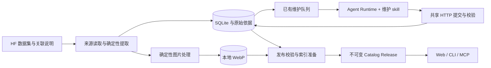

# 素材数据维护架构与执行流程

> 2026-10-28：默认工作台采用[仓库内轻量目录](../spec/LAB_ASSET_METADATA_PLATFORM_SPEC_V1.md)，JSONL 和 WebP 随 Git 保存，SQLite 为可重建缓存。下面保留的队列、Runtime、回执和历史发布流程仅适用于显式旧式 MetadataStore 宿主。普通维护 Agent 从[当前操作指引](../CATALOG_MAINTENANCE.md)进入。

> 实现架构 · 2026-10-27。细化[元数据平台规格](../spec/LAB_ASSET_METADATA_PLATFORM_SPEC_V1.md)，实现跟踪 [#208](https://github.com/CaiZongyuan/spatial-sync/issues/208)。交付维护能力与可复用 skill；真实全库整理由后续 Agent 在选定范围内执行。

## 目标与当前边界

让每个选定来源的条目经过有依据的整理，成为人和 Agent 都能发现、比较、继续读取的资料。搜索返回简短用途摘要；比较时读取技术资料；核对时读取原始依据。图片由后台维护生成本地 WebP 缩略图，浏览页面读取本地发布结果。

沿用 Source Collection、Catalog Entry、Maintenance Run 和 Catalog Release，不另建知识库服务，也不为每个素材创建 skill。一个维护 skill 指导整个集合的整理；每条素材是结构化内容，通过已有查询入口渐进披露。

| 能力 | 已有基础 | 本设计补足的内容 |
|---|---|---|
| 来源与持久化 | 固定 HF revision、三种配方、SQLite、原始依据 | 逐阶段产物、责任与完成条件 |
| Agent 整理 | 有界批次、外部 Runtime、描述字段白名单、用量回执 | 逐条分析方法、可检索摘要标准与质量复核 |
| 检索与读取 | search、show summary/full、evidence；共享 HTTP/CLI/MCP | 原生 metadata-search/show、分段依据、离线读取；Lab 消费适配独立 |
| 图片 | 物体图选择、按需下载、原格式本地缓存 | 受预算的后台 WebP 派生、持久保留与发布/备份绑定 |
| 质量 | 输入/版本校验、人工更正、覆盖统计 | 整理质量和缩略图覆盖的独立验收 |

## 组件与所有权

| 组件 | 拥有的内容 | 写入边界 |
|---|---|---|
| 来源读取与配方 | 身份清单、版本、来源字段、原文、预览候选角色 | 缓存原始字节；通过维护 HTTP 提交字段与覆盖 |
| 维护服务 | 任务、批次、版本约束、预算、检查点与回执 | 持久写入由服务拥有；worker/Agent 不编辑数据库或索引 |
| Agent Runtime | 双语名称、别名、摘要、类别、tags、领域与用途描述 | 每条提交描述字段或错误，保留输入身份与摘要 |
| 图片处理 | 物体图下载、解码、缩放、WebP 编码与派生记录 | 确定性 CPU 工作；Agent 判断角色和异常 |
| 发布与索引 | 可重建、可回退的读取视图 | 校验、索引及派生引用就绪后原子切换 |
| 消费适配层 | 本地 Asset、获取准入、物理验证与设备能力 | 描述整理不能授予许可或物理能力 |

复用 SQLite、普通文件、现有 worker 与队列。`packages/catalog_metadata` 拥有 HTTP 路由，Lab 网关与独立 `service.create_app` 使用同一实现；宿主注入鉴权与可选发布准备回调，元数据核心不导入 Lab、仿真、设备、获取或本地 Asset 模块。来源配方处理实际结构差异；每运行一个活动整理批次、每批最多 24 条。

独立入口是 `python -m packages.catalog_metadata`，最小依赖在同目录 `requirements.txt`。一份状态目录由一个宿主持有文件租约；读者通过 HTTP 消费，不让两个编排器同时打开同一 SQLite 目录接管任务。Lab 默认继续嵌入使用；以后远程集成可消费已有原生发布查询接口，不需要把 Lab 准入逻辑搬进目录服务。

## 条目内容与渐进披露

保留原始数据、提取事实、Agent 整理、人工更正四层归属。组合结果保留 `fieldProvenance`；人工更正独立保存，重跑不覆盖。输入摘要、skill 内容摘要、配方和词表版本共同决定整理结果能否复用，来源 revision 单独绑定。

| 读取层 | 要回答的问题 | 内容与已有入口 |
|---|---|---|
| 发现 | 这是什么，为什么值得看？ | `catalog search`：稳定引用、双语名称、一句摘要、类别/少量 tags、匹配理由、关键未知项和详情入口 |
| 比较 | 是否适合当前需求？ | `catalog show --view summary`：物体特征、用途、有依据的技术字段、限制/未知、整理状态；保留 release/documentDigest |
| 核对 | 这些说法来自哪里？ | `catalog show --view full`、`catalog evidence`：原始字段、来源引用、字段归属、变体及所需依据页 |

复用已有字段：维护记录的 `summary` 对应消费者的 `descriptions`；`aliases/tags/domains/uses` 参与索引。新增摘要不能只展示在详情中。默认大小、响应预算、精确身份、硬条件和游标继续兼容；证据通过 digest 按需读取，搜索不携带完整原文。

摘要回答“物体类别 + 区分特征 + 有依据的用途”。来源明确说明是二维条码试管架读取器时，可写“用于读取试管架二维条码的实验室设备”。仅从包名识别到眼镜时，保守写“眼镜外观素材；用途与物理属性待核对”，不推断碰撞或任务成功能力。

名称保留型号与原文；别名补充常用中英文称呼；tags 表达物体/结构/领域；用途采用来源支持的场景词。建议中文摘要约 30–80 字、英文一句话，可按内容调整；这是写作建议，不是新 schema 限制。未知许可、尺寸、单位或物理性质留在事实/未知层。

目标是已发布搜索和摘要读取不访问上游，已缓存依据可离线核对。旧目录按需读取详情的行为保留兼容；不能把按需补取误报成完整离线覆盖。

## 维护流程与完成条件

| 阶段 | 行为 | 完成条件与持久产物 |
|---|---|---|
| 1. 定范围 | 选集合、固定 revision，确认已有授权、Runtime 和上限 | 集合档案、运行 ID、预算、配方/skill/词表绑定；同范围已授权动作不反复确认 |
| 2. 枚举 | 官方清单/分页/分片，记录身份和来源单位 | 完整清单闭合并对账；partial Viewer 或单个 split 不能代替全库 |
| 3. 提取 | 确定性导入名称、描述、格式、尺寸、许可声明、预览角色和依据 | 每个身份有提取结果或明确缺口，保留事实归属和输入摘要 |
| 4. 逐条整理 | 复用未变输入，分批分析其余条目 | 本批每个身份恰好一个描述结果或错误；真实回执先持久化 |
| 5. 预览维护 | 下载选定物体图并生成本地缩略图 | 每项有派生物或缺图/失败/疑似错误记录，使用独立预算与检查点 |
| 6. 质量复核 | 检查空泛摘要、类别/双语/图文一致性，抽查检索 | 问题可定位并定向修复；内容质量与处理覆盖分开 |
| 7. 发布 | 组合来源/整理/人工层，准备实际索引与派生引用 | 原子激活 release；准备失败继续读取旧发布 |
| 8. 消费验证 | 真实 search → summary → evidence，检查离线和缓存 | 报告实际 release、各类覆盖、质量、用量、缺口与下一步 |

清单完整但整理未完成时，现有机制可以发布明确标注的部分整理版本。整库整理完成要求所有选定身份都处理或有效复用；存在整理失败时不能称“全库整理完成”。清单、提取、整理、内容复核、图片就绪和检索质量分别计数。

### 来源配方

| 来源 | 提取重点 | 容易混淆的边界 |
|---|---|---|
| SimReady | package 清单、包内 manifest/声明和物体预览 | Space 与主数据集版本不同；材质/normal 图不是物体预览 |
| Scenario | 所有元数据表/分片、原始说明、变体和预览列 | example 数与模型文件数分开；缺 Parquet decoder 要报告配置缺口 |
| ChemLab | release 联合清单、仪器/器具/家具子索引 | 仪器 Viewer 不含全库；中文翻译不替换型号身份 |

新集合先调查结构、补配方，再进入同一流程，避免 Agent 对未知来源无限爬取。

### 其他 Agent 的接入

执行入口是 [lab-catalog-maintain](../../skills/lab-catalog-maintain/SKILL.md)。运行显式选择 `organizer`：`runtime` 调用已配置的外部 Runtime，`external` 等待外部 Agent 领取批次，`none` 只维护来源与图片。三种模式共用输入绑定、版本、更正、持久队列和发布逻辑。

`external` 模式下，worker 完成提取/图片后在 `awaiting_agent` 退出，运行继续等待。调用方按 claim → submit 循环，最后 maintenance-finish 发布；服务不启动模型。模型预算由调用方拥有，服务保留未知用量、外部批次数与可选报告，不把提交当成服务调用模型。Runtime 模式仍使用实际回执计量，未知执行用量停止后续服务端模型调用。

批次提供有界词表子集、可内联的小型证据正文以及原始提取字段；较大依据按 digest/section 继续读取。Runtime 工具上下文由配置者提供，worker 令牌和宿主操作凭据不传给模型。外部 Agent 可通过原生 metadata-search/show 和 thumbnail 命令检查数据，无需读取数据库。

### 增量与恢复

- 输入及版本绑定未变：复用整理；图片来源摘要与转换参数未变：复用派生物。
- 输入、配方、skill 或词表变化：重处理受影响项；历史 Agent/人工文案不能成为新的发布者证据。
- 提交超时：重放同批次、同回执；输入冲突则重新读取、领取，保留旧回执。
- 单项问题：返回单项错误，处理其他条目；配置/鉴权问题结束该阶段并报告恢复条件。
- 预算耗尽或取消：保存检查点，服务旧发布。Runtime 未知执行用量停止服务端模型调用；外部 Agent 的模型用量由调用方管理并如实记录。
- 仅图片失败：条目可搜索并报告图片缺口；修图不必重新生成摘要。

## 本地 WebP 缩略图

对启用缩略图维护的集合，后台覆盖所有有合法物体预览的条目。全库图片采集是独立、显式启用的阶段；轻量清单同步与普通浏览保持独立。

首版采用一种卡片规格：最长边 384px、保持比例、不放大小图、WebP quality 78、保留透明通道、应用方向信息、去掉无关元数据。校验真实类型、像素总量、截断与解码失败；输入字节、像素和输出字节分别有界。更大详情图以后按独立资源加载。

派生记录包含来源 dataset/revision/path、原图实际 SHA-256、原始 MIME/尺寸/字节、转换版本/参数、输出 SHA-256/尺寸/字节和本地位置。查找键由原图摘要与转换参数决定，输出摘要独立验证；文件原子写入后才提交可用引用。原图证据与派生 WebP 摘要分别保留。

缩略图作为发布版本的本地阅读依赖保留，与可淘汰的原图缓存分开，总保留上限 512MiB。任务可再下调派生增量空间；网络量、原图缓存和重试另算。`--previews` 显式启用，未给图片限额时按每次 16MiB 外部图片正文处理。资源不足检查点停止，不靠前台静默联网满足“本地可读”。备份导出 v2 保存引用与字节，恢复也读取旧 v1；沿用有界 JSON 导出限制，过大时明确报限额。

发布记录绑定缩略图清单和实际覆盖，前台使用同源本地地址与内容摘要缓存。未采集、无来源图、采集/转换失败、疑似错误图和本地可用分别记录；新处理状态与既有预览状态需版本化映射，不能直接塞入未实现的新枚举。

现有 `/preview` 路由保留兼容，轻量目录和维护目录共用转换逻辑；旧内容摘要的原图 URL 仍可读取。页面继续视口加载与稳定占位，持久缩略图按发布摘要读取。原生服务的图片任务使用独立容量，避免图片等待占满查询线程。

## 质量与验收

服务/确定性工具负责身份与输入键、字段白名单、类型、合法类别、重复提交、用量和发布准备校验。现有 `organized` 只代表结构化提交已接受，不能代表内容复核通过。

内容复核检查名称可识别、摘要能区分物体、别名有用、双语一致、用途有依据、许可与物理未知仍未知。问题记录条目引用、字段、原因、依据和修复结果。抽查覆盖三个来源、主要类别、缺字段及异常图；不将抽查外推为全库逐项核验。

沿用 #202 的真实身份/查询语料和保留集规则，逐语言报告前五项命中目标，精确身份/硬条件独立验收。开发查询可用于修正摘要；冻结保留查询及答案不进入整理 Agent 的上下文。保留集失败要报告缺陷，不能回填答案后宣称同一保留集仍有效。

性能分别观察本地搜索、首屏数据、可见图片、冷缓存维护和热缓存读取，记录实际请求/字节、候选/图片数和等待原因。采用 Linux/WSL 可重复诊断，不从单图压缩率推算整页速度。来源断网后，已发布搜索/摘要、缓存依据和本地缩略图应继续可读。

报告至少包含选定集合/revision、release、清单分母、提取/整理/复用/失败数、复核范围、图片覆盖/用量、逐语言检索结果、未解决项及恢复方式。分母未知就明确未知。

## 验证与后续整理

固定夹具验证独立宿主、实际 worker/CLI/MCP、外部模式零模型调度、图片预算/恢复、分页版本与离线备份。运行命令见[维护指引](../CATALOG_MAINTENANCE.md)和[验证指引](../VERIFICATION.md)。真实全库执行与内容质量仍由 #202 跟踪，需要后续选定来源与调用方预算；工程检查不代替真实整理质量。

当前 skill 安装及 worker 注入只传递单个 `SKILL.md`。本轮可执行核心保持自包含；以后若拆按需参考文件，需同时实现打包/安装、Runtime 资源加载和完整内容版本绑定，避免安装成功却丢失规则。
