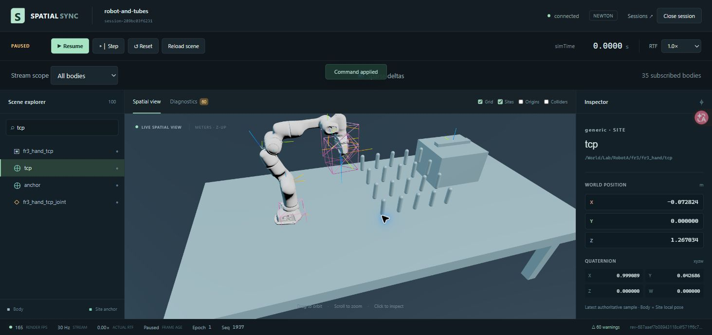

# Final integrated validation

Tested product candidate: `389687587435150665d10b3e0d726943c661f15d`. Milestone baseline: `633735534aa05376138904582ebb7712a0ea19c9`. Gateway `40e1a8e`, Source `ba48bc5` and TLS `5d7292d` are integrated on local master. Later delivery edits affect documentation and evidence only. No Git remote, external CI run, deployment or publication is configured.

| Integrated check | Result |
| --- | --- |
| Base-only Python contract/unit/Gateway, unraisable warnings as errors | **204 passed, 2 optional skipped, 18.32 s**; independently confirmed Newton=false and Warp=false in that environment |
| Pydantic protocol regeneration and Git diff | Passed |
| TypeScript protocol | **6 passed** |
| Web unit | **64 passed / 9 files** |
| Production build and full Ruff | Passed; existing bundle-size advisory remains |
| New actual Newton CPU over authenticated TLS, narrowed gather/full recovery/heartbeat/cleanup | **1 passed, 8.08 s**, source recorded as actual spawned Newton CPU, child PID41192, one Body /28 pose bytes; owned child reaped |
| Actual Chromium against integrated API8009 and production preview5189 | **15 passed, 1.9 min**, no skips; both optional Newton flags enabled |
| Independent Standards and Spec | No unresolved mandatory finding; [review record](FINAL-REVIEW.md) |

The browser run includes actual Y-up USD/GLB/fallback, Franka visuals/TCP, JSON/binary shared controls, Runner crash/restart/reload/refresh, multi-visual matrices, LOD/instances/raycast, real Synthetic/Newton diagnostics, both scoped-delta recovery formats, and the full workbench journey. Each test creates and cleans its own sessions. `SPATIAL_NEWTON_E2E=1` enables the older optional asset/reliability paths; `SPATIAL_TEST_NEWTON=1` enables the new diagnostics path. All tests ran sequentially with one worker and software WebGL. Raw root receipts are in `.scratch/final-v12`; normal browser traces/screens are in `.scratch/viewer-e2e`.

Actual CUDA evidence is reused from the unchanged extraction/Runner paths in [the Source report](FINAL-source-repair.md): ten CPU/CUDA checks passed without skips, then two real CPU/CUDA Gateway checks passed after the cache-only Pose repair. Per-slice tests are not added to the204 integrated count. The two skipped base tests are optional real Newton TLS paths; the new narrowed one was then executed separately above. The earlier successful full-scope CPU TLS receipt remains supporting evidence, while the new path covers changed interests/full recovery.

## Retained application

- Production application: http://127.0.0.1:5189
- Demonstration: http://127.0.0.1:5189/sessions/session-289bc03f6231
- API8009 PID23700 / command session38910; preview5189 PID1904 / command session99530.
- PM-owned Newton Robot and Tubes, Runner PID28972, PAUSED after reset, epoch1, seq1937, simTime0. Selected Site `/World/Lab/RobotA/fr3/fr3_hand/tcp`.
- Actual read-only Pose API: `p=(-0.0728235108,-0.0000000326,1.2670344040)`, matching the Inspector's rounded `(-0.072824,0,1.267034)` at the same metadata. Real model Shape count98; Runner/Gateway heartbeats continue while paused.

The previous8000/5173 and earlier8009/5189 processes were no longer listening at the post-interruption inventory. PM did not reset/close the unknown-owner earlier session; its authority could no longer be observed and was not fabricated. Only the new owned preview/demo above is retained. Foreign5175 remains untouched. Developer8008/5188 and their owned runners were cleaned.

## Evidence limits

The measured large-scene browser used SwiftShader. The suggested45FPS target is unmet: the prior10k comparison has two valid runs near4.03FPS, with a failed third attempt explicitly excluded. Per-capture CUDA index allocation is new work; reduced readback bytes do not establish a total speedup. No solver-overlap, WAN, hardware-renderer or end-to-end freshness claim is supported. The read-only Pose endpoint intentionally reports the original sample time and staleMs. The offline timeline's JSON/links are checked statically; interactive HTML visual QA remains unverified because opening that file URL was rejected earlier, and no alternate route was used.
