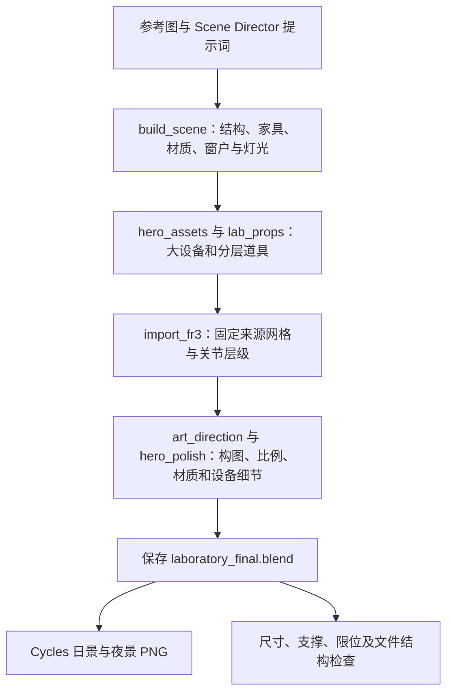

# 单图与 Prompt 驱动的实验室制作实例核对

> 日期：2026-10-27。输入：用户指定的 `D:/Projects/Robots/assets/modeling/`。
> 范围：读取原始提示词、压缩包、源码和交付记录，并用自控脚本检查、试导出模型副本。原始文件保持不变，未执行交付脚本、重建或重新渲染。
> 下文用 `源码包::Laboratory_FR3/文件:行号` 定位原文；源码包是 `实验室_FR3_重建源码.zip`。

这份实例确实提供了“参考图与 Scene Director → 分层建模 → 官方机器人导入 → 材质、布景、构图、灯光细化 → Blender 场景和最终图”的完整交付。它的主要价值是把场景先制作到有足够形体、尺度、材质分区和光照意图的程度。

需要精确区分的是：交付源码实际执行的是 **程序化材质与 Cycles 离线渲染出图**。所提供九份 Python 源码没有贴图烘焙、UV 烘焙或 GLB/USD 导出调用；因此，这份包目前不能直接作为“已经烘焙好的实时贴图包”使用。它是值得复用的美术制作起点，仍需补上面向平台的视觉构建与导出步骤。[S1][S2][S3]

## 1. 输入和实际交付

| 文件 | 内容与证据 | 可确认的范围 |
|---|---|---|
| `陽光下的細胞培養機器人實驗室.png` | 原始参考图 | 视觉锚点；不能独立证明尺寸、背面、碰撞、机构或任务能力 |
| `blender-scene-director.md` | 可复用的 Scene Director 提示词 | 规定结构灰盒、素材分流、细化、分层布景、材质与灯光的创作方法 |
| `实验室_FR3_模型.zip` | 可编辑 `laboratory_final.blend`，README，FR3 许可与转换说明 | Blender 原生模型交付，不是平台 Asset／Scene Version 包 |
| `实验室_FR3_重建源码.zip` | 九份 Python 脚本、素材清单、尺寸审计、结构检查记录、固定来源的 FR3 原文件 | 可以静态审计具体制作步骤；本轮没有重跑其跨版本兼容性或重建结果 |
| `实验室_FR3_预览.zip` | `daylight_final.png`、`nighttime_final.png`、`metric_overview.png` | 固定视角的最终图和尺寸概览；不是 mesh UV 材质图或场景 irradiance/lightmap |

父任务核对交付清单中声明的 55 个文件，均存在且 SHA-256 匹配。该核对证明当前分包文件彼此对应，不证明视觉或物理质量。原始清单、哈希核对和源码调用扫描在 `.scratch/issue214/modeling-reference/`。

README 明确说明，场景由单张参考图和 Blender Scene Director 流程制作；使用 Blender 4.3.2，材质主要由节点生成，不依赖另行查找的纹理图片。预览由场景直接渲染；制作声明为 CPU，日景和夜景有独立采样设置。[S1：README_中文.md:3、11、13、27、53、55]

## 2. Prompt 的目标与交付的实现分别是什么

| Prompt 要求 | 交付实际实现 | 原文定位 |
|---|---|---|
| 参考图作为视觉锚点，先做结构与精确几何 | 米制建筑、家具、百叶窗、实验台、安全柜；固定随机种子 | `build_scene.py:5、9、62`；README:59 |
| 规则物件用 bpy，复杂有机物可图生 3D 后修复 | 官方 FR3 加 bpy 场景；椅子、手套、植物均为程序化近似 | `asset_manifest.json:7`；README:98、99 |
| PBR 材质分区与瑕疵处理 | 白漆、金属、橡胶、玻璃、培养液等分别设 Principled 参数；噪声接 Bump | `build_scene.py:11、31`；`lab_props.py:10、20` |
| 主体、功能组、细碎道具逐层布景 | 培养瓶、刻度、管帽防滑筋、试管架、培养皿、笔记本、手套、植物、线缆 | `lab_props.py:103、119、128、176、204、224、242` |
| 日光、体积空气感及昼夜灯光 | 太阳、天空／补光区域灯、低密度体积；复制灯光状态构建夜景 | `build_scene.py:148`；`render_finish.py:22` |
| 可选 IES 夜景 | 使用分析灯光，没有实测 IES | `asset_manifest.json:10`；README:100 |
| 可选外部 Tripo／Meshy／Rodin | 明确没有调用或上传参考图到此类服务 | `asset_manifest.json:8`；README:98 |

Prompt 中列出一个能力，不代表本次制作已经用了它。当前文件也没有原始对话或 Agent Runtime trace，因此无法从这些文件独立核实模型名称、每轮调用、token 或制作耗时。可确认的是交付脚本组织、模型与输出文件，以及明确保留的审计说明。

## 3. 可读出的实际制作链路

- `rebuild.py:22` 传递采样数、分辨率和 BUILD_ONLY，再由新启动的后台 Blender 执行 `build_scene.py`；不会操作现有 Blender 窗口。[S1：rebuild.py:22]
- `build_scene.py:138` 调用两个设备／道具模块，随后 `import_fr3.replace_existing()` 将程序化机器人替换为官方 FR3。[S1：build_scene.py:138、142]
- `render_finish.py:16` 调用 `art_direction.apply()` 和 `hero_polish.polish_heroes()`，最终保存 `.blend`，再按开关渲染两张最终 PNG。[S1：render_finish.py:16、18、50、53]
- 包里保留过一次独立比例审计及修订记录：前景实验台从原先约 5.5 m 调整为 2.8 m，周围家具与道具相对官方米制 FR3 重新归一。该记录说明制作过程重视尺度反馈；本轮没有重新执行这些历史测量。[S1：proportion_audit.md:5、16、55]

### 真实感实际来自哪些制作投入

1. **尺度关系和轮廓**：房间、桌面高度、官方机器人、试管和培养瓶的相对尺寸统一。源代码直接定义尺寸，避免整间房成为一个不可拆分网格。[S1：build_scene.py:62；README:59]
2. **形体细节**：逐片百叶窗、窗框／悬绳、通风槽、盖板、密封圈、旋钮、螺钉，以及容器刻度、标签和管帽纹理中的一部分是实际几何。Bevel 与 Weighted Normal 改善制造边缘的高光。[S1：build_scene.py:37、70；hero_assets.py:152；hero_polish.py:12；lab_props.py:103]
3. **布景和层次**：前景器皿、背景安全柜／储物架、植物、纸张与线缆，形成不同距离与材质的视觉线索。位置、旋转与液面有小幅、固定种子的变化。[S1：lab_props.py:7、138、242]
4. **明确的光照和摄影意图**：相机镜头与景深、通过百叶窗的方向光、柔和补光、玻璃／培养液透射、低密度体积和 AgX 显示共同构成最终图。`art_direction.py` 还调整太阳角度与颜色、金属粗糙度、透明混合与体积密度。[S1：build_scene.py:145；art_direction.py:5；render_finish.py:37]

因此，仅给简化几何体加几张贴图，难以重现这份场景的观感。应先保留这条制作链中的尺度、几何、布景与光照意图，再决定实时环境如何呈现它们。

## 4. 对“烘焙”的文件级核对

已对源码包全部九份顶层 `.py` 用 AST 解析进行调用清点，没有执行源码。结果为：

| 项目 | 代码证据 |
|---|---|
| `bpy.ops.object.bake` 或其它 `.bake` 调用 | 未见 |
| `ShaderNodeTexImage` 图像纹理节点 | 未见 |
| GLB／glTF／USD 等导出调用 | 未见 |
| `bpy.ops.render.render` | 两处，分别输出日景和夜景最终图 |
| 原生模型保存 | `bpy.ops.wm.save_as_mainfile` 保存 `laboratory_final.blend` |

README 和材质代码相互支持“程序化节点材质”的解释；`render_finish.py` 则直接展示了最终图的生成方式。完整调用清单保存于 `source-calls.json`。[S1：README:13；build_scene.py:31；render_finish.py:50、54、56]

这一结论限定于当前交付源码与产物证据，不凭“没有名叫 bake 的文件”推断历史上绝没有其它操作。下节的原生文件检查也未发现图像材质或烘焙图。交付包没有提供可复用的 UV 材质／lightmap、实时导出配方和加载规则。

两张 beauty PNG 已含相机透视、材质色、光照、景深、体积和显示变换，不能直接当作同语义的 PBR 底色或 Three.js `lightMap`。平台应从创作场景显式生成所需贴图；材质烘焙、局部 AO 和场景光照烘焙的区别见[实时渲染管线调研](LAB_REALTIME_RENDERING_PIPELINE_RESEARCH_V1.md)。

## 5. 原生 `.blend` 检查

父任务使用自己的只读检查器，在 Blender 4.5.9 中以 `--disable-autoexec`、`open_mainfile(use_scripts=False)` 打开模型副本。没有执行包内脚本、保存、重建或重新渲染。`blend-inspection.json` 与 `blend-summary.json` 保存于原始回执目录。

| 检查项 | 实际观察 | 解释 |
|---|---|---|
| 材质与图像节点 | 84 个材质；`ShaderNodeTexImage` 为 0 | 材质实际依赖参数与程序化节点，未使用可供实时加载的图像纹理节点 |
| 图像 datablock | 仅有空的 `Render Result`，source 为 VIEWER、size 为 0、没有打包图像 | `.blend` 中也没有找到已交付的烘焙材质图／lightmap |
| 日景 | 1653 个对象，1418 个 Mesh 对象 | 与交付结构记录一致，但不是 draw call 或实时性能测量 |
| 夜景 | 1654 个对象，1419 个 Mesh 对象 | 两个场景共享大量几何；不能相加当作唯一资产数量 |
| 基础 Mesh 数据 | 1420 个 datablock，390937 个顶点，286287 个面；基础三角形估计 347585 | 不含后续 modifier 评价和 FONT 转换，不能直接作为浏览器最终预算 |
| 修改器 | 721 个 Bevel、47 个 Subsurf、35 个 Solidify 等 | 导出预算须测量评价后的运行网格，不能只看基础面数 |
| 物理与链接 | 0 个 rigid-body 对象，0 个链接库 | 原生文件是视觉场景，没有现成的刚体模拟或平台设备行为 |
| 渲染与相机 | 保存为 Cycles CPU、256 samples、1456×1088、46 mm 镜头、景深 f/9 | 是离线摄影式渲染配置，不能视为浏览器运行配置 |

交付 README 声明制作版本为 Blender 4.3.2。本轮较新 Blender 的成功只读打开不证明重建／导出／色彩跨版本完全一致。内部 `bpy.data.version` 的 `(4, 3, 34)` 是文件子版本信息，不能误写成公开发行版“Blender 4.3.34”。

## 6. 直接 GLB 导出检查

另用受控脚本打开副本的日景，禁用自动脚本执行，应用可见几何修改器并导出标准 Y-up GLB；保留相机与可支持的灯光，不导出动画。明确排除两个 render-hidden 夜景灯和不受核心 glTF 支持的空气体积对象，避免把体积容器导成不透明房间外壳。该检查没有执行原包代码，也没有改写 `.blend`。

| 直接导出结果 | 实际值或现象 |
|---|---|
| 文件大小 | 28,108,456 bytes，约 26.8 MiB |
| 网格节点／primitive 实例 | 1539／1539；这是几何提交规模，不是已测量的每帧 draw calls |
| 导出三角形 | 756,508，已包含此次导出应用的修改器与文字／曲线转换 |
| 导出材质 | 81 |
| 图像／纹理 | 0／0；导出器没有自动把程序化材质烘焙成贴图 |
| 保留的扩展 | transmission、IOR、emissive strength、punctual lights |
| 灯光 | 仅导出一个 directional 太阳；三个 AREA 灯报告不支持 |

回执为 `export_probe.py`、`daylight-direct.recipe.json`、`direct-export-summary.json` 和 `export-probe.log`；GLB 仅留在任务临时目录。这个结果证明该模型可以形成浏览器几何／标准材质的派生物，不证明观感、光照或核显性能已与 Cycles 一致。

原始基础三角形估计与实际导出三角形不同，说明预算必须在导出后检查。直接把本文件当作一个素材会超过现行单素材 500k 三角形上限；应按真实素材和刚体边界拆分，并对固定布景合批、重复物件实例化、细碎几何做适当简化。1539 个 primitive 也提示需要控制提交开销，不能仅凭文件体积判断帧率。支持的 Principled 常量材质可以保留；程序化细节、区域灯反弹光、体积和原显示变换需要单独确定实时实现或烘焙／近似方案。

## 7. 机器人、许可和验证边界

- 这里的 FR3 来源是 `frankarobotics/franka_description`，固定提交 `7aeeddc449edf8d62b594f9e36a81da53e7796f9`，按官方 DAE 节点矩阵与关节原点建立可编辑层级，保留原 diffuse 颜色和法线，统一映射到 Principled 粗糙度 0.32。[S1：import_fr3.py:18、25、65]
- 七个关节用 Blender Empty、局部旋转和 LIMIT_ROTATION 约束表达，手指用滑动对象及一个镜像 driver。它们是视觉层级；脚本明确说明不是已验证的控制器或碰撞仿真。夹持试管是独立自制道具，挂在 TCP 下，不是抓取成功证据。[S1：import_fr3.py:66、68、80、91；official_fr3/CONVERSION_NOTICE.txt:14]
- 当前平台内置 `robot/fr3@1` 则固定自 `newton-physics/newton-assets` 的另一 revision。来源、关节限位与派生转换不同，不能因为都叫 FR3 就直接替换物理或绑定语义。[S4]
- 官方 LICENSE／NOTICE 原文保留；包内说明 Apache-2.0 以及附带 BSD 条款，转换不代表厂家背书。采用此素材时继续保留原文、来源与转换记录。[S1：README:73；official_fr3/CONVERSION_NOTICE.txt:1]
- `scene_validation.json` 的 `passed: true` 来自包内 `validate_scene.py`：验证场景／相机存在、坐标有限、选定道具与支撑面接触、轮子落地、37 个官方网格组件、七个关节限位、指定 TCP、文件哈希与嵌入许可。它没有运行 Newton、平台 HTTP 管线或完整碰撞／设备操作，因此不能替代平台的 Validation Report。[S1：validate_scene.py:1、10、15、29、38、42]

## 8. 对平台流程的具体启示

| 应复用的制作环节 | 到平台前仍需补齐 |
|---|---|
| 参考图、构图、尺寸与素材清单 | 明确场景用途、可动部件和观察距离；参考图推断保留未知与估算标签 |
| 规则壳体与家具的细化建模、官方机器人视觉 | 为固定布景和真实刚体建立身份映射；保留既有可信物理包和稳定 `entityKey` |
| 程序化 PBR 节点与制造细节 | 把不受 GLB 支持的节点显式烘焙为可复用材质图；重要轮廓保留几何 |
| 按摄影意图做的日光与材质参考图 | 转为受限实时光照／环境反射；固定布景确需光照烘焙时单独构建，排除可动遮挡物 |
| 分层布景与大量重复物件 | 实测三角形、材质、draw calls 和贴图；在固定布景中合并／实例化，机械臂与设备可动部件保持可分离 |
| Blender 中的尺度与支撑检查 | 生成规范 USD 与自包含 GLB，导入固定版本，再在真实视口与 Newton 验证外观、对齐、碰撞和动作 |

当前 #214 已验证了最小的贴图构建／导入／显示／回放链路；这份参考补充的是更完整的**场景美术制作阶段**。下一次样板应把这份实例的空间和美术细化方法纳入，而不是只扩大基本几何体数量或先堆叠运行时效果。

建议直接把这份真实 `.blend` 与重建源码作为上游创作输入，先做副本上的版本兼容和预算检查，再生成受限的实时派生物。已有的常量 Principled 底色、粗糙度和金属度可优先走标准 PBR 导出；程序化 Noise／Bump、混合透明、体积和其它不受目标格式支持的效果才需要明确烘焙、替代或报告缺口。无需把所有材质无差别重新烘焙，也无需重做一遍已有的家具与实验室细节。

已有 [Scene Factory 规格](../spec/LAB_SCENE_FACTORY_SPEC_V1.md) §8.3 和 [ADR 0004](../adr/0004-scene-authoring-through-external-factories.md) 已覆盖外部 Blender 制作、保留原始物理引用和实际平台验收的分工。此研究不修改公共格式、物理契约或设备行为，也不把离线最终图的观感当成已经实现了同等实时效果。

## 来源

- **S1**：`D:/Projects/Robots/assets/modeling/实验室_FR3_重建源码.zip`，文中 `文件:行号` 均相对 `Laboratory_FR3/`。README 原名是 `README_中文.md`。
- **S2**：`D:/Projects/Robots/assets/modeling/blender-scene-director.md`，用户提供的创作提示词。
- **S3**：同目录的 `实验室_FR3_模型.zip`、`实验室_FR3_预览.zip`、`陽光下的細胞培養機器人實驗室.png`。
- **S4**：[平台内置 FR3 provenance](../../library/assets/robot/fr3/1/provenance.json)，来源 `newton-physics/newton-assets`，revision `f8fb7abcbeba2318814a74f3eeb02780ad7925d6`。
