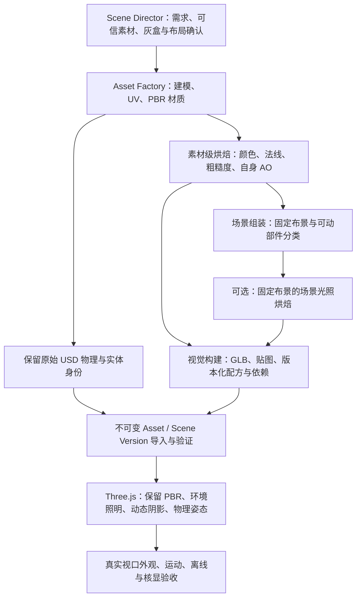

# Lab World 建模到实时写实运行的技术调研

> 日期：2026-10-27。研究基线：仓库 `049192db`，Three.js `0.186.1`、react-three-fiber `9.8.2`、drei `10.7.9`，工厂固定 Blender `4.5.9 LTS`。
> 范围：现有 Scene Director / Asset Factory 工作流之后，如何交付适合实时运行的外观，以及烘焙、导出、导入、显示和失效管理的责任。
> 性质：官方文档／规范／源代码调研与仓库静态调查；下文的技术建议尚未实现。未运行 Blender 烘焙、场景视觉试验或核显性能测量。

建议采用 **素材级 PBR 贴图烘焙 + 预处理环境照明 + 受限实时阴影** 作为第一层框架；固定布景的场景光照烘焙作为第二层可选能力。可复用素材的贴图与依赖布局的场景光照必须分开管理。把所有物体的光影一起烘焙进一张图，会让机械臂、试管和开盖仪器在运动后出现过期的影子，并妨碍素材复用。[S1][S2][S3][S5][S6]

## 1. “烘焙贴图”包含几种不同的工作

Blender 的 Bake 需要 UV 和烘焙目标，可输出法线、AO、粗糙度、Diffuse、Emit、Combined 等内容；它同时服务于材质制作和静态光照预计算。它们不能当作一种可以互换的贴图。[S1]

| 产物 | 解决的事情 | 对移动物体的适用性 | 建议归属 |
|---|---|---|---|
| Base Color / Roughness / Metallic | 将复杂创作材质变成实时 PBR 可读取的颜色和表面参数 | 不含场景光影时可随刚体移动并跨场景复用 | Asset 版本 |
| Tangent-space Normal | 把高精度网格／材质的表面法线细节转移到较低开销的视觉网格 | 适合刚体运动；不能改变轮廓、真实孔洞或碰撞 | Asset 版本，按刚体制作 |
| 素材自身 AO | 预先记录自身沟槽、缝隙等对环境间接光的遮蔽 | 按单个刚体、排除可相对运动的邻件时适合复用 | Asset 版本 |
| 场景 AO | 记录柜子、墙角、桌面与周围物体共同形成的遮蔽 | 周围布局或物体移动后可能过期 | 固定 Scene Version 的派生产物 |
| 场景 Lightmap | 预先计算某个布局和照明下的光照分布／反弹光 | 仅适用于明确固定的接收面；运动机构不能继续携带其原位置的场景光照 | Scene Version 的派生产物 |
| Combined / Beauty | 烘焙大量材质和照明外观，适合特定展示用途 | 与运行时 PBR 再次受光组合容易重复计算；高光与反射仍有视角问题 | 不作为通用 Asset 的默认材质 |

**每个通道必须有明确配方。** Blender 4.5 的 Bake Type 并不为每个 PBR 参数都提供一个同名按钮，例如手册没有内置 Metallic Bake Type。已是符合要求的金属度常量／图片可直接导出；复杂材质才需要逐通道提取为图像。底色须明确排除灯光贡献，标量数据须避免颜色变换；将标量接入 Emission 再烘焙可作为待验证的制作配方，不能说成导出器自动完成或现有工厂已经支持。[S1][S2]

法线烘焙的 Selected to Active 可将高模信息转到低模；Blender 推荐用于动画的切线空间法线。UV 岛边缘的 margin 用于避免过滤与 mipmap 引起接缝。法线改变的是着色法线，因此重要轮廓、夹爪间隙和试管架孔仍需要真实几何。[S1][S2][S3]

AO 是“减少某些区域收到的环境间接光”，不是“烘焙好的灯光颜色”，也不是动态投影。glTF 规定 occlusion 不影响直接光；Three 的 AO shader 也主要衰减间接项。将灯光图塞进 AO 的 R 通道不能获得等价的光照。[S3][S6]

对机械臂尤其要按刚体烘焙：连杆自身的凹槽 AO 可以保留；整台机械臂在一个姿态下、由其它连杆形成的遮蔽不应被烘焙进可复用连杆外观。试管对台面的投影、盖子对仪器内部的遮蔽也属于会随状态变化的关系。这是由烘焙数据依赖关系得到的技术判断，而非已经执行过的本仓库试验。[S1][S3]

## 2. 建议的完整流程与责任

这是建议流程，不代表新增步骤已经存在。当前 `skills/lab-scene-director/SKILL.md` 已覆盖需求／灰盒、素材检索和获取、外部制作、导入验证、精确版本启动及 Authoring Report；`factory/blender_author.py` 主要创建工作空间和提取布局，`factory/authoring.py` 按固定素材写组合包。现有流程缺少明确的“UV／材质准备 → 烘焙 → 视觉产物构建 → 平台外观核对”制作阶段。现有 Scene Factory 规格虽提到按支持程度派生／烘焙，但不等于工具已经实现该生产链。[R1][R2][R3][R4]

| 阶段 | 应增加的明确输出／检查 | 承担者 |
|---|---|---|
| 布局确认 | 标明固定布景、会移动的物体、各关节刚体和目标观察距离；保留未知尺寸／型号 | Scene Director 与原对话 |
| 素材制作 | 可信原始 USD、适合实时显示的网格、UV、可导出的 PBR 节点；高模和工作文件留在工厂侧 | Asset Factory / Blender |
| 素材烘焙 | 明确每张图的含义、颜色空间、分辨率、UV 集、是否包含 AO／灯光／材质色；保存配方 | Asset Factory 的离线构建步骤 |
| 场景制作 | 组合固定版本；若做 lightmap，定义参与烘焙的静态集合、照明、UV atlas 和动态物体排除规则 | Asset Factory 的场景构建步骤 |
| 视觉打包 | 形成可独立加载的视觉文件及依赖，按刚体保存视觉归属；记录工具版本和文件哈希 | 工厂构建步骤 |
| 导入 | 核对引用、纹理、UV、预算、身份和当前支持的文件格式；产出正式 Validation Report | 平台现有导入／验证管线 |
| 运行 | 显示派生视觉，使用 Newton 权威姿态驱动每个部件；不在网关中运行 Blender 烘焙 | Three.js Viewer 与空间状态管线 |
| 验收 | 同一真实视口核对全景、近景和运动；记录实际 GPU 与性能条件 | 平台人工／自动化验证 |

建议先扩展既有 Scene Director 的阶段契约及工厂构建步骤，不另建一套独立的场景搭建体系。只有出现第二个独立制作入口时，再考虑提取可复用的制作技能。上述是待确认的职责建议，不是本轮对 skill 文件的修改。

## 3. Blender → glTF/GLB：可以沿用的标准链路

Blender glTF 导出器根据其识别的材质节点构建 glTF；它不是把任意 Cycles 节点图无损变成浏览器 shader，也没有承诺自动完成所有程序化材质的烘焙。复杂噪声、程序化纹理和不支持的节点关系应在离线阶段显式烘焙，再接到导出器支持的 PBR 输入上。Blender 手册分别说明了法线、AO 烘焙后如何连接到可导出的节点。[S1][S2]

**第一阶段的交付建议使用内嵌纹理的自包含 GLB。** 当前 `apps/api/app/recordings.py::_standalone_gltf` 会拒绝 buffers／images 中不是 data URI 的外部 URI，`freeze_manifest` 只冻结 Manifest 指向的视觉文件；场景预览捕获也调用同一冻结函数。因而“贴图放在同一个素材目录、实时浏览器可以加载”仍不足以保证可录制／预览。应把首期 PBR 图像内嵌进 GLB，再验证实际回放。若后续场景环境或 lightmap 使用附属文件，需显式冻结完整依赖，不能只复制主 GLB 或假定录制会自动追踪自定义引用。[R10]

| 数据 | glTF 标准存储 | 颜色处理与注意点 |
|---|---|---|
| 底色 | `baseColorTexture` 与 factor | RGB 按 sRGB 编码；应保留材质固有颜色，避免烘焙固定灯影 |
| 金属度／粗糙度 | 同一 `metallicRoughnessTexture`：G 粗糙度、B 金属度 | 线性数据；Blender 设 Non-Color |
| AO | `occlusionTexture`：R | 线性数据，影响间接光；可与前两者组成 ORM，但各图的 UV／变换必须相容 |
| 法线 | `normalTexture` | 线性数据，切线空间、+Y；不做 sRGB 解码 |
| 自发光 | `emissiveTexture` | RGB 按 sRGB 编码；不是场景的间接光照槽 |
| UV | `TEXCOORD_0`、`TEXCOORD_1` 等，纹理可指定 `texCoord` | 不同贴图可选不同 UV 集；需保留实际索引 |

以上由 glTF 核心规范规定；ORM 是兼用通道的存储约定，occlusion 与 metallic-roughness 仍是两个语义引用，不是发现一张 RGB 图后就能任意解释。[S2][S3]

**避免沿用过期的 UV 写法。** 已核对的 Three.js r186 GLTFLoader 与本机 `0.186.1` 对应文件字节一致：`TEXCOORD_0 → uv`，`TEXCOORD_1 → uv1`，依次到 `uv2/uv3`；`Texture.channel` 选择 0–3。glTF AO 可以使用 `texCoord: 0`，不必为了 AO 无条件复制第二份 UV。场景 lightmap 通常需要单独、不可重叠的 UV 展开，这是制作要求，不应混同为“所有 AO 都必须用 uv2”。[S4][S7]

场景 lightmap 的 UV 还需要 UV 岛间距、atlas 边缘和 mipmap 下的防串色；重复实例共享同一个场景光照 atlas 时，需处理每实例的 UV／偏移和材质绑定。不能假定同一素材的所有实例天然收到相同的场景光照，也不能为了合图丢掉刚体和选择身份。这部分应先以少量固定布景验证。[S1][S3][S4]

## 4. Lightmap 是当前框架中的额外能力

**glTF 2.0 核心材质没有 Three.js `lightMap` 槽。** 核心只有颜色、metallic-roughness、normal、occlusion、emissive 等相应材质属性；标准 GLTFLoader 会把 occlusion 绑定到 `aoMap`，不会从任意名为 lightmap 的图片自动建立场景光照。把图片烘焙好并导出 GLB，并不等于已经完成运行时 lightmap 支持。[S3][S4][S8]

Three.js `MeshStandardMaterial.lightMap` 表达预烘焙照明数据，通常使用带明确 Linear-sRGB 颜色空间的 HDR 浮点纹理。r186 shader 将 lightmap 加入照明项，再通过材质的 BRDF 计算表面反射。因此，已包含底色和显示曝光的 Cycles Combined 图片不能直接当作同等语义的 `lightMap`：可能再次乘材质色、再次叠加灯光，或颜色空间／强度不匹配。[S1][S5][S9]

Blender 的 Diffuse／Combined 可以选择 Direct、Indirect、Color 等贡献；如何由这些 pass 得到 Three 所期望的照明数据，还需一个小型校准试验，确认包含哪些光照、是否含底色、曝光、HDR 编码和能量尺度。不能仅凭界面勾选名称宣称与 Three 光照单位完全一致。[S1][S5][S9]

建议明确选择下列一种组合，避免重复照明：

| 组合 | 合理用途 | 必须解决的问题 |
|---|---|---|
| PBR + 素材自身 AO + 环境照明 + 实时灯／阴影 | 第一阶段默认；机械臂和实验台均适用 | IBL 与阴影的质量／性能预算；素材 AO 不包含邻件姿态和场景投影 |
| 静态间接光 lightmap + 运行时直接光／阴影 | 后续固定实验室布景 | 明确哪些间接贡献已被烘焙，避免与环境 diffuse 等重复；AO 也可能再次压暗已经包含遮蔽的光照 |
| 静态完整 diffuse lightmap + 单独保留必要的实时镜面／动态物体照明 | 更固定的展示空间 | 静态表面的直接光不能重复叠加；动态物体仍需照明；当前标准材质的贡献控制与数据绑定需额外设计 |
| 全色烘焙图 + Unlit | 极固定的远景或展示 | 缺少对运行灯光和运动关系的响应，不能作为全部实验室实体的通用模式 |

`lightMap` 与环境照明均可进入间接照明管线；“加了 lightmap 后照常保留所有环境光和灯强度”不是有保证的组合。需要明确计算项并校准，不用加亮／压暗整张贴图掩盖重复计算。[S5][S9]

静态 AO／lightmap 烘焙应排除会移动的遮挡物，避免把机械臂、盖子或试管的某个姿态永久压进接收面。如果 lightmap 已经包含相应遮蔽，再套相同 AO 会重复压暗；需明确哪些遮蔽来自各自的贴图，并以实际组合验证。[S1][S6][S9]

标准 lightmap 主要补充 diffuse 照明，不能替代随视角变化的金属镜面反射；金属外观仍需要合理的 PBR 参数、环境 specular 或相应实时光照。不能用一张固定场景颜色图解决所有材质的真实感。[S3][S9][S16]

| 样板对象 | 第一阶段烘焙 | 可选场景烘焙 | 运行时保留 |
|---|---|---|---|
| 固定墙、地面、柜体 | 可复用 PBR／normal／自身 AO | 布局固定后可测试场景间接光／AO | 对可动物体的动态投影与必要镜面 |
| 固定实验台 | 可复用 PBR／normal／自身 AO | 可烘焙固定环境；排除机械臂、可搬试管的固定姿态影响 | 机械臂与试管运动中的阴影 |
| 机械臂、夹爪、离心机盖 | 按刚体的 PBR／normal／自身 AO | 不固定跨关节、跨开合状态的场景光影 | 权威姿态、当前受光／遮挡与阴影 |
| 试管与可搬物件 | 可复用的表面贴图／刻度；按需要简化透明 | 不携带原放置点的场景光照 | 当前位置的照明、透明排序和投影 |

这里“固定”是对烘焙依赖的分类，不改变 Entity / Dressing 的领域含义：有物理的固定实验台仍可属于 Entity，纯视觉内容仍属于 Dressing。[R5]

### 传输选择

以下是可研究的备选方式，不是已决定的新格式：

1. **先沿用核心 GLB 能表达的 PBR／normal／AO。** 可在已有节点 `Glb` 视觉字段内交付，通常不需要为了材质贴图变更空间 wire 格式；仍需验证导入、复制、预览、录制依赖与回放能够保留完整视觉文件。
2. **在视觉 GLB 内约定额外的 lightmap 数据与自定义 loader/plugin。** 可用应用约定的 extras 或正式命名的自定义扩展，明确图片、UV、强度、颜色空间和贡献语义；GLTFLoader 不会自行实现它。需要检查现有 GLB 验证是否保留这些数据、旧 viewer 的回退行为，以及不可变视觉产物的兼容规则。
3. **场景视觉描述文件关联 atlas／环境与节点映射。** 便于表达场景光照，但当前 Asset / Scene 元数据和 Manifest 没有对应字段，不能假定放一个 JSON 文件就会被运行时发现。需设计受限文件引用、内容哈希、版本和回放依赖。

若只在已有 GLB 的可选视觉内容中增加标准贴图，并沿用原来的 URL／坐标／节点身份，不能据此断言必须升级 wire；若新增或改变 Manifest、公开包字段／语义，则须按仓库契约规则评审版本和兼容。新光照能力不能让已有录制依赖当前活动场景或远端文件。本轮不决定新的公开格式。[R5][R6][S3][S4][S8]

## 5. 运行时技术框架

**保留创作材质与正确颜色处理。** GLTFLoader 按 glTF 语义设置纹理及颜色空间；viewer 应避免把普通显示的底色重新混入 UI 主题色，或持续覆盖创作自发光。选择态和幽灵预览退出后恢复创作状态。颜色贴图与法线／ORM 数据图使用不同颜色处理，这是材质正确性的前提。[S3][S4][R7]

**环境照明与反射。** PMREM 从环境图生成适合不同粗糙度使用的预过滤环境表示；Three 的 PBR shader 用它计算环境 diffuse／specular。它适合离线或加载时准备后复用，不需要每帧重新拍摄整间实验室；它也不是实时光线追踪，不会自动提供随机械臂变化的局部遮挡和精准场景反射。第一阶段建议使用本地固定环境及受限实时阴影。[S9][S10]

**运动与物理保持分工。** USD 继续是规范格式，可信机器人包保留，视觉作为派生物按实际刚体绑定。Newton 给出的姿态驱动连杆、夹爪和试管；烘焙不改变碰撞、质量、关节或动作能力。Blender 视觉往返不能当作保留 USD 物理语义的证明。[R5][R6]

现有 Manifest 可以表达每个节点的 GLB，但这不等于工厂已能从一个有关节的来源包正确导出全部刚体视觉。当前 Asset 元数据只登记单一 `visual` GLB，运行导入也需要解析明确的 owner；无法归属时保留原生视觉并报告缺口。按刚体拆分的实际 GLB 产物、Prim Path／entityKey 对应、局部坐标和最终绑定仍需补齐并用运动验收，是本方案中的实现工作。[R3][R6][R9]

**玻璃和液体按已确认范围简化。** 透明层数和排序要在平台真实视口检查；可先用合理的透明度／高光／刻度，保持场景可读。Blender 手册明确指出 transmission 与普通 alpha blend 不同，并介绍透明面排序与分层的实时限制；不将复杂折射或液体模拟设为首期写实前提。[S2]

## 6. 压缩与优化：构建和运行两端必须成对支持

KTX2/Basis 的作用包括传输与 GPU 纹理存储优化；运行时需转码为设备支持的块压缩格式。KHR_texture_basisu 建议颜色数据通常选择 ETC1S、法线／roughness-metallic 等非颜色数据通常选择 UASTC；低支持设备上的非颜色 UASTC 也可能退到未压缩 RGBA，以避免伪影。因此“转换成 KTX2”不保证所有 GPU 的显存和帧率都有同样收益。[S11]

GLTFLoader 需要配置 KTX2Loader，后者需 `detectSupport(renderer)` 及可离线使用的转码资源。Draco 和 meshopt 也分别需要对应 decoder；缺少 required extension 的 decoder 会失败。压缩网格主要改变传输／存储／解码，不能视为自动减少三角形、draw calls 或着色成本；简化、合并、实例化是另外的操作。glTF Transform 可以作为离线工具选择性执行这些步骤，但其“一键 optimize”的默认项官方也说明不适合所有场景。[S4][S12][S13][S14][S15]

本仓库目前只创建普通 GLTFLoader；S6 图片尺寸解析只支持 PNG/JPEG/特定 WEBP，网格统计也按现有原始 accessor/bufferView 路径读取。KTX2 或网格压缩需要**验证器、运行 loader、静态预览、文件复制和回放**一起适配，不能只换导出选项或补一个 loader。建议第一阶段先交付当前系统支持的普通 GLB 和有预算的图像贴图，后续以实际体积／显存／加载瓶颈决定压缩方案。[R7][R8]

## 7. 产物版本、配方与失效

建议把制作依赖分成两层；这些是制作配方应记录的内容，不是已经加入公开 schema 的字段：

- **素材视觉配方**：原始／高低模输入哈希、几何和 UV、材质图与贴图、刚体局部变换、Blender／导出器版本、烘焙类型与贡献、分辨率、采样、margin／cage、颜色空间、随机种子、导出／压缩参数和输出哈希。
- **场景光照配方**：固定 Asset 版本及实例姿态、静态烘焙集合、排除的运动物体、灯和环境版本、UV atlas／每实例映射、光照贡献与编码、烘焙器版本和输出哈希。

素材的 UV、几何、材质或相关烘焙参数变化，需要重建相应素材视觉。场景布局、参与遮挡的静态物体、灯光、环境或 atlas 改变，需要重建依赖它们的场景光照。实时机械臂运动不应触发场景重烘焙，因此不能将它在某一帧的影响固化进静态接收面。相同 Asset 跨场景复用时，保留素材贴图，重新计算确有需要的场景光照。[S1][S3]

导入仍形成不可变版本，旧包和旧录制保持原字节及其依赖；构建配方用于解释和重建，不把“使用了同一随机种子”当作跨工具／跨 GPU 的逐字节确定性保证。真实 Blender 烘焙的重现范围需要另测，输出应以实际哈希固定。[R2][R5][R6]

## 8. 分阶段建议与尚待验证的事实

| 阶段 | 交付目标 | 进入下一阶段的证据 |
|---|---|---|
| 一：把制作与导出闭环打通 | 在 Scene Director 流程中明确 UV／PBR／烘焙制作与交付；一份带 normal/AO 的素材从 Blender 经现有导入到真实平台；关节刚体对应正确；本地环境照明与有限阴影 | 对比原始材质与平台全景、近景、运动；证明导出／加载未丢图、未重新染色，物理身份不变 |
| 二：核显预算与批量可复用制作 | 对代表实验台实际测量，优化纹理／网格／材质和重复物件；出现事实瓶颈后再接压缩全链路 | 核对浏览器实际 GPU、1080p 显示与绘图缓冲、平均帧率／帧时间、加载和显存；Iris Xe 目标实际达标 |
| 三：可选固定布景 lightmap | 小型静态场景验证烘焙贡献、UV、线性 HDR／编码、绑定、运动物体排除和场景失效；明确公开格式影响后再推广 | 与实时参考比较亮度及遮蔽；机械臂移动无残留影子；旧录制回放与离线依赖有效 |

还需要做但本轮没有执行：Blender Diffuse pass 到 Three lightMap 的能量／颜色校准、具体 Blender 导出器与插件的版本配对、GPU 纹理压缩在 Iris Xe 上的实际转码格式和收益、每刚体视觉导出的真实样板、目标帧率与加载结果。**不能由“用了烘焙”直接推出核显 1080p 稳定 30 FPS。**

## 9. 来源与核实方式

外部事实来自以下官方手册、规范与源码。Three.js r186 的 MeshStandardMaterial、GLTFLoader、Texture、lightmap shader 和 AO shader 已与本机安装的 `0.186.1` 对应文件比较，字节一致。网页／源码原文、抓取状态、哈希和调查回执在 `.scratch/realism-research/`；未以博客二手概括替代原文。

| 编号 | 一手来源 | 核实内容 |
|---|---|---|
| S1 | [Blender 4.5 Cycles Render Baking][S1] | Bake 类型、Direct/Indirect/Color、目标、切线法线、高低模、margin |
| S2 | [Blender 4.5 glTF 2.0 导入导出][S2] | 支持的 PBR 节点、AO 特定输出、法线烘焙接法、UV、透明与 transmission |
| S3 | [Khronos glTF 2.0 核心规范][S3] | 贴图通道、色彩编码、occlusion 语义、UV 选择 |
| S4 | [Three.js r186 GLTFLoader][S4] | 标准材质映射、texCoord、压缩 decoder 配置 |
| S5 | [Three.js r186 MeshStandardMaterial][S5] | lightMap 的预烘焙照明与颜色空间语义、AO 区别 |
| S6 | [Three.js r186 AO shader][S6] | AO 作用于间接项 |
| S7 | [Three.js r186 Texture][S7] | UV channel 0–3 及属性对应 |
| S8 | [Khronos glTF 核心 material schema][S8] | 核心材质不存在 lightMap 槽 |
| S9 | [Three.js lightmap/环境 shader][S9] 与 [PBR 光照 shader][S16] | 加和关系与材质 BRDF 计算 |
| S10 | [Three.js r186 PMREMGenerator][S10] | 环境预过滤与粗糙度表示 |
| S11 | [KHR_texture_basisu][S11] | KTX2/Basis、颜色空间、ETC1S/UASTC 与硬件回退 |
| S12 | [Three.js r186 KTX2Loader][S12] | 设备能力检测、转码资源、初始化要求 |
| S13 | [EXT_meshopt_compression][S13] | 网格数据压缩语义 |
| S14 | [KHR_draco_mesh_compression][S14] | Draco 扩展与 decoder 需求 |
| S15 | [glTF Transform CLI 官方文档][S15] | 独立优化命令与默认配置边界 |

仓库依据：

- [R1 Scene Director][R1]：现有流程与职责。
- [R2 Factory README][R2]：固定版本、布局导出与物理保留。
- [R3 工厂 authoring][R3]、[Blender authoring](../../factory/blender_author.py)、[procedural](../../factory/procedural.py)：实际构建行为。
- [R4 Scene Factory 规格][R4]：外部制作与受限派生边界。
- [R5 USD 规范格式 ADR][R5]、[外部工厂分工 ADR](../adr/0004-scene-authoring-through-external-factories.md)：物理与视觉的职责。
- [R6 素材／场景元数据][R6]、[空间协议模型](../../packages/protocol)：现有公开字段与版本约束。
- [R7 视觉加载][R7]、[材质显示](../../apps/web/src/components/viewer/NodeVisuals.tsx)：实际 loader 配置及主题处理。
- [R8 GLB 验证][R8]：当前图像与几何检查边界。
- [R9 场景刚体视觉归属][R9]：provided GLB 的 owner／局部变换解析与缺口回退。
- [R10 录制视觉冻结][R10]、[场景预览捕获](../../tools/capture_scene_preview.py)：当前自包含图像／缓冲要求和实际预览消费路径。

[S1]: https://docs.blender.org/manual/en/4.5/render/cycles/baking.html
[S2]: https://docs.blender.org/manual/en/4.5/addons/import_export/scene_gltf2.html
[S3]: https://github.com/KhronosGroup/glTF/blob/main/specification/2.0/Specification.adoc
[S4]: https://github.com/mrdoob/three.js/blob/r186/examples/jsm/loaders/GLTFLoader.js
[S5]: https://github.com/mrdoob/three.js/blob/r186/src/materials/MeshStandardMaterial.js
[S6]: https://github.com/mrdoob/three.js/blob/r186/src/renderers/shaders/ShaderChunk/aomap_fragment.glsl.js
[S7]: https://github.com/mrdoob/three.js/blob/r186/src/textures/Texture.js
[S8]: https://github.com/KhronosGroup/glTF/blob/main/specification/2.0/schema/material.schema.json
[S9]: https://github.com/mrdoob/three.js/blob/r186/src/renderers/shaders/ShaderChunk/lights_fragment_maps.glsl.js
[S10]: https://github.com/mrdoob/three.js/blob/r186/src/extras/PMREMGenerator.js
[S11]: https://github.com/KhronosGroup/glTF/tree/main/extensions/2.0/Khronos/KHR_texture_basisu
[S12]: https://github.com/mrdoob/three.js/blob/r186/examples/jsm/loaders/KTX2Loader.js
[S13]: https://github.com/KhronosGroup/glTF/tree/main/extensions/2.0/Vendor/EXT_meshopt_compression
[S14]: https://github.com/KhronosGroup/glTF/tree/main/extensions/2.0/Khronos/KHR_draco_mesh_compression
[S15]: https://gltf-transform.dev/cli
[S16]: https://github.com/mrdoob/three.js/blob/r186/src/renderers/shaders/ShaderChunk/lights_physical_pars_fragment.glsl.js
[R1]: ../../skills/lab-scene-director/SKILL.md
[R2]: ../../factory/README.md
[R3]: ../../factory/authoring.py
[R4]: ../spec/LAB_SCENE_FACTORY_SPEC_V1.md
[R5]: ../adr/0001-usd-canonical-scene-format.md
[R6]: ../../packages/library/metadata.py
[R7]: ../../apps/web/src/lib/scene/visual-assets.ts
[R8]: ../../packages/library/visuals.py
[R9]: ../../packages/sim_runtime/library_scene.py
[R10]: ../../apps/api/app/recordings.py
