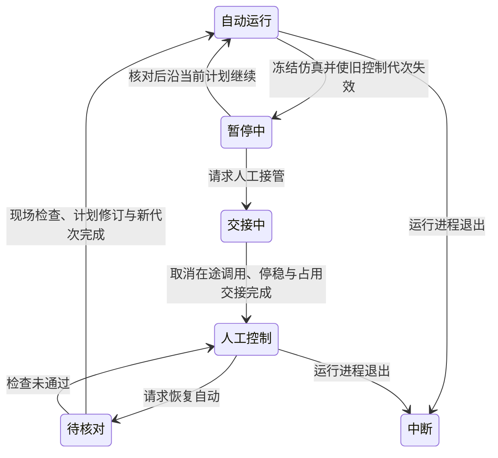

# Cell Passage Simulation

> 状态：已批准实施；用户于 2026-10-28 调用 pm-development 并指示“开始做吧”。
> 日期：2026-10-28。
> 本文记录 assets02 场景向完整细胞传代仿真的扩展要求，不表示新增能力已经实现或验收。

## 1. 已确认目标

用户要求提升 assets02 的场景与操控，使流程模拟整个细胞传代实验，缺少的场景要素、设备与耗材随流程补齐。三轮访谈确认：

1. **实验范围**：常见贴壁哺乳动物细胞的一次传代。从培养箱取出已达到传代条件的母培养物，覆盖观察、去旧培养液、清洗、解离与终止、收集、离心、去上清、重悬、计数、分装接种、子代回培养箱及废物收尾。起点不含复苏，终点不延伸到下一轮传代。
2. **模拟深度**：机械动作与实验状态都可核验。容器转移、开关盖、夹持和设备装载须在物理场景中成立；液体体积、培养物身份、细胞数量及操作条件采用可追踪的状态模型。允许满足几何条件后的固定约束夹持；逐粒子流体与细胞生长机理求解不在本次范围。
3. **操控主线**：Agent 自动完成整轮，人在 Web 查看计划、暂停、检查并接管；同时保留单步操作。正常流程覆盖耗材取用及设备间转运，设备、夹具与工位按流程补齐。
4. **器皿与规模**：一块六孔母培养板分为两块六孔子板，每个母孔对应两个子孔，保留逐孔母子关系。
5. **处理路线**：包含收集、离心、去上清、重悬与计数；具体条件采用明确标注的仿真规程。
6. **夹持边界**：对准、夹爪闭合及夹持几何通过后，可以固定约束保持器皿。真实可达、连续搬运、释放及碰撞检查仍是门槛；固定约束不能补偿够不到或夹不住。
7. **观察与计数**：由设备动作生成与培养物状态一致的模拟观测及计数，明确标注模拟来源，并用于继续、等待或失败判定。
8. **暂停与恢复**：暂停冻结仿真时间。人工接管后核对当前状态再续行；已发生的液体转移和耗材使用保留。失败保留现场与记录，修订后续步骤；从头重开另记一轮。
9. **逐孔分流**：六个母孔各自进入独立离心管，全程不混样。计数后，每份可用活细胞均分给对应两个子孔，补足配置液量。计数取样、残留和废弃均有记录。
10. **备料边界**：初始场景已备好足量试剂储液槽、枪头盒、带盖空管和子板，母板在培养箱。运行内自动开关盖、取用耗材、转运、移液、离心、计数及废物收尾；不足时停下提示补料。试剂瓶到储液槽的备料、补货和工位清洁属于运行前准备。
11. **演示时钟**：等待采用明确标注、可配置的教学时长，机械动作按稳定物理步连续执行；暂停冻结全部仿真计时。教学时长不作为真实实验条件。
12. **进程中断**：本轮恢复范围为同一会话内接管后续行。进程退出则保留中断记录与回放，重启后新开一轮。

## 2. 已核实的当前能力

基线为主线 `d2746d32`，并只读核对外部 assets02 包、`feat/assets02-platform` 工作树及其现有验收文件。本轮没有重新运行 Newton、浏览器或实验验收。

| 范围 | 当前事实 | 对本需求的影响 |
|---|---|---|
| assets02 验收 | `survey.yaml` 明确声明 empty-load、not a biological protocol。16 个成功动作覆盖门、轨道、空手 FR3 与 Flex XYZ；另 3 项验证拒绝 | 19/19 不构成细胞传代成功证据 |
| assets02 行为 | 七个绑定：培养箱内外门、轨道、Flex XYZ、FR3 七关节 | 现有操控只覆盖部分机械运动 |
| 培养箱 | 场景绑定 `joint-door/v1`，未绑定已有 `incubator/v1` 的环境信号 | 需要将门、取放位、培养条件和器皿占位协调起来 |
| FR3 | 手爪几何和指关节存在，但场景公开行为只有关节运动/停止 | 抓取、释放、夹具适配和运输判定仍需补齐 |
| Flex | Z 滑台有移液器碰撞代理，公开行为只控制 XYZ | 取/弃吸头、吸液、分液、混匀、液量与试剂状态尚不存在 |
| 成像机 | 静态机壳和托盘 | 没有进出料、成像、计数或培养状态观测动作 |
| 板、吸头盒、储液槽、瓶及废物容器 | 在 USD 的 Dressing 下作为外观引用 | 需要按用途变成有物理、占位、内容及使用状态的对象 |
| 32 个素材包 | 每个 `asset.usda` 都是空 Xform；当前物理集中在场景 stage | 素材包数量不等于可操作设备数量；补制时须明确实际物理来源 |
| 主线机器人 | `robot_arm.newton` 有示教式 pick/place/pickPlace 与 weld/contact，接口和几何检查专用于 tube | 不可直接宣称已支持培养板或培养瓶 |
| 主线离心机 | 有门、对称装载联锁、转速/时长及停止；物理目标转速受 60 rpm 上限约束 | 可研究复用机械行为，尚无沉淀/上清等实验状态；不能将此演示转速当作生物处理条件 |
| 主线实验状态 | tube 只有位置、直立与掉落；没有移液、培养物、体积、细胞量或样品谱系模型 | 实验完成必须新增可观察的结果条件 |
| 操作计划 | 已有 `do / wait / check` 和客户端 `lw plan run` | 可复用公开 API 路径，不需要先假定新增网关编排引擎 |
| 中断恢复 | Session pause 冻结仿真及动作；`plan_run` 跳过完成步骤，但拒绝含 running/failed 步骤的计划 | 实验阶段暂停、人工接管与失败后续行需要明确产品语义 |
| Web 计划面板 | 已展示步骤、结果、失败、修订、路径及可复制命令 | 单步执行和接管所需的具体操作仍需设计 |

用户报告还记录了夹爪开口 80 mm 小于板宽 85.48 mm、手爪到柜门约 1.31 m 而臂展约 0.855 m、FlexZ 配置限制及 XPBD 不稳定。本轮可从配置核对 FlexZ 上限 0.08 m 与场景指定 MuJoCo；距离、抓取几何和求解器稳定性属于报告证据，尚未重新测量。后续布局与工具改造须重新验证实际尺寸、可达性和运输路径。

## 3. 设计树

| 决策 | 依赖 | 状态 |
|---|---|---|
| R1：贴壁细胞单次传代及起止范围 | 用户目标 | 已确认 |
| R2：机械事实与符号化实验状态分别核验 | 用户目标 | 已确认 |
| R3：整轮自动操作，Web 可观察、暂停、接管 | 用户目标 | 已确认 |
| R4：六孔母板分两块子板，逐孔对应 | R1 | 已确认 |
| R5：收集后离心、去上清、重悬、计数 | R1 | 已确认 |
| R6：满足几何条件后允许固定约束夹持 | R2 | 已确认 |
| R7：与状态一致且标注来源的模拟观测及计数 | R1、R2 | 已确认 |
| R8：冻结仿真、保留物料变化，检查后续行 | R2、R3 | 已确认 |
| R9：六份独立处理，可用活细胞等分，去向可追踪 | R4、R5、R7 | 已确认 |
| R10：已备料场景启动，运行内全自动 | R3、R4、R5 | 已确认 |
| R11：明确标注的教学等待与连续机械运动 | R2、R5、R7、R8 | 已确认 |
| R12：会话内续行；进程中断保留记录后新开 | R1–R8 | 已确认 |
| 工程默认：四槽分批、补制清单、物料单写者、控制交接 | R1–R12、已核对源码 | 已确认，进入实施 |
| 完整规格与交付验收 | 上述决定与工程默认 | 已确认，进入实施 |

每轮只询问上游已确定的决定。建议不等于已接受；新增术语在含义确定时进入根 GLOSSARY，只有存在真实取舍且难逆转的架构决定才另建 ADR。

R4–R8 已由用户统一确认采用推荐方案。培养板路线的确定不表示现有 Flex 模型的板位、吸头、工作空间或所有操作已经验证适配。几何与控制验证属于后续交付要求。模拟分层与夹持边界记录在 [ADR-0006](../adr/0006-cell-passage-simulation-fidelity.md)。

## 4. 完整流程

| 阶段 | 必须发生的动作 | 成功证据 |
|---|---|---|
| 就绪检查 | 识别母板与六份培养物，检查试剂、吸头、空管、子板、计数取样板、废物余量和工位条件 | 固定 Scene Version、仿真规程和初始物料快照；库存及站点可用 |
| 母板出箱与观察 | 开门、实际取板、关闭门、将板装入观察位并观察 | 实际位姿与占位匹配；观测关联母板/孔位及物料修订 |
| 去旧液与清洗 | 搬到洁净工位、移开板盖、取吸头、逐孔处理并向废液容器排放 | 母孔、吸头、废液的液量和细胞去向可核对 |
| 解离与终止 | 按仿真规程加试剂、等待、观察状态、满足条件后终止 | 条件、仿真经过时间与观察结果满足规程，状态变化有据 |
| 收集 | 各母孔独立收集到对应带身份的管，开/关管盖，必要时混匀 | 六份培养物保持独立，母孔与管的内容收支一致 |
| 离心 | 搬管、按批装载、模型质量配平检查、关盖、启动、等待停稳、开盖卸载 | 实际装载及转子周期完成；处理结果关联该批/该周期 |
| 重悬与计数 | 去上清、加液、混匀，分别向计数取样板对应孔取样，再装载观察位计数 | 取样量从原管扣除并保留去向；计数结果绑定样品、取样孔与物料修订 |
| 分种 | 按剩余可用活细胞量等分给两子板的对应孔，补足配置液量 | 十二子孔的身份、母子关系、活细胞量与液量满足目标 |
| 回培养与收尾 | 盖好子板、实际放回培养箱、关闭门并核对环境；废液/吸头/取样物料归位 | 两子板确实就位；无悬空夹持/在途液体；审计与记录完整 |

六个母孔在初始场景中标识为六份独立培养物。转移、离心、重悬和计数取样保持关联；分种时形成十二份有明确母来源的子培养物。

## 5. 设备、器皿与布局的工程默认

用户已授权按流程补齐缺少的设备并批准以下工程默认。尺寸、坐标、夹具间隙和具体资产版本由后续几何验证确定并固定在包中。

| 对象 | 配置与处理方式 | 要补齐的能力 |
|---|---|---|
| FR3、轨道 | 保留可信原始机器人几何与关节；重新安排轨道、柜门和工位的位置 | 面向板、管、盖的动作与真实夹持界面；连续无碰撞运输 |
| 板托和夹持接口 | 补适合现有夹爪的载具/抓取界面、板盖暂存位和定位件 | 真实可夹尺寸；随物体运动的抓取框；不得挪动真实 TCP 代替标定 |
| 六孔培养板 | 三块培养板及对应独立板盖：母板一块、子板两块 | 六孔真实几何、逐孔容量与站点、独立物理实例 |
| 计数取样板 | 再设一块六孔板及独立盖，六份取样保持独立 | 明确取样量、孔位及来源；计数后连板/盖移入指定废弃物暂存位，样本仍计入去向；不计入两块子培养板 |
| 收集管和管架 | 六支样品管及适配管架，补带身份的管盖和自动开关盖夹具 | 容量、盖状态、管架/离心槽兼容性、真实就座与搬运 |
| 离心机 | 沿用四槽几何与离心基础，按四份、两份分两批；另备两支带盖配平管及架位 | 新场景增加内容质量估算与配平联锁、批次/周期证据；保留旧类型和场景语义 |
| Flex 移液工作单元 | 复用可信外观与机构，明确新的唯一轴/吸头/泵控制归属；补实际实验耗材 | 取/弃吸头、接近液面、吸液/分液/混匀、容量与前置条件、泵进度 |
| 吸头与吸头架 | 补独立可使用吸头及架槽 | 空闲/已用/安装/弃置状态；用量由操作计划推导 |
| 试剂与废液 | 预装按用途区分的储液槽，补废液和固体废物容器 | 余量、容量、用途、混用限制、收支与使用状态 |
| 洁净操作工位 | 优先复用生物安全柜环境行为，适配 Flex、机器人和器皿工作空间 | 风机/就绪条件及区域互锁；工位清洁为初始条件 |
| 观察/计数工位 | 改造现有成像机的板定位/装载界面，补设备行为 | 实际装载验证、模拟观察与计数产物、结果身份与来源 |
| 培养箱 | 协调现有门机构、内部取放位及环境信号 | 可达的存取位、实际占位、门与环境条件、子板回培养判定 |

四槽离心机的旧 `balanced` 仅按占位判断。新场景的启动条件还须检查根据管皮重、模型液量及配置密度计算的质量差，明确标注为模型估算。不可把它当作新增真实称重传感器，也不可仅以对角放管代表质量配平。首批四份、第二批两份均单独验证；不满足条件时停止，不自动混样或改变实验配方来凑平衡。

固定成功初态中，六份样品采用规程定义的收集液量；第一批对角放置 S1/S2、S3/S4。第二批对角放置 S5/B5、S6/B6，B5/B6 为预装配平液的两支配平管，不携带培养物身份。初态固定其内容和质量计算依据；离心后配平管返回指定架位。每批均以当前内容重算配平，不能因初态设计为平衡而跳过检查。

模型配平与液体含量属于实验状态；液体随体积变化的惯性反馈不由此自动获得。实际 Newton 转速、配置的教学处理条件和周期时长分别记录。已有 60 rpm 物理上限不能被显示为已达到真实实验转速。

布局按“可达、兼容、净空、连续运输路径”验证，不按美术位置优先保留。交付包含俯视布局图、真实平台视口和可复现的包；原固定资产不拉伸来适配流程。没有完成几何与运动验证的部件继续列为缺口。

Flex 当前配置可用 Z 行程只有 0.08 m。板、吸头架、管架及储液槽高度需要共同适配；如需调整机构范围，必须重新做运动和碰撞验证，不能将 USD 的更大声明行程直接当成已验证可用行程。

## 6. 实验状态与守恒

### 6.1 培养物与内容

- 空间对象继续用其 `entityKey` 标识；孔位、管内、吸头内和废物容器属于该对象的内容位置。
- 培养物身份与器皿身份分开。母孔的培养物在收集、离心和重悬过程中保持来源关联；计数取样仍关联该来源；接种后生成对应子培养物及母子关系。
- 同一孔的附着、悬浮、沉淀部分分别记录活/死细胞量。解离、离心和重悬改变它们的分布，不凭动作成功创造细胞。
- 试剂按用途、组分与数量记录；液量包含容器内、吸头内、计数样本、残留和废物。模型中的损失必须有去向。
- 仿真规程固定初态、教学等待、容量、试剂用途、恢复率/损失规则及判定容差。默认计数可由状态确定性生成；测量值和模型值分别保留。

### 6.2 规则

1. 任意液体转移的源减少量、吸头变化量、目的增加量与废物流量必须相符，保持非负且不超过容量。
2. 每份母来源的细胞分布必须覆盖容器、附着/沉淀部分、计数样本、子培养物、残留及废弃；活转死是分类变化，不能静默消失。
3. 六份样品不得混合。跨样品复用吸头、将接触样品的吸头返回公共试剂或向错误子孔接种均拒绝。首版采用保守的吸头隔离策略，不增加吸头清洗复用流程。
4. 两个子孔均分的是取样及明确损失之后的可用活细胞量。离散计数的舍入余量有明确归属，数量差按规程容差验证，液量另行补足。
5. 去旧液不能吸走仍附着的细胞；去上清不能把沉淀当成已悬浮液；未完成重悬不能按均匀浓度分装。相关模型条件和例外须在仿真规程中明确。
6. 数量更新以已发生的器具/泵动作及状态条件为依据。取消保留已转移部分，续行根据当前余量重新计算，不按旧参数重放整笔转移。

## 7. 程序与状态所有权的工程方案

### 7.1 单一物料写入者

新移液工作单元的 Device Program 负责本场景的物料状态，作为唯一写入者。它控制 Flex 移液机构及泵，维护一个带修订号的公开物料快照，快照含容器/孔位内容、培养物关系、吸头、进行中的转移和资源占用。相关行使用固定字段对象数组，不要求扩展现有 schema 子集。

机器人、离心机、门和观察设备继续拥有自己的机械状态或观测产物；它们读取工作单元的材料/占用信息，不能各自写一份独立液量。工作单元读取离心周期、装载、环境和观察结果作为自身状态变化的证据。Flex 轴不再同时绑定另一套可写驱动程序，避免两个程序争写同一机构。

这个方案将跨容器的扣减/增加放在同一 Program 的一个物料快照更新内，遵守现有 `Ctx.set` 单实体边界。吸液/分液动作由同一所有者推进并发布物料，动作成功时其自身的物料发布也必须完成。取样或分种完成不能只凭另一设备的调用终态判定。

状态所有权与控制交接的取舍见 [ADR-0007](../adr/0007-cell-passage-material-and-control-ownership.md)。

已有容器、机器人和离心机类型的语义保持；新场景所需的器皿动作、配平和周期证据采用明确的新类型/程序或兼容配置，具体接口名在实现时遵从仓库约定。行为仍归 `devices/` 与 `packages/programs/`。

### 7.2 占用与交接

物料写入者还维护本流程的容器、孔位和工位占用。客户端通过它的声明式动作取得分配给相应设备的占用，再调用机械动作。机器人取板、液体操作、开关盖、离心装载和成像都检查这些占用及实际位置；不能各自看到“空闲”就同时动手。

占用和操作身份属于公开状态。设备仍持物、存在在途液体或动作尚未停稳时，不因超时而自动释放占用。人工接管需停稳并核对现场后转交所有权。这个机制只服务本场景的真实多设备消费者，不新增通用后端流程引擎。

### 7.3 原子边界、取消与查询

- 移液状态随实际执行进度记录；记录本次操作身份、已转移量和剩余量。部分吸液后取消时，吸头中的液体继续存在。
- `requestId` 保持 API 幂等键含义。同一派发尝试失答后观察原调用；控制者或计划修订改变后，新尝试使用新 requestId。未开始且意图未变的领域 operationId 保持稳定，跨步骤的周期引用也保持；已开始/失败或改变意图的替换需显式更新相关依赖。
- 快照保留近期普通终态操作及所有进行中、制动中、故障/部分完成记录。完整已执行终态回执通过通用声明事件、调用结果和录制保留；同一 Source 生命周期的去重不依赖近期行是否仍在快照。重置产生新 round 和新操作身份，控制代次不得出现旧值复用。
- 观察和计数产物包含源培养物、器皿/孔位、物料修订、动作身份及模拟来源；不自动覆盖模型真值。
- 供 `wait/check/expect` 使用的核验结果暴露为顶层标量/修订，并与快照更新一致；逐孔详情由公开快照查询。首版不扩展条件语言为 JSONPath。
- 状态不只存在于 Program 私有字段；录制必须足以解释物料变化、占用、部分完成与最终去向。旧录制读取要求保持。

## 8. 操控与 Web

自动执行继续由外部 Agent 或客户端执行器推进 Operation Plan，网关追踪意图、调用与结果。Web 使用同一 HTTP API 提交控制与设备动作，不引入设备专用的旁路。

### 8.1 控制代次与暂停

源码边界需要明确：PAUSED 会话仍受理动作，`Program.accept` 与已启动动作的 `cancel` 即时执行；`start/tick` 及物理推进等待正仿真时间。现有 Plan 没有 paused/cancelled 状态，现有 `lw plan run` 也不监听暂停，HTTP 等待仍消耗墙钟时间。这些基础不能直接当作完整接管能力。

本场景在工作单元的公开控制状态中增加执行者、控制代次、控制模式和交接进度。新场景的受控设备动作携带当前执行者/代次，设备 Program 在 `accept`、`start` 及运动推进时检查。控制请求先使旧代次失效；已经读到旧状态的自动执行器，其迟到请求仍须被拒绝。该校验属于新设备类型/程序及 action 参数，不给通用网关加入设备分支，也不为此修改公共 InvokeRequest 或协议消息形状。

控制请求需能在暂停期间生效：专用控制动作在完成验证后于 `accept` 更新本实体的控制意图和代次，使用允许与运行中动作并发的声明；受理后通过公开状态确认请求已生效，不能等待普通 `start` 来建立隔离。机械停稳、取消结果和交接完成另行确认，不能把受理控制请求等同于设备已停稳。实现须覆盖该回调边界的原子性、幂等和异常路径。

控制动作在 `accept` 时尚未获得 InvocationHandle；它记录该控制操作身份及已提交的结果。恢复后的 `start` 只确认这次提交并结束调用，不得再次递增代次，或恢复已被后续控制请求取代的模式。多条暂停期间排队的控制调用亦按此处理。一次状态提交使用同一次 `Ctx.set(...)`，不假定多个 set 或回调异常会自动回滚。

旧代次失效后，已启动的机械动作必须主动建立安全保持目标并停止泵推进，保留持物及已吸液体。仅停止写目标、跳过 tick 或把调用标为终态都不够：底层关节目标会保留，恢复物理后仍可能向旧目标运动。安全保持必须在恢复物理前或首个控制边界完成，并以实际速度/状态确认停稳后才交接；不得自动松爪或释放在途物料。

这些是工作单元的控制模式，不新增或重解释公共 PlanStatus。人工接管后可恢复仿真以执行人工动作，自动派发仍被控制代次/模式阻止。接管不自动松爪、卸载液体或释放占用。

### 8.2 客户端执行

为本演示提供可观察控制模式和会话状态的客户端执行路径，复用现有 Plan、修订、调用及查询 API。它在派发前检查当前场景/会话、Plan 修订和控制代次；暂停或交接时停止派发，并继续跟踪已经受理的调用，不能因一次 HTTP 等待超时而重新执行动作。

实验动作时限按仿真时间计算；网络请求超时只说明本次请求/观察未完成，不能直接解释为设备失败。长实验等待优先使用工作单元的声明式等待动作，由已有 Program 仿真时钟推进，避免把当前网关墙钟 wait 误当成可暂停的实验计时。已有普通客户端行为不能在未验证兼容性时全局改变。

续行时先核对真实机械状态、物料快照、在途调用与当前修订。仍有 running step 时先完成或取消；失败步骤通过现有 revision API 重建为 pending，保留内容未变的已完成步骤及结果。执行器与 Web 均呈现停止派发、设备停稳、可接管和待核对的区别。

### 8.3 界面与中断

Web 展示当前阶段/步骤、六个母孔到十二个子孔的关系、所选器皿内容、试剂/吸头余量、废物余量、当前占用及最近观察结果。机械反馈、符号化数量和模拟观测明确标识来源。复杂内容不能只交付一段 JSON 作为主要操作视图。

单步、自动推进、暂停和人工接管共享状态。暂停须冻结机械动作、实验等待和仿真时间；接管须停止后续自动派发，并核对持物、吸头/在途液体、盖/门、转子、占用及物料修订。续行保留已完成步骤，对受影响步骤修订计划后继续。只修改物料显示或把失败调用改成成功不构成修复。

进程退出后该轮标为中断并保留可用记录。重启后的新一轮不能沿用旧运行的持物、占用或物料变更，回放也不被当作可执行检查点。

## 9. 交付顺序与验收

| 阶段 | 可演示结果 | 门槛 |
|---|---|---|
| P1 场景与搬运 | 固定版本包可启动，板/盖/管在各工位间实际搬运 | 尺寸兼容、可达、夹持条件、连续路径、占位及稳定就座通过 |
| P2 移液与物料 | 真实机构完成取/弃吸头、吸液/分液/混匀；可查询部分完成及收支 | 单写者、守恒、容量、混样隔离、占用和取消用例通过 |
| P3 全流程 | 六份培养物完成两批离心、取样计数、十二子孔接种与回培养 | 阶段条件与处理周期有证据；最终身份、细胞量、液量和去向正确 |
| P4 Web 与恢复 | 自动、单步、暂停、接管、修订后续行及回放可演示 | 自动派发与人工控制互斥，暂停不推进时间/物料，续行不重复已完成转移 |

计划按七个固定阶段组织，阶段内以约 128 步的普通 Plan 分段；同一 round 自动串行全部分段，共用会话和连续录制，不重置持物或物料。分段前后的动作顺序、参数和全局 step/operation 身份等价。任何单段完成都不代表整个实验完成。

首次整轮 Newton 运行之前，依据离散细胞分配与已确认的 float32 执行分辨率固定以下教学验收规则：

- 全域细胞守恒容差为 `1e-6` 个模型细胞，覆盖所有容器、取样、残留与废弃；它不因分配容差而放宽。
- 同一母来源的两个子孔，活细胞分配差不超过 `1` 个模型细胞。取样与物理分辨率导致的不可转移残留须保留并明确去向，不能把任意未完成转移称为残留而通过。
- 子孔最终液量与配置目标的绝对误差不超过 `0.01 µL`；不可转移的微量余量同样受固定规程限制。
- 精确数量与“当前可用量/分数/补足目标/排出吸头当前内容”等数量意图分开。源设备按实际状态与机械可行终点解析意图，记录实际执行量及余量；不把浮点名义目标吸附成实际数量，不放宽库存/容量检查掩盖差异。

这些规则在没有整轮物理结果时固定，后续不依据失败样本放宽。培养箱的新场景教学设定为 37°C、5% CO₂、95% RH；环境就绪依照公开配置范围与实际双门闭稳判定，等待使用仿真时钟。上述参数为本场景教学配置，不替代具体细胞系规程或生物学验证。

最终交付至少包含：

1. 一条本地命令导入/选定固定场景并启动演示，及可在 Web 中完成的操作入口。
2. 新制/派生素材、场景、绑定与程序的明确版本和来源；没有将 Dressing 数量当成设备完成数。
3. 整轮自动演示的连续录制和按阶段结果；至少三次从相同固定初态独立启动的完整成功运行，关键末态一致。
4. 两子板十二孔的母来源、细胞量分配、液量、盖状态、实际培养箱位置及条件全部通过；母板、取样、残留、废液和废耗材有去向，无未知在途持物/液体。
5. 负例覆盖：缺吸头/试剂不足、容量溢出/废物满、错误器皿或样品、盖/门未开或转子未停、无效占用/工位冲突、配平失败、不可达/夹持几何失败及碰撞风险。
6. 中断用例覆盖：吸液与分液中途取消、机械动作和等待中暂停、人工改变现场后续行、进程退出后保留中断记录。验证不重复扣料/分装、不伪造恢复成功。
7. 按 [VERIFICATION](../VERIFICATION.md) 完成必需回归；运行时/程序/场景变更执行 Newton CPU 四项检查，原始证据保留在任务 `.scratch/`。

所有机械容差依据夹具间隙与已有验证门槛固定到场景/规程；液量和细胞数容差固定到仿真规程。不得在看到结果后放宽容差，或为通过流程关闭所有碰撞。

本规格已获用户整体共识确认，按仓库 issue/PR 流程实施；本次设计文档不宣称 P1–P4 已实现。

## 10. 与已有架构的关系

- Newton 决定实际位姿和机械运动，实验状态模型不得把动作意图当成搬运成功。
- Web、CLI 和 MCP 继续经过同一 HTTP action pipeline；设备行为归 `devices/` 与 `packages/programs/`。
- 当前 Program 只能写本实体属性。跨容器转移涉及的扣除、增加、取消与守恒需要明确状态所有权，不能直接绕过该边界写其他实体。
- 当前动作忙碌检查按实体执行，未提供跨设备共享的容器/耗材占用。自动操作与人工接管必须明确同一物料的独占和交接。
- 当前属性可表达固定字段对象和对象数组，但不支持任意动态键对象的 schema；条件语言只选择顶层属性。若集中保存多个容器的内容，需同时设计可查询、可用于 wait/check 的结果，不能假定现有 Plan 会解析任意嵌套内容。
- 场景可预先声明 `unplaced: true` 的信息实体，但同一实体只对应一个 Program，运行中没有动态创建实体的现有 API。新增物料状态的归属需据此选择；未放置实体目前也不会自动成为 Web 设备图例中的项目。
- `requestId` 只标识一次 API 调用；取消已开始动作不会自动撤销状态。吸液成功但分液未发生、人工接管后重试等情况须保留可观察的中间状态，防止重复扣除或重复分装。
- 录制能保存公开属性、事件和调用，不能保存任意程序私有字段，也不能直接恢复成可继续执行的检查点。本次现场续行与进程重启恢复应分别规定。
- 通用界面当前以 JSON 展示复杂属性。逐孔内容、样品去向与实验进度需要具体呈现；Newton 宿主的统一 `source: sim` 标签本身不能区分物理观测与符号化实验读数。
- Operation Plan 表达操作意图及步骤结果，当前网关不调度计划；客户端 `lw plan run` 已能顺序执行。自动运行与接管设计需要尊重或显式修订这一边界。
- 物理素材和 Scene Version 仍为有版本的 USD；布局与补制由外部工厂完成，使用平台导入和验证。原资产版本与历史录制保持可读。
- 若需要改变公开协议或录制格式，应单列版本与兼容方案；仅增加设备类型不能被误称为已完成所有契约分析。

## 11. 依据

- 用户输入：`REPORT-assets02-20261028.md`，2026-10-28，以及本次设计访谈。
- 外部包：`asset_replacement_20261028/integration/deliverables/platform_packages/scene/{scene.yaml,devices.yaml,stage.usda}`。
- 当前空载验收：主检出 `.scratch/assets02-platform/survey.yaml`。
- 既有源码：`apps/cli/lw/client.py`、`packages/info/plans.py`、`packages/info/program.py`、`packages/programs/robot_arm/newton.py`、`devices/types/`、`apps/web/src/components/PlanChecklist.tsx`。
- [平台 PRD](LAB_RSI_PLATFORM_PRD_V1.md)、[信息平面](LAB_INFORMATION_FOUNDATION_SPEC_V1.md)、[操作计划](LAB_LIVE_OPERATIONS_SPEC_V1.md)、[素材与场景](LAB_ASSETS_AND_SCENES_SPEC_V1.md)、[Scene Factory](LAB_SCENE_FACTORY_SPEC_V1.md)、[验证要求](../VERIFICATION.md)。
- [ADR-0001](../adr/0001-usd-canonical-scene-format.md)、[ADR-0002](../adr/0002-tube-grasp-point-and-physical-tcp.md)、[ADR-0004](../adr/0004-scene-authoring-through-external-factories.md)。
