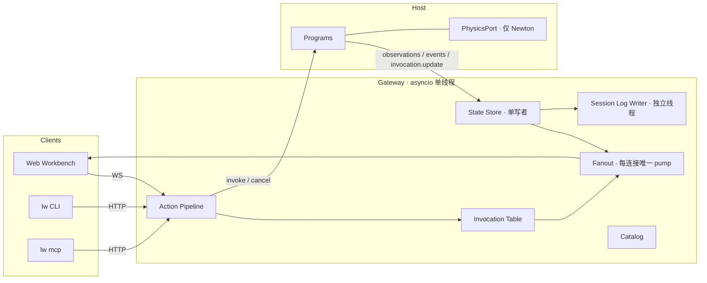

# Lab Information Foundation

> **高性能实验室信息底座 · Technical Specification v1.0**  
> 日期：2026-10-17  
> 状态：Ready for implementation（未决项集中在 §18，均有默认值；未另行决定前按默认值执行）  
> 仓库：`CaiZongyuan/spatial-sync`（主仓库）。空间同步部分以 [v1.2 规格](NEWTON_SPATIAL_SYNC_SPEC_V1.2.md) 为准，本规格只描述新增与改动。  
> 参考：`CaiZongyuan/labworld` 的 `CONTEXT.md` 领域词汇、ADR 0006 / 0007 / 0012、`packages/server/src/lab/devices/*`。只借概念，不迁移代码。  
> 运行形态：本地优先。设计保证日后能迁移到"静态托管回放 + 远程节点实时"，但本规格不包含任何部署工作。

## 0. 一句话定义

在 spatial-sync 中新增**信息平面**：用声明式的**实体类型**描述实验室里每一类设备、机器人和器皿的属性与动作；**设备程序**运行在拥有时钟和状态的宿主里（Newton 场景中就是 Runner 进程），维护属性、执行动作；网关用一条**动作管线**、一个**状态存储**、一路**事件流**和一份**会话日志**对外服务；Web、CLI 与 MCP 共用同一套接口。

Agent 通过 MCP 或 CLI 就能查询实验室状态、控制 Newton 中的机械臂和虚拟设备。以后把某台设备换成真实硬件，只换程序，接口不变。

现有空间平面（Manifest + Transform 流）保持不变。两个平面共用 `entityKey` 作为身份。

## 1. 目标与范围

### 1.1 目标体验

1. 开发者启动 `robot-and-tubes`（Newton）或 `lab-demo`（Synthetic）场景。
2. 在浏览器中点选离心机，Inspector 显示它的类型、实时属性（阶段、转速、盖子状态、孔位装载）、可执行的动作，以及最近的动作调用。
3. 在终端执行 `lw do /World/Lab/RobotA pickPlace from=rack.A1 to=centrifuge.slot1 --wait`：机械臂在 Newton 中完成抓放，浏览器同步看到运动，试管的 `location` 属性随之变化。
4. 盖子开着时执行 `lw do /World/Lab/Centrifuge start rpm=3000 durationSeconds=60`，被拒绝并返回可读原因和下一步建议。
5. Claude Code 通过 MCP 自主完成"取管 → 放入离心机 → 关盖 → 离心 → 等待完成"，每一步在浏览器中可见。
6. 会话自动录制；结束后在浏览器中回放运动、属性变化和每一次动作调用。

### 1.2 包含

- 实体类型定义与场景实体绑定（YAML），加载时编译校验器。
- 设备程序接口，以及两个宿主：Newton Runner、SyntheticSource。第三个宿主（网关内的真实设备宿主）只定义接口。
- 首批类型：`robot-arm/v1`、`centrifuge/v1`、`tube/v1`，每个类型都有 Newton 版和虚拟版程序。
- Newton 侧：物理端口（关节目标、位姿读取、焊接约束启停）、物理事实计算、示教位置。
- 网关：状态存储、动作管线、动作调用生命周期、事件流、审计字段。
- 协议 v2：信息平面消息；同时完成 Phase 0 精简（§14）。
- HTTP API、`lw` CLI、`lw mcp` MCP server。
- 会话日志（即录制）与浏览器回放页。
- 性能预算与基准脚本。

### 1.3 不包含

- 账户、多租户、数据库、任何部署。
- 真实设备驱动（只定义宿主接口；MQTT 放在后续）。
- MHS 兼容。MHS 目前是研究预览，规范未公开；本规格只预留适配点（§13.4）。
- 通用运动规划与基于 IK 的笛卡尔运动。MVP 用示教位置。
- 实验流程编排引擎。流程由 agent 编排。
- 多 world 训练可视化、Blender/UE5 导出。

## 2. 与已有工作的关系

### 2.1 与 spatial-sync v1.2

| v1.2 内容 | 本规格中的处理 |
|---|---|
| Manifest、Transform 流、会话命令（pause / resume / reset / step） | 不变 |
| `entity.state`（预留信封） | 删除，由 `entity.observations` 等消息取代（§7） |
| `SpatialSource` | 扩展为同时承载信息平面（§5.2） |
| 范围订阅、累积增量、视口订阅、TLS 远程 Runner、压力场景、LOD、JSON 帧 | Phase 0 删除（§14） |

### 2.2 概念对照（借自 Lab World `CONTEXT.md`）

| Lab World | 本规格 | 说明 |
|---|---|---|
| Entity | Entity（`entityKey`） | 身份统一为 entityKey |
| Asset / Equipment Model | EntityType | 声明式定义，带版本 |
| Equipment Instance | Entity（绑定了类型） | |
| Capability | Action | |
| Runtime Binding | 程序绑定（`program` 字段） | 同一类型可换程序：newton / virtual / 以后 mqtt |
| Virtual Device + Device Program | Program（virtual 程序） | |
| Observation | Observation | 带来源与时间 |
| Device Command + Device Task | Invocation（动作调用） | 合并为一个带进度的生命周期 |
| Simulation Session | Session | |
| Lab Recording / Replay | 会话日志 / 回放页 | 日志就是录制 |
| Registered Location | 不做 | MVP 只有物理事实得出的 `location` |

Lab World 的设备代码按程序名写 if 分支做校验（如 `program === 'centrifuge.v1'`）。本规格改为由定义驱动：新增一种设备只写一份 YAML 和一个程序类，网关代码不改。

## 3. 设计原则

1. **定义即接口。** Agent、Web、CLI 看到的属性、动作、参数、单位、限值、前置条件，全部来自同一份 YAML。网关里没有任何设备专属代码。
2. **程序在数据旁边运行。** 设备程序在拥有时钟和状态的宿主中执行：Newton 设备在 Runner 进程里按仿真时间推进。跨进程的只有低频的观测和调用更新。
3. **单写者状态。** 网关状态存储只由事件循环写入；读取是 O(1) 的不可变快照，不加锁。每个实体的属性只由它自己的程序写。
4. **只传变化。** 程序每个 tick 可以随意写属性；宿主负责去重、死区和限速，只把变化批量发出。
5. **日志即录制。** 网关广播的可靠消息和帧原样写入会话日志；回放读取同一格式。
6. **一条动作管线。** Web、CLI、MCP 走同一条管线，Agent 没有旁路。
7. **默认严格。** 限值、前置条件、并发规则默认严格；放宽必须改定义，并且在 describe 中可见。

## 4. 数据模型

### 4.1 EntityType

文件：`devices/types/<name>.yaml`，一个文件一个类型。`type` 带版本号；版本不兼容的修改必须新开版本。

```yaml
type: centrifuge/v1
title: 台式离心机
description: |
  4 孔转子。装管数必须是 0、2 或 4，2 支时须对位（1 与 3，或 2 与 4）。
  运行中盖子锁定；phase 回到 idle 后才能开盖。
properties:
  phase:
    schema: {enum: [idle, accelerating, running, decelerating, fault]}
    description: 运行阶段
  lidOpen:
    schema: {type: boolean}
  rpm:
    schema: {type: number, minimum: 0, maximum: 15000}
    unit: rpm
    deadband: 10
    maxRateHz: 5
  remainingSeconds:
    schema: {type: number, minimum: 0}
    unit: s
    maxRateHz: 1
  slots:
    schema: {type: array, items: {type: [string, "null"]}, minItems: 4, maxItems: 4}
    description: 每个孔位中试管的 entityKey，空位为 null
actions:
  openLid:
    description: 打开盖子，约 1 s 完成。
    preconditions:
      - {property: phase, equals: idle, message: 运行中盖子锁定；等待 phase 回到 idle}
    timeoutSeconds: 5
  closeLid:
    description: 关闭盖子，约 1 s 完成。
    preconditions:
      - {property: phase, equals: idle}
    timeoutSeconds: 5
  start:
    description: 以给定转速运行给定时长，结束后自动减速；转子停稳回到 idle 时调用成功。
    params:
      rpm: {type: number, minimum: 500, maximum: 15000, unit: rpm}
      durationSeconds: {type: number, minimum: 1, maximum: 3600, unit: s}
    required: [rpm, durationSeconds]
    preconditions:
      - {property: lidOpen, equals: false, message: 盖子开着；先调用 closeLid}
      - {property: phase, equals: idle}
    longRunning: true
    timeoutSeconds: 3700
  stop:
    description: 立即减速停止；正在运行的 start 调用以 cancelled 结束。
    concurrent: true
events:
  runCompleted:
    schema: {type: object, properties: {rpm: {type: number}, durationSeconds: {type: number}}}
```

**属性字段**

| 字段 | 必填 | 含义 |
|---|---|---|
| `schema` | 是 | JSON Schema 子集（见下） |
| `unit` | 否 | 单位字符串：`m`、`rad`、`s`、`rpm`、`degC` 等 |
| `description` | 否 | 写给 agent 的说明 |
| `deadband` | 否 | 数值变化小于该值不发；数组按元素最大绝对差比较 |
| `maxRateHz` | 否 | 该属性的最高发送频率；限速期间最后一个值在下一个允许时刻补发（不丢最终值） |

**动作字段**

| 字段 | 默认 | 含义 |
|---|---|---|
| `description` | — | 写给 agent：做什么、多久、副作用 |
| `params` / `required` | 无参数 | 参数 schema（子集），可带 `unit` |
| `preconditions` | `[]` | 只能引用本实体属性（§4.3） |
| `longRunning` | `false` | 是否上报进度 |
| `timeoutSeconds` | 30 | 仿真宿主按仿真时间计，真实设备宿主按墙钟计 |
| `concurrent` | `false` | 为 true 时不受"同一实体一次一个调用"限制，例如 stop |
| `risk` | `normal` | `normal` / `high`，影响审批策略（§13.2） |

**事件字段**：`schema`（可选）、`description`。程序发出未声明的事件，记为程序错误。

**JSON Schema 子集**：`type`（含联合类型）、`enum`、`const`、`minimum`、`maximum`、`exclusiveMinimum`、`exclusiveMaximum`、`minLength`、`maxLength`、`pattern`、`items`、`minItems`、`maxItems`、`properties`、`required`。对象默认 `additionalProperties: false`。加载器拒绝子集以外的关键字。加载时编译为 Pydantic `TypeAdapter`，同时导出标准 JSON Schema 供 MCP 与前端使用。

### 4.2 场景绑定

文件：`devices/scenes/<sceneId>.yaml`。它把类型绑定到场景中的实体，并指定程序与配置。跨实体的互锁只能写在这里，因为类型是可复用的，不能引用具体实体。

```yaml
scene: robot-and-tubes
entities:
  - key: /World/Lab/RobotA
    type: robot-arm/v1
    program: robot_arm.newton
    config:
      armJoints: [/World/Lab/RobotA/fr3/fr3_joint1, /World/Lab/RobotA/fr3/fr3_joint2,
                  /World/Lab/RobotA/fr3/fr3_joint3, /World/Lab/RobotA/fr3/fr3_joint4,
                  /World/Lab/RobotA/fr3/fr3_joint5, /World/Lab/RobotA/fr3/fr3_joint6,
                  /World/Lab/RobotA/fr3/fr3_joint7]
      fingerJoints: [/World/Lab/RobotA/fr3/fr3_finger_joint1, /World/Lab/RobotA/fr3/fr3_finger_joint2]
      handBody: /World/Lab/RobotA/fr3/fr3_hand
      tcpSite: /World/Lab/RobotA/fr3/fr3_hand/tcp
      speedScale: 0.5
      grasp: {mode: contact}            # contact | weld（§6.4，D-01）
      locations: robot-and-tubes.locations.yaml

  - key: /World/Lab/Centrifuge
    type: centrifuge/v1
    program: centrifuge.newton
    config:
      lidJoint: /World/Lab/Centrifuge/LidHinge
      rotorJoint: /World/Lab/Centrifuge/Spindle
      slotSites: [/World/Lab/Centrifuge/Rotor/Slot1, /World/Lab/Centrifuge/Rotor/Slot2,
                  /World/Lab/Centrifuge/Rotor/Slot3, /World/Lab/Centrifuge/Rotor/Slot4]
      visualRpmCap: 60
    interlocks:
      closeLid:
        - {entity: /World/Lab/RobotA, property: zone, notEquals: centrifuge,
           message: 机械臂仍在离心机区域内；先把它移出}

  - match: /World/Lab/Tubes/*          # glob，展开为多个实体
    type: tube/v1
    program: tube.newton
    config:
      locationSites: [/World/Lab/Rack/*, /World/Lab/Centrifuge/Rotor/Slot*]
```

**加载时校验**（任一失败，会话进入 FAILED 并给出具体错误）：

- 每个 key（或 glob 展开结果）都存在于 Manifest 的节点中（group / body / static）；不在场景中的实体必须显式写 `unplaced: true`。
- 程序 id 已在当前宿主注册，且实现的类型与 `type` 一致。
- `config` 通过该程序的 `Config` 模型校验。
- `interlocks` 引用的实体、属性存在，比较运算符与属性类型匹配。
- 同一 key 只能绑定一次。

### 4.3 条件语言

前置条件、互锁、位置的 `requires` 使用同一种结构化条件，列表表示"全部满足"。不支持 or，也不支持表达式；更复杂的逻辑写在程序的 `accept()` 里。

```yaml
- {property: lidOpen, equals: false, message: 盖子开着；先调用 closeLid}                    # 本实体
- {entity: /World/Lab/RobotA, property: zone, notEquals: centrifuge, message: ...}        # 其他实体（仅场景绑定中允许）
```

运算符：`equals`、`notEquals`、`in`、`notIn`、`lt`、`lte`、`gt`、`gte`、`isNull`、`notNull`。属性值未知（尚无观测）时，条件一律视为不满足，并在拒绝详情里注明 `actual: unknown`。

求值器在 Python（网关与宿主）和 TypeScript（前端显示）各实现一份，共用 `tests/fixtures/conditions.json` 中的测试表。

### 4.4 示教位置

机械臂通过命名位置工作，不做运动规划。文件：`devices/scenes/<sceneId>.locations.yaml`，由场景绑定中机械臂的 `config.locations` 引用。

```yaml
robot: /World/Lab/RobotA
locations:
  rack.A1:
    site: /World/Lab/Rack/A1
    zone: rack
    approach: [0.00, -0.30, 0.00, -2.20, 0.00, 1.90, 0.78]   # 7 个关节角（rad）
    grasp:    [0.00, -0.10, 0.00, -2.30, 0.00, 2.20, 0.78]
  centrifuge.slot1:
    site: /World/Lab/Centrifuge/Rotor/Slot1
    zone: centrifuge
    approach: [...]
    grasp: [...]
    requires:
      - {entity: /World/Lab/Centrifuge, property: lidOpen, equals: true, message: 先开盖}
      - {entity: /World/Lab/Centrifuge, property: phase, equals: idle, message: 等离心机停止}
```

- `site` 是该位置对应的 Site，用于物理事实判定和可视化。
- `zone` 用于跨设备互锁（§6.3 定义 `zone` 属性的语义）。
- `requires` 在动作受理时检查，并在进入 grasp 姿态前再检查一次。
- 示教工具 `tools/teach.py`：先用 `lw do ... moveJoints` 把机械臂移到位，再把当前关节角写入某个位置的 approach 或 grasp；同时用正运动学检查 grasp 姿态下 TCP 与 site 的距离，超过 1 cm 给出警告。

### 4.5 实体运行时状态

```text
EntityState
  key       entityKey
  type      如 "centrifuge/v1"
  rev       u64，属性每次变化 +1（由宿主分配）
  values    {属性名: 值}；尚无观测的属性不出现
  meta      {属性名: {simTime, sampleTimeMs, source}}，source ∈ sim | virtual | device
  active    当前活跃的调用 id 列表
```

### 4.6 Invocation（动作调用）

一次动作请求产生一个 Invocation，从受理到结束只有一个生命周期。

```json
{
  "invocationId": "inv-01JB5Q7X3K9V2M8T6R4N1C0D7E",
  "requestId": "cli-7f3a",
  "entityKey": "/World/Lab/Centrifuge",
  "action": "start",
  "params": {"rpm": 3000, "durationSeconds": 60},
  "actor": {"kind": "agent", "name": "claude-code"},
  "status": "running",
  "progress": 0.42,
  "result": null,
  "error": null,
  "epoch": 0,
  "createdSimTime": 12.50,
  "startedSimTime": 12.52,
  "endedSimTime": null,
  "createdAtMs": 1760630000123
}
```

**状态机**

```text
            ┌─► rejected（终态，从未受理）
request ────┼─► pending_approval ─► (approve) ─► accepted
            └─► accepted ─► running ─► succeeded | failed | cancelled
```

- 没有进度的短动作可以从 `accepted` 直接到终态，跳过 `running`。
- `pending_approval` 被拒绝或超时，以 `rejected` 结束，错误码为 `approval_denied`。

**错误码**

| 码 | 阶段 | 含义 |
|---|---|---|
| `unknown_entity` / `unknown_action` | 受理 | |
| `invalid_params` | 受理 | `details.errors` 列出字段错误 |
| `precondition_failed` | 受理 | `details.failed: [{condition, actual, message}]` |
| `busy` | 受理 | `details.activeInvocationId` |
| `not_permitted` | 受理 | 角色不允许 |
| `approval_denied` | 受理 | 审批被拒或超时 |
| `source_unavailable` | 受理 / 执行 | 宿主不可用，或该实体程序已被禁用 |
| `timeout` | 执行 | 超过 `timeoutSeconds` |
| `session_reset` | 执行 | 仿真 reset 或场景重载 |
| `program_error` | 执行 | 程序抛出异常 |
| 程序自定义码 | 受理 / 执行 | 如 `grasp_failed`、`place_failed`、`imbalanced`、`location_empty`、`motion_timeout`，必须在动作 `description` 中列出 |

网关内存中保留全部活跃调用和最近 1,000 个终态调用；所有调用（包括被拒的）都写入会话日志。

### 4.7 Event

```json
{"type": "entity.event", "entityKey": "/World/Lab/Tubes/Tube03", "event": "dropped",
 "data": {"lastHolder": "/World/Lab/RobotA"}, "simTime": 41.2, "sampleTimeMs": 183402551.2}
```

事件只用于"发生了什么"（掉落、运行完成），不代替属性。Agent 判断当前状态时读属性。

## 5. 运行架构



宿主有三种：

- **Newton Runner 进程**：程序与物理同进程，按仿真时间推进。
- **SyntheticSource**：网关进程内，按合成仿真时间推进，运行 virtual 程序；用于前端开发、CI 和 MCP 测试。
- **Device Host（后续）**：网关进程内，按墙钟推进，程序通过异步驱动（MQTT、HTTP、串口）连接真实设备。

### 5.1 Program 接口

```python
class Program(Protocol):
    id: ClassVar[str]                  # 如 "centrifuge.newton"
    type: ClassVar[str]                # 实现的类型，如 "centrifuge/v1"
    Config: ClassVar[type[BaseModel]]  # config 校验模型
    tick_priority: ClassVar[int] = 100 # 越小越先 tick（§6.6）

    def init(self, ctx: Ctx) -> None: ...
    def accept(self, inv: InvocationView, ctx: Ctx) -> Reject | None: ...
    def start(self, inv: InvocationHandle, ctx: Ctx) -> None: ...
    def tick(self, ctx: Ctx, dt: float) -> None: ...
    def cancel(self, inv: InvocationHandle, ctx: Ctx) -> None: ...
    def reset(self, ctx: Ctx) -> None: ...   # 默认调用 init
```

`Ctx` 提供：

| 成员 | 含义 |
|---|---|
| `key`、`config`、`sim_time`、`tick_index` | 基本信息 |
| `fact_due` | 本 tick 是否应计算物理事实（按 `factHz`） |
| `set(**values)` | 写本实体属性；宿主负责差分、死区、限速 |
| `get(prop)` | 读本实体当前属性 |
| `read(entity_key, prop)` | 读同宿主其他实体的属性（本 tick 已更新的值） |
| `emit(event, **data)` | 发出已声明的事件 |
| `physics` | `PhysicsPort`；非 Newton 宿主为 `None` |

`InvocationHandle` 提供 `params`、`progress(x)`、`succeed(result=None)`、`fail(code, message, **details)`。

**规则**

- 程序是同步、非阻塞的，不做 I/O。`tick` 必须在预算内返回（§12）。
- 程序只能写本实体属性。需要别的实体变化时，读对方属性或通过对方的动作。
- 程序抛出异常：该实体的活跃调用以 `program_error` 失败，宿主记录错误并继续运行。同一实体连续 3 次异常后被禁用，此后的调用以 `source_unavailable` 拒绝，直到 reset。

### 5.2 宿主循环与 SpatialSource 扩展

每个 tick 按以下顺序执行（Newton 宿主在物理步边界执行，默认 `controlHz = 60`）：

1. 处理收到的 invoke / cancel 请求：重新评估前置条件、互锁、并发规则和 `program.accept()`，回复 accepted 或 rejected。这是**权威检查**，网关侧的检查只是快路径。
2. Newton：读取一次物理快照（§6.1）。
3. 按 `tick_priority` 顺序调用每个程序的 `tick`。
4. 对属性写入做差分（死区、限速），合成一条 `entity.observations`（无变化则不发）。
5. 依次发出本 tick 的事件和调用更新。
6. Newton：一次性写回关节目标，应用焊接约束变化。

**顺序不变量**：同一个 tick 内，消息按 observations → events → invocation.update 的顺序发出，网关按此顺序应用和转发。所以 agent 收到 `succeeded` 时，状态存储里已经是动作完成后的属性。例如 `pickPlace` 成功时，试管的 `location` 已经更新。

暂停时不 tick，仿真时间冻结，运行中调用的进度也冻结。新的 invoke / cancel 请求在暂停期间收到后立即处理（执行第 1 步），受理的调用在恢复后开始推进。

`SpatialSource` 的变化（v1.2 中的 `set_interest` 在 Phase 0 删除）：

```python
class SpatialSource(Protocol):
    async def start(self, scene_id: str, options: SessionOptions) -> tuple[SceneManifest, Catalog]: ...
    async def invoke(self, request: InvokeRequest) -> InvocationUpdate: ...   # 返回 accepted / rejected，最长等待 500 ms
    async def cancel(self, invocation_id: str) -> InvocationUpdate: ...
    def events(self) -> AsyncIterator[SourceEvent]: ...
    # 以及 v1.2 的 latest_frame / snapshot / execute / query_joint_state / read_mesh / close

SourceEvent = (SessionState | SceneReplaced | ServerError
               | EntitySnapshot | EntityObservations | EntityEvent | InvocationUpdate)
```

Newton 宿主的 invoke、cancel、observations、事件和调用更新全部走 v1.2 的控制 Pipe（可靠、保序），不占用帧 Pipe。

### 5.3 网关状态存储

- `dict[entityKey, EntityState]`。收到 `entity.observations` 时，为每个变化的实体生成新的不可变记录并整体替换（copy-on-write）。HTTP 处理函数与写入在同一事件循环中，读取直接返回当前记录，不加锁。
- `wait_until` 的等待者按（实体，属性）登记，只在该属性变化时检查，不轮询。
- 调用表：活跃调用 dict + 最近 1,000 个终态调用的环形缓冲；等待终态的请求按调用 id 登记。
- 信息平面消息另有一个 10,000 条的环形缓冲，按网关序号编号，供 `/events` 长轮询使用（§8）。

### 5.4 动作管线

网关对每个请求依次执行：

1. **鉴权**：viewer 不能发起调用。本地默认模式不要求 token（沿用 v1.2）。
2. **幂等**：同一会话内重复的 `requestId` 直接返回已有调用。
3. **解析**：实体和动作不存在时以 `unknown_*` 拒绝。
4. **参数校验**：使用编译好的 `TypeAdapter`，失败返回 `invalid_params`。
5. **快路径检查**：基于状态存储评估前置条件、互锁、并发，不满足时直接以 `precondition_failed` 或 `busy` 拒绝，不经过宿主。
6. **审批**：`risk: high` 且策略要求审批时，进入 `pending_approval`，等待 operator 批准（默认 10 分钟超时）。
7. **派发**：交给宿主做权威受理，结果为 accepted 或 rejected。
8. 此后的状态变化由宿主上报。

被拒的调用同样写入调用表和日志，用于审计。

### 5.5 并发与会话事件

- 同一实体同时最多一个非 `concurrent` 的活跃调用；第二个请求以 `busy` 拒绝。
- `cancel` 可作用于任何活跃调用。程序决定怎么停：机械臂保持当前位置；离心机减速，等回到 idle 时调用以 `cancelled` 结束。
- 仿真 reset：所有活跃调用以 `session_reset` 失败；所有程序执行 `reset`；宿主发出新 epoch 的 `entity.snapshot`。
- 场景重载：同上，并按 v1.2 广播 `scene.replaced`；客户端重新获取 Catalog。

## 6. Newton 侧实现

### 6.1 PhysicsPort

PhysicsPort 是程序访问物理的唯一入口，所有读取都来自每个 tick 一次的 CPU 快照。

| 方法 | 说明 |
|---|---|
| `joint_q(key)` / `joint_qd(key)` | 该关节的坐标与速度切片 |
| `body_pose(key)` / `site_pose(key)` | 世界位姿 `(p, q)` |
| `set_joint_target(key, values)` | 写入缓冲，tick 结束时统一写回 `control.joint_target_q` |
| `set_joint_target_velocity(key, values)` | 同上，写 `control.joint_target_qd` |
| `weld(a_body, b_body)` / `unweld(a_body, b_body)` | 启停预先声明的焊接约束（§6.4） |

**实现约束**

- tick 开始时读一次 `state.body_q`、`state.joint_q`、`state.joint_qd`。CPU 设备直接取视图；CUDA 设备做一次同步拷贝，FR3 场景约 10 KB。
- 键到数组下标的映射在加载时预先算好；程序内部不做字符串查找。
- 关节目标写入 numpy 缓冲，tick 结束时整体拷贝一次到设备。
- 删除 v1.2 中的 `RobotDriver` 正弦驱动；场景中的关节目标完全由程序决定。
- Runner 统计 `tick_ms`（读回 + 程序 + 差分 + 写回），在 `/stats` 和诊断面板中显示。

### 6.2 场景改动（robot-and-tubes）

| 改动 | 内容 |
|---|---|
| 试管架 | 静态几何组成 2 × 4 个孔位（A1–A4、B1–B4），每个孔位底部中心放一个 Site |
| 试管 | Tube01–Tube04 初始放在 A1–A4；其余试管保持现状 |
| 离心机盖 | 新增盖子 Body 与转动关节 `LidHinge`（位置驱动：0 = 关，1.4 rad = 开） |
| 转子孔位 | 转子上增加 4 个孔位几何与 Site（`Rotor/Slot1–4`），试管可以竖直插入 |
| 转子驱动 | `Spindle` 改为速度驱动（`JointTargetMode.VELOCITY`） |
| 示教文件 | 新增 `robot-and-tubes.locations.yaml`，包含 8 个架位和 4 个离心机孔位 |

试管直径必须小于 FR3 手指最大开口（约 0.08 m）并留足余量，建议 0.016 m。

### 6.3 机械臂：`robot-arm/v1` 与 `robot_arm.newton`

**属性**

| 属性 | 类型 | 说明 |
|---|---|---|
| `phase` | `idle / moving / grasping / releasing / fault` | |
| `jointPositions` | `number[7]`，rad | deadband 0.002，maxRateHz 10 |
| `tcpPose` | `number[7]`（x, y, z, qx, qy, qz, qw） | deadband 0.001，maxRateHz 10 |
| `gripperWidth` | number，m | deadband 0.0005，maxRateHz 10 |
| `holding` | string \| null | 当前夹持的试管 entityKey |
| `atLocation` | string \| null | 最近一次到达的位置名 |
| `zone` | string \| null | 互锁用，语义见下 |

**动作**

| 动作 | 参数 | 前置条件 | 说明 |
|---|---|---|---|
| `home` | — | — | 回到初始姿态 |
| `moveJoints` | `positions: number[7]`、`speed?: 0.1–1` | — | 关节空间运动 |
| `moveTo` | `location`、`pose: approach / grasp`、`speed?` | 位置的 `requires` | |
| `setGripper` | `width: 0–0.08` | — | |
| `pick` | `location` | `holding isNull` | longRunning |
| `place` | `location` | `holding notNull` | longRunning |
| `pickPlace` | `from`、`to` | `holding isNull` | longRunning，等于 pick + place |
| `stop` | — | — | concurrent；停在当前位置 |

**pick 流程**：受理时找出 `location == 该位置 site` 的试管，没有则以 `location_empty` 拒绝。执行顺序：移到 approach → 张开夹爪 → 再次检查 `requires` → 移到 grasp → 闭合夹爪（宽度 0.2 s 内不再变化即视为夹紧）→ 抬回 approach → 检查 `holding` 是否为该试管（试管抬升 ≥ 2 cm 且位于手指区域内）。检查失败时以 `grasp_failed` 结束，张开夹爪，停在 approach。

**place 流程**：移到 approach → 检查 `requires` → 移到 grasp → 张开 → 抬回 approach → 1 s 内检查该试管的 `location` 是否等于目标 site，否则以 `place_failed` 结束。

**轨迹**：每段在关节空间内按梯形速度规划。速度上限 = URDF 关节速度限 × `speedScale` × `speed`，加速度上限 2 rad/s²。最大关节误差 < 0.01 rad 且最大关节速度 < 0.05 rad/s 时该段完成。超过（2 × 规划时长 + 1 s）以 `motion_timeout` 失败。轨迹规划写成纯函数（`trajectory.py`），在 CI 中单测。

**holding 的持续判定**：`holding` 不只在 pick 结束时设置，而是在每个 `fact_due` 的 tick 重新计算。contact 模式下，夹爪处于闭合状态且某支试管位于手指区域内（TCP 坐标系中的包围盒）时取该试管，否则为 null；weld 模式下取当前与手掌焊接的试管。因此运输途中滑落会立即反映为 `holding = null`，试管随之变为 `loose` 并发出 `dropped` 事件，正在执行的 pick / pickPlace 以 `grasp_failed` 结束。

**zone 语义（保守）**：机械臂开始驶向某个位置时，`zone` 立即设为该位置的 zone；直到到达另一个 zone 的位置或回到 home 才改变。在途期间不会出现 null，互锁因此不会被"中途"绕过。

**不做碰撞检测**：示教位置视为安全路径，这是 MVP 的已知风险，在 `robot-arm/v1` 的 description 中写明。

### 6.4 抓取与焊接约束（D-01）

| 模式 | 抓取方式 | 说明 |
|---|---|---|
| `contact`（默认） | 靠接触摩擦夹持，MuJoCo 求解 | 符合严格物理的要求；需要调手指驱动刚度与摩擦系数 |
| `weld`（后备） | 夹紧瞬间启用手掌与试管之间的焊接约束，张开时停用 | 稳定可控；抓取由约束模拟而非摩擦 |

两种模式下物理事实的计算方式完全相同；当前模式写在 Catalog 中，agent 调用 describe 时可见。

**焊接约束在 MVP 中无论如何都需要**：离心机运行时，孔位中的试管焊接到转子上；回到 idle 后解除。

**实现依据（Newton 1.7）**：

- SolverMuJoCo 支持 `weld` 等式约束，启用状态存于 `model.mujoco.equality_constraint_enabled`，相对位姿存于 `model.mujoco.equality_constraint_relpose`。
- 运行时修改后调用 `solver.notify_model_changed(newton.ModelFlags.CONSTRAINT_PROPERTIES)` 生效。
- MJCF 的 `<weld active="false">` 可以直接导入；在 Python builder 中创建焊接约束目前只能用 Newton 内部的 MuJoCo 等式约束辅助函数（非公开 API）。

**约束**：

- 所有焊接约束在构建期预先声明且处于停用状态：每支试管各与手掌、4 个转子孔位各有一条。20 支试管 × 5 = 100 条，开销可以忽略。
- 启用时把 relpose 设为当前两物体的相对位姿，避免跳动。
- 对 Newton 内部 API 的调用只允许出现在 `packages/sim_runtime/welds.py` 一个文件中，并有对应的 smoke 检查。

**I3 前两天先做 spike**：

1. 在 CPU MuJoCo 上用 contact 模式完成 20 次 pick / place，统计成功率与试管滑落情况；
2. 验证焊接约束的运行时启停与 relpose 更新。

成功率 ≥ 95% 时默认用 contact，否则默认改为 weld，并把结论回填 D-01。

### 6.5 离心机：`centrifuge.newton`

- `lidOpen`：铰链角度 > 0.1 rad。`openLid` / `closeLid` 设置铰链位置目标，角度误差 < 0.02 rad 时调用成功。
- `slots`：读取每支试管的 `location`，落在本机孔位 Site 上的试管按孔位顺序填入。
- `start` 的 `accept()` 检查转子平衡：装管数必须为 0、2 或 4；为 2 时必须是 1 与 3 或 2 与 4。否则以 `imbalanced` 拒绝，`details` 给出当前装载。
- **运行流程**：焊接孔位中的试管 → accelerating（1,000 rpm/s 爬升）→ running（持续 `durationSeconds`，仿真时间）→ decelerating → 转子停在下一个整圈位置 → idle → 解除焊接 → 调用成功，发出 `runCompleted` 事件。
- `progress` = 已用时 / 计划总时长。
- 转子的**物理**角速度为 `min(rpm, visualRpmCap) / 60 × 2π`，避免高速转动导致数值不稳定；`rpm` 属性报告程序值。这是已知简化，写入类型 description。
- 停在整圈位置，保证孔位与示教位置对齐。
- `stop`：转入 decelerating；正在运行的 `start` 回到 idle 时以 `cancelled` 结束。

### 6.6 试管：`tube.newton`

- `tick_priority`：机械臂 10、试管 20、离心机 30。试管读取机械臂的 `holding`，离心机读取试管的 `location`，按此顺序同一 tick 内就能读到最新值。
- `location` 在 `fact_due` 时计算（`factHz` 默认 10）：
  - 若某机械臂的 `holding` 等于本试管，取值为 `held`；
  - 否则对 `locationSites` 展开后的每个 Site：试管原点与 Site 的水平距离 < 0.015 m、高度差 < 0.02 m、倾角 < 20°、试管原点在该 Site 坐标系中的相对速度 < 0.05 m/s 时，取值为该 Site 的 entityKey；静止 Site 自然退化为世界线速度。相对速度由实际物理快照计算，包含 Site 的旋转输运，不以目标转速或焊接标记代替事实；因此随转子稳定共转的试管仍属于其孔位；
  - 都不满足时取值为 `loose`。
- `upright`：倾角 < 20°。
- 事件 `dropped`：`location` 从 `held` 变为 `loose`，且机械臂当时没有在执行 place 的释放步骤。
- 判定逻辑写成纯函数（`tube/facts.py`，输入位姿数组，输出位置），CI 中用合成位姿单测。
- 20 支试管 × 16 个 Site 每秒 10 次，成本可以忽略。实体数增长到数百时再考虑批量程序（一次处理同类全部实体），MVP 不做。

### 6.7 虚拟程序（Synthetic 宿主）

`robot_arm.virtual`、`centrifuge.virtual`、`tube.virtual` 实现相同的类型，不依赖物理：

- 机械臂按规划时长插值关节角；pick / place 成功时更新自己的 `holding`。
- 试管读取机械臂的 `holding` 和最近一次 place 的目标位置，更新自己的 `location`。
- 离心机的盖子与转速按时间变化。
- SyntheticSource 同步移动对应 Body 的位姿：夹持时试管跟随 TCP，放下后对齐到目标 Site，让浏览器画面与属性一致。

`lab-demo` 场景的绑定文件与 Newton 场景使用相同的类型和位置名，只是程序换成 `*.virtual`。这样 MCP、CLI 和 E2E 测试都能在没有 Newton 的环境中跑通完整流程。

## 7. 协议 v2：信息平面消息

`protocolVersion` 升为 2：Phase 0 删除了 v1 的部分消息，并新增信息平面消息；目前没有已发布的录制，不存在兼容负担。空间平面消息除 Phase 0 删除项外不变。新增消息全部可靠、保序，使用 JSON。

**服务端 → 客户端**

`entity.snapshot`：订阅成功后紧跟在 `stream.snapshot` 之后发送；reset 后也会发送。

```json
{
  "type": "entity.snapshot", "sceneRevision": "rev-0001", "epoch": 0,
  "entities": [
    {"key": "/World/Lab/Centrifuge", "rev": 18,
     "values": {"phase": "idle", "lidOpen": false, "rpm": 0, "slots": [null, null, null, null]},
     "meta": {"phase": {"simTime": 3.2, "sampleTimeMs": 183390000.0, "source": "sim"}}}
  ],
  "invocations": []
}
```

`invocations` 包含全部活跃调用和最近 50 个终态调用。

`entity.observations`：每个宿主 tick 至多一条。

```json
{
  "type": "entity.observations", "sceneRevision": "rev-0001", "epoch": 0,
  "simTime": 12.533, "sampleTimeMs": 183402551.25, "source": "sim",
  "changes": [
    {"key": "/World/Lab/Centrifuge", "rev": 19, "values": {"phase": "accelerating", "rpm": 150}},
    {"key": "/World/Lab/Tubes/Tube01", "rev": 7, "values": {"location": "/World/Lab/Centrifuge/Rotor/Slot1"}}
  ]
}
```

`entity.event`：见 §4.7。

`invocation.update`：每次状态变化发送完整的 Invocation 对象（§4.6）。仅进度变化时，同一调用最多每秒 4 次。

**客户端 → 服务端**

```json
{"type": "action.request", "requestId": "web-91c2", "entityKey": "/World/Lab/Centrifuge",
 "action": "start", "params": {"rpm": 3000, "durationSeconds": 60}}
{"type": "action.cancel", "requestId": "web-91c3", "invocationId": "inv-..."}
{"type": "action.approve", "requestId": "web-91c4", "invocationId": "inv-...", "decision": "approve"}
```

结果通过 `invocation.update` 返回，格式错误返回 `server.error`。

**其他**

- Catalog（类型定义 + 实体绑定）通过 HTTP 获取，不走 WS，ETag 为 sceneRevision。
- `client.subscribe` 新增 `info: boolean`（默认 true）。为 false 的连接只收空间平面。

## 8. HTTP API

基础路径为 `/api/v1/sessions/{id}`。entityKey 一律用查询参数传递（沿用 v1.2）。

| 方法 | 路径 | 功能 |
|---|---|---|
| GET | `/catalog` | 类型定义与实体绑定（ETag = sceneRevision） |
| GET | `/entities?type=&q=` | 实体列表与状态摘要 |
| GET | `/entity?key=` | 定义 + 当前状态 + 活跃调用 + 最近 10 次调用 |
| GET | `/state?keys=a,b` | 多个实体的当前状态 |
| POST | `/actions` | 发起调用：`{requestId, entityKey, action, params, wait?, timeoutSeconds?}` |
| GET | `/invocations/{id}?wait=&timeoutSeconds=` | 查询调用；`wait=true` 时长轮询到终态 |
| GET | `/invocations?entity=&status=&limit=` | 调用列表 |
| POST | `/invocations/{id}/cancel` | 取消 |
| POST | `/invocations/{id}/approve` | `{decision: approve / deny}`，仅 operator |
| GET | `/wait?key=&property=&op=&value=&timeoutSeconds=` | 等待条件成立 |
| GET | `/events?after=&timeoutSeconds=` | 长轮询信息平面消息，`after` 为网关序号 |

**状态码**

| 情况 | 状态码 |
|---|---|
| 受理或运行中 | 202 |
| `wait=true` 且已到终态 | 200 |
| `invalid_params` | 422 |
| `precondition_failed`、`busy` | 409 |
| `unknown_*` | 404 |
| `not_permitted` | 403 |

等待超时不算错误：返回 200，带 `timedOut: true` 和当前对象。

请求头 `X-Actor: <kind>:<name>`（kind ∈ `user / cli / agent`）写入调用的 `actor` 字段，只用于归属标注，不用于鉴权。

## 9. CLI 与 MCP

### 9.1 `lw` CLI

入口 `lw`（在 `pyproject.toml` 中声明 script）。配置：`LW_URL`（默认 `http://127.0.0.1:8000`）、`LW_TOKEN`、`LW_SESSION`（默认取唯一的活跃会话）。

```text
lw status                                   会话、场景、状态、simTime
lw ls [--type T]                            实体列表
lw show <key>                               定义 + 状态 + 最近调用
lw get <key> [prop]                         读属性
lw do <key> <action> [k=v ...] [--no-wait] [--timeout S]
lw inv <id> [--wait]                        查询调用
lw cancel <id>
lw approve <id> [--deny]
lw wait <key> <prop> <op> <value> [--timeout S]
lw watch [key]                              实时打印观测、事件、调用
lw session pause|resume|reset|step [n]
lw rec ls                                   本地录制列表
lw mcp                                      以 stdio 启动 MCP server
```

- 参数写成 `k=v`，值按 JSON 解析（数字、`true` / `false`、`null`、数组如 `positions=[0,0.1,0,-2.2,0,1.9,0.78]`），解析失败时按字符串处理；校验在服务端完成。
- `lw do` 默认等待到终态。
- 所有命令支持 `--json`，输出给 agent 的机器可读结果；默认输出简洁的人类可读格式。
- 退出码：0 成功；2 被拒绝；3 失败或被取消；4 等待超时；1 用法或连接错误。
- 实现只依赖标准库 argparse 和 httpx。

### 9.2 MCP server

`lw mcp` 使用官方 Python `mcp` SDK（版本锁定），通过 stdio 提供服务，背后调用同一套 HTTP API。

| 工具 | 输入 | 输出 |
|---|---|---|
| `list_entities` | `type?`、`query?` | `[{key, type, title, summary}]` |
| `describe_entity` | `key` | 完整类型定义（属性、单位、说明、动作参数 schema、前置条件、风险）、当前状态、活跃调用 |
| `get_state` | `keys` | 各实体当前属性 |
| `invoke_action` | `key`、`action`、`params`、`wait = true`、`timeoutSeconds = 120` | Invocation；`wait` 时为终态或超时 |
| `get_invocation` | `invocationId`、`wait?`、`timeoutSeconds?` | Invocation |
| `cancel_invocation` | `invocationId` | Invocation |
| `wait_until` | `key`、`property`、`op`、`value`、`timeoutSeconds` | `{satisfied, value}` |
| `session_control` | `action: pause / resume / reset / step` | 会话状态 |

- 不提供审批工具：agent 不能批准自己的高风险动作。
- 动作是通用的 `invoke_action`，不为每个动作生成一个工具；新增设备类型时 MCP server 不需要改。
- server 的 `instructions` 在连接时由 Catalog 生成（不超过 1,500 字）：实验室概况、实体列表、单位与坐标约定、位置命名，以及工作方式建议——先 `describe_entity`；被拒绝时阅读 `error.details` 再决定下一步。
- 被拒绝时，结果中带 `hint` 字段，内容取自条件的 `message`。
- actor 记为 `agent:<客户端名称>`。

## 10. 会话日志与回放

### 10.1 格式

每个会话一个目录 `recordings/<sessionId>/`（根目录可配置，默认不进 git）：

```text
recording.json     元数据，段落滚动和会话结束时原子重写
manifest.json      SceneManifest
catalog.json       Catalog
seg-000001.bin     日志段
seg-000002.bin
...
```

`recording.json`：

```json
{
  "formatVersion": 1, "protocolVersion": 2,
  "sessionId": "session-289b", "sceneId": "robot-and-tubes", "sceneRevision": "rev-0001",
  "createdAt": "2026-10-17T03:12:00Z", "status": "complete",
  "segments": [
    {"file": "seg-000001.bin", "startSampleTimeMs": 183390000.0, "endSampleTimeMs": 183450000.0,
     "startSimTime": 0.0, "endSimTime": 60.0, "bytes": 2210304}
  ]
}
```

`status` ∈ `recording / complete / incomplete`。

**段文件**：文件头为 magic `LWLG` + `u16` 格式版本。之后是一串记录，每条为：

```text
u32 length | u8 kind | f64 tMs | payload
kind 1 = 二进制 transform 帧（v1.2 §5.7 布局）
kind 2 = JSON 消息（UTF-8）
kind 3 = gap 标记（payload 为 JSON：丢失的帧数与时间范围）
```

- `tMs` 为 sampleTimeMs，回放按它定时。
- 写入内容是网关对所有客户端广播的消息：transform 帧（按 basePublishHz）、`session.state`、`scene.replaced`、`entity.*`、`invocation.update`、`server.error`。不写每连接的 ack 和心跳。
- 每段开头先写一份完整的 `stream.snapshot` 和 `entity.snapshot`，任何一段都可以独立开始播放。
- 段按 60 s 或 16 MiB 滚动，先到者为准。FR3 场景约 2 MB/分钟。
- 段文件不压缩，压缩留给传输层。
- 网关启动时，若发现上次的 `recording.json` 状态仍是 `recording`，将其标记为 `incomplete`；读取器容忍段尾不完整的记录。

### 10.2 写入

- 独立写线程，有界队列 4,096 条记录，每秒或每 64 KB 批量 flush。
- 队列满时先丢帧，并在恢复时写一条 gap 记录；可靠消息不丢。若可靠消息也无法写入，录制标记为 `incomplete` 并停止，会话继续运行（D-04）。
- 默认开启录制，保留最近 20 个会话（`SPATIAL_RECORDINGS_KEEP`）。

### 10.3 回放

- 本地网关提供 `GET /api/v1/recordings`（列表），并以静态文件方式提供 `/recordings/<id>/...`。
- 前端回放页 `/replay/$recordingId`（另支持 `?src=<recording.json 的 URL>` 播放任意位置的录制）。页面复用 SceneViewport、Inspector 和调用面板，所有动作控件禁用。
- `ReplaySource` 在浏览器中实现：读取段文件，把记录按 `tMs` 喂给与实时模式相同的 client 处理函数，不另写一套回放逻辑。
- 播放控制：播放 / 暂停、0.25×–4× 倍速、拖动进度。拖动时加载目标所在段，应用段首快照，然后快速应用记录直到目标时刻，中间帧不渲染；60 s 的段跳转目标 ≤ 300 ms。
- **兼容性**：读取器支持所有已发布的格式版本。每个格式版本在 `tests/fixtures/recordings/v<N>/` 保留一份小录制（Synthetic 场景 10 s，< 1 MB），E2E 必须能播放。

## 11. 前端

- **设备页**：Inspector 选中的节点若本身或最近的祖先在 Catalog 中，显示"设备"标签页，内容包括：
  - 类型名称；
  - 属性表：值、单位、更新时的 simTime、来源；
  - 动作列表：按参数 schema 自动生成表单（数值带范围、枚举用下拉、数组用 JSON 文本框），每条前置条件旁实时显示是否满足（使用 TS 版条件求值器）。
- **调用面板**：最近的调用，显示状态、进度条、发起者、耗时；可按实体过滤；点开查看参数和错误详情。
- **审批横幅**：有 `pending_approval` 的调用时，operator 可以直接批准或拒绝。
- **场景树**：带类型的实体显示图标，`phase` 用颜色区分。
- **回放页**：见 §10.3。
- **性能**：信息平面状态放在 React 之外（与 v1.2 的 pose buffer 同样处理），组件用 `useSyncExternalStore` 只订阅当前选中的实体；场景树上的徽标最多每秒刷新 4 次。

## 12. 性能

### 12.1 预算

在本地开发机、CPU 设备上测量，使用 FR3 场景和 Synthetic 基准场景。表中的值均为 p95。

| 指标 | 目标 | 测量方式 |
|---|---|---|
| 快路径拒绝（前置条件 / 参数） | ≤ 2 ms | 本机 HTTP 往返 |
| 动作受理：Synthetic 宿主 | ≤ 5 ms | `POST /actions` 到返回 202 |
| 动作受理：Newton 宿主 | ≤ 25 ms | 含一次 IPC 往返和最多一个 tick |
| 观测从宿主产生到 WS 客户端收到 | Synthetic ≤ 5 ms；Newton ≤ 20 ms | 宿主 sampleTimeMs 到客户端接收时刻 |
| `get_state` / `describe`（1,000 个实体） | ≤ 2 ms | HTTP |
| Newton tick 总耗时 | ≤ 2 ms | Runner `tick_ms` |
| 持续吞吐 | 10,000 次属性变化/s，2 个客户端 | 期间 transform 帧发布节奏下降 ≤ 10%，可靠消息零丢失 |
| 日志写入 | ≥ 5 MB/s，且不阻塞事件循环 | 写线程队列深度 |
| `wait_until` 唤醒 | 条件满足后 ≤ 5 ms | |

实验室的实际负载约为每秒数百次属性变化，10,000/s 是留出的余量。

### 12.2 实现约束

1. 热路径上没有数据库、没有同步磁盘 IO、没有逐属性消息、没有逐属性的 GPU 读写。
2. 差分在宿主完成：数值按 deadband 比较，数组按元素比较；按 maxRateHz 限速，并补发限速期间的最后一个值。
3. 每个 tick 至多一条 `entity.observations`。网关对每条消息只编码一次（orjson），同样的字节发给所有客户端，复用 v1.2 每连接唯一 pump 的结构。
4. 定义在加载时编译：参数编译为 `TypeAdapter`，条件编译为闭包列表，实体与属性名在宿主内部映射为整数下标（消息中仍用名字）。
5. Newton 宿主每个 tick 只做一次读回和一次目标写回；程序只读 PhysicsPort 的 CPU 快照。
6. 日志写入在独立线程（§10.2）。
7. 长轮询、`wait_until`、等待终态都由事件唤醒，不轮询。
8. 前端信息平面状态放在 React 之外，按选中实体订阅。

### 12.3 基准工具

`tools/bench_info.py`：用 Synthetic 宿主启动网关，加载一个基准场景（N 个实体，遥测属性按可配置频率变化），开 2 个 WS 客户端并施加 HTTP 负载，输出 §12.1 各项指标（JSON + 表格）。手动运行，不进 CI。每个里程碑收尾时运行一次，结果写在 PR 描述中，不提交结果文件。

## 13. 安全、审批与审计

### 13.1 角色

沿用 v1.2 的 viewer / operator：

- **viewer**：只读。
- **operator**：发起调用、批准、会话控制。

本地默认模式不要求 token。agent 本地使用 operator 权限，用 `X-Actor` 标注身份。开放远程访问时再增加不能审批的 agent token（后续）。

### 13.2 风险与审批

- 动作的 `risk` 为 `normal` 或 `high`。
- 会话选项 `approval.high ∈ auto / require`。仿真会话默认 `auto`；以后的真实设备宿主默认 `require`。
- 审批只能由 operator 在 Web 或 CLI 中完成；MCP 不提供审批工具，并且 `approve` 接口拒绝 `X-Actor` 为 agent 的请求。

### 13.3 审计

每次调用（包括被拒绝的）都写入日志，内容包括 actor、参数、各阶段时间、结果与错误详情。网关内存保留最近 1,000 条，完整记录以日志为准。

### 13.4 MHS 适配点

MHS 公开后，增加 `*.mhs` 程序。对应关系：

| MHS | 本平台 |
|---|---|
| read | 属性 |
| write | 动作 |
| 驱动层限值 | schema + 前置条件 |
| 高风险决策转人工 | `risk: high` + 审批 |

预计网关和协议不需要改动。

### 13.5 真实设备（后续）

- Device Host 在网关进程内运行，程序通过异步驱动连接设备，按墙钟推进。
- 属性增加 `staleAfterSeconds`，超时后在状态中标记为 stale。
- 仿真实体与真实实体使用不同的 key（例如 `/World/...` 与 `/Real/...`），永远不共用身份（同 Lab World ADR 0007）。agent 先在仿真实体上演练，再对真实实体执行。

## 14. Phase 0：精简（前置）

信息平面开工前先完成精简，减少后续改动的面积。

| 删除 | 范围 |
|---|---|
| 范围订阅与累积增量 | `delta_stream.py`、`subscription_scope.py`、`transport/scoped_frames.py`、`SubscriptionControls.tsx`、`TransformDelta` 消息、`Subscribe` 中的 scope / delta / entityKeys / deviceKey / viewport 字段 |
| 视口订阅与观察者兴趣并集 | `CameraSubscription.tsx`、`viewport-planes.ts`、`SpatialSource.set_interest`、Runner 的变长 gather 与 interest 分支、`session_manager.py` 中相应逻辑 |
| TLS 远程 Runner | `sources/remote_source.py`、`transport/remote.py`、`transport/remote_server.py`、`tools/run_remote_runner.py`、`tools/smoke_remote_runner.py` |
| 压力场景与 LOD | `sources/stress_scene.py`、`visual-tiers.ts`；保留 InstancedMesh |
| JSON 帧 | WS 帧只用二进制；HTTP 快照与位姿接口仍返回 JSON |
| `entity.state` | 由 §7 的消息取代 |
| 过程证据 | `docs/development/` 删除，git 历史中保留 |
| 重复的 skills | `.agents/` 与 `.claude/` 只保留一份 |

同时删除对应测试（约 3,400 行）。`source_state.py` 中本地 Pipe 仍在使用的部分保留。

**验收**：

- CI 通过；
- 应用代码（不含测试与生成代码）≤ 9,500 行；
- 四个场景都能启动；
- Newton CPU smoke 通过；
- 浏览器 E2E 通过。

## 15. 里程碑

```text
I0 精简 ──► I1 信息模型 + Synthetic ──┬─► I2 CLI + MCP ────────────┐
                                      ├─► I3 Newton 宿主 ───────────┼─► I5 Agent 演示
                                      └─► I4 录制与回放 ────────────┘
```

I2、I3、I4 在 I1 之后可以并行。

**I1 信息模型 + Synthetic 宿主 + HTTP / WS**

内容：类型与绑定加载器、条件求值（Python + TS）、状态存储、动作管线、调用生命周期、宿主循环核心、三个 virtual 程序、`lab-demo` 绑定文件、协议 v2 消息、§8 HTTP API、设备页与调用面板。

验收（Synthetic 场景）：

1. 盖子开着时调用 `start`，被拒，返回 `precondition_failed` 和提示。
2. `closeLid` → `start` → 进度推进 → `succeeded`；两个浏览器看到相同过程。
3. 装 1 支管时调用 `start`，以 `imbalanced` 拒绝。
4. 运行中再次调用 `start`，以 `busy` 拒绝；`stop` 后原调用以 `cancelled` 结束。
5. 暂停时进度冻结；reset 后活跃调用以 `session_reset` 失败。

**I2 CLI + MCP**

验收：

1. `lw` 全部命令可用，退出码符合 §9.1。
2. Claude Code 通过 MCP 在 `lab-demo` 上完成"取 2 支管 → 放入离心机对位孔位 → 关盖 → 离心 30 s → 等待完成 → 开盖"。过程中如果遇到被拒绝（例如未关盖），能根据提示自行修正。

**I3 Newton 宿主**

内容：先做 §6.4 的 spike；PhysicsPort、`welds.py`、§6.2 场景改动、三个 newton 程序、示教工具与示教文件、`tick_ms` 统计。

验收（通过 CLI，CPU 设备）：

1. `pickPlace rack.A1 → centrifuge.slot1`、`rack.A2 → centrifuge.slot3`。
2. `closeLid`，`start rpm=3000 durationSeconds=20`，等待完成。
3. `openLid`，把两支管放回架子。
4. 只装 1 支管时 `start` 以 `imbalanced` 拒绝；机械臂在离心机区域内时 `closeLid` 被互锁拒绝。
5. 全程各试管的 `location` 与浏览器画面一致。
6. `tick_ms` p95 ≤ 2 ms。

**I4 录制与回放**

内容：日志写入、录制目录、回放页、格式 fixture。

验收：

1. 录下 I3 的完整流程，在浏览器中回放。
2. 抽 10 个时刻，比较回放中的试管 `location` 和机械臂关节角与实时日志是否一致。
3. 拖动跳转 ≤ 300 ms。
4. 强制结束网关后，录制被标为 `incomplete` 且仍可回放。

**I5 Agent 演示**

验收：

1. Claude Code 通过 MCP 在 Newton 场景完成 I3 的流程。
2. 该会话被录制，作为演示录制通过 release 附件分发，不提交进仓库。
3. 运行一次 `bench_info.py`，结果写进 PR 描述。

**之后**：Device Host + MQTT 驱动、审批体验完善、静态托管回放、远程节点。

## 16. 测试

**CI 门禁**（≤ 5 分钟，不需要 GPU 和 Newton）

| 类别 | 内容 |
|---|---|
| 单元 | schema 子集加载（合法 / 非法）；条件求值（Python 与 TS 共用 fixture 表）；差分、死区、限速（含补发最后一个值）；调用状态机；日志写入与读取往返、段尾截断；轨迹规划纯函数；试管位置判定纯函数；离心机平衡检查 |
| 契约 | 协议 v2 的 Pydantic 与 TS 类型一致 |
| 网关 | 基于 Synthetic 宿主：全部拒绝码、busy、cancel、reset、暂停冻结、幂等、`wait` 与长轮询、§5.2 顺序不变量 |
| CLI | 在测试服务上运行，检查输出与退出码 |
| MCP | 进程内客户端逐个调用全部工具 |
| E2E | 一条：回放页播放 fixture 录制；一条：在 Inspector 中发起动作，看到调用成功 |

**非门禁**（手动运行）

- `tools/smoke_info_newton.py`：在 CPU 上跑完 I3 流程。
- `tools/bench_info.py`：性能基准。

物理事实的判定逻辑以纯函数形式在 CI 中测试；真实物理只在 smoke 中验证。

## 17. 目录结构

```text
devices/
  types/
    robot-arm.v1.yaml
    centrifuge.v1.yaml
    tube.v1.yaml
  scenes/
    lab-demo.yaml
    robot-and-tubes.yaml
    robot-and-tubes.locations.yaml
packages/
  info/                       # 与 Newton 无关，网关与宿主共用
    schema_subset.py          # JSON Schema 子集 → TypeAdapter
    catalog.py                # 类型与绑定加载、校验
    conditions.py             # 条件编译与求值
    diff.py                   # 差分、死区、限速
    invocations.py            # 调用状态机与调用表
    program.py                # Program / Ctx / InvocationHandle / HostCore
    store.py                  # 网关状态存储与等待者
    pipeline.py               # 动作管线
    log.py                    # 日志写入与读取
  programs/
    robot_arm/{newton.py, virtual.py, trajectory.py}
    centrifuge/{newton.py, virtual.py}
    tube/{newton.py, virtual.py, facts.py}
  sim_runtime/
    physics_port.py
    welds.py                  # 唯一允许调用 Newton 内部等式约束 API 的文件
    robot_scene.py            # §6.2 改动
  protocol/schema/            # v2 消息
apps/
  api/app/{info_routes.py, recordings.py}
  cli/lw/{__main__.py, client.py, mcp_server.py}
  web/src/
    lib/info/{store.ts, conditions.ts}
    lib/replay/{reader.ts, replay-source.ts}
    components/{EntityPanel.tsx, InvocationsPanel.tsx}
    routes/replay.$recordingId.tsx
tools/{teach.py, bench_info.py, smoke_info_newton.py}
tests/fixtures/{conditions.json, recordings/v1/}
recordings/                   # .gitignore
```

## 18. 待决策清单

| ID | 决策 | 默认值 | 状态 |
|---|---|---|---|
| D-01 | 抓取模式 | contact；spike 成功率 < 95% 时改为 weld | 当前选择 weld，待最终夹爪驱动验证。直径 16 mm、长 30 mm 的试管在瞬时闭合目标下完成 20 次真实接触抓放，成功 0/20，120 个运动段均收敛。后续诊断发现瞬时闭合会弹出试管；按 URDF 速度限制加入夹爪目标斜坡后须重做 20 次，再以相同 95% 阈值冻结选择。运行时焊接启用位移约 0.00036 mm、运输相对漂移 0.513 mm，停用后恢复自由运动 |
| D-02 | tick 频率 | `controlHz = 60`，`factHz = 10` | 默认生效 |
| D-03 | 录制 | 默认开启，保留最近 20 个 | 默认生效 |
| D-04 | 录制写入失败 | 标记 incomplete 并停止录制，会话继续 | 默认生效 |
| D-05 | 审批策略 | 仿真 `auto`；真实设备 `require`（high 风险） | 默认生效 |
| D-06 | 定义格式 | 类型与绑定用 YAML，程序用 Python | 已定 |
| D-07 | 条件语言 | 结构化 all-of，不支持表达式 | 已定 |
| D-08 | 机械臂运动 | 示教位置；基于 IK 的 `moveTcp` 留到后续 | 已定 |
| D-09 | 协议版本 | 升为 2，不保留 v1 兼容 | 已定 |
| D-10 | 离心机物理简化 | `visualRpmCap = 60`；停在整圈位置 | 默认生效 |
| D-11 | MCP SDK | 官方 Python `mcp` 包，锁定版本 | 已定 |
| D-12 | 会话数 | 单活跃会话（沿用 v1.2）；CLI / MCP 默认连接它 | 已定 |
| D-13 | 进度上报频率 | 每个调用最多 4 Hz | 默认生效 |

## 19. 参考

- spatial-sync v1.2 规格：`docs/spec/NEWTON_SPATIAL_SYNC_SPEC_V1.2.md`
- Lab World：`CONTEXT.md`；ADR 0006（后端运行设备程序）、0007（仿真与真实实体身份分离）、0012（场景模板与录制）；`packages/server/src/lab/devices/*`
- Newton 1.7 源码：`newton/_src/solvers/mujoco/equality.py`（焊接等式约束）、`newton/_src/sim/enums.py`（`ModelFlags.CONSTRAINT_PROPERTIES`、`JointTargetMode`）、`newton/_src/utils/import_mjcf.py`（`<weld active=…>` 导入）
- 概念参考：W3C WoT Thing Description（properties / actions / events）、SiLA 2（带进度的可观察命令）
- MHS（Model Hardware Standard）公开报道：设备描述含能力与限制，读 / 写两类原语，驱动层安全边界，可经 MCP、CLI、代码 API 访问
