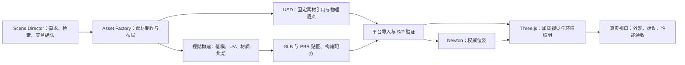

# Lab World 视口真实感

> 状态：流程与技术框架草案；#214 已开始首个外观实验，完整推广与核显目标尚待验证。
> 日期：2026-10-27。
> 基础：[Web 视口契约](LAB_WEB_UI_SPEC_V1.md)、[素材与场景](LAB_ASSETS_AND_SCENES_SPEC_V1.md)、[Scene Factory](LAB_SCENE_FACTORY_SPEC_V1.md)、[USD 规范格式](../adr/0001-usd-canonical-scene-format.md)、[外部工厂分工](../adr/0004-scene-authoring-through-external-factories.md)。

## 已确认的目标

用户希望提升当前 Three.js 场景和素材的外观，访谈已确认：

- **实时写实**：设备形状和细节可信，能分辨金属、塑料、玻璃等材质；机械臂运动和设备操作仍能流畅进行。
- **一个样板先行**：先交付包含机械臂、实验台、仪器和试管的代表性实验室，再提炼可供其他场景复用的能力。
- **控制配置要求**：用户要求“也别太夸张，不吃配置最好吧”。以 Intel Iris Xe 这类核显、1080p 显示条件下稳定 30 FPS 为目标；流畅优先，有余量再增加效果。尚无性能实测结论。
- **验收视角**：实验室全景、台面近景、机械臂运动。能看清仪器轮廓、倒角、接缝和材质差异；不以贴着表面查看微小划痕或每颗螺丝为本期标准。
- **真实材质优先**：保留素材本身的颜色与材质；深浅主题主要改变界面和视口背景。
- **样板内容**：机械臂、夹爪、实验台、离心机、试管架、试管，以及少量实验室布景。整体为可信的新设计，不是某个真实实验室的尺寸复刻。
- **素材投入**：零采购费，优先复用许可合适的现有或官方素材，再用 Blender 补制。关键型号缺素材时报告缺口并与用户选择替代方案。
- **玻璃与液体**：以简化透明、高光和刻度呈现，满足上述三个视角；复杂折射与液体晃动不纳入首期。

这里的外观目标不构成精确尺寸、可信碰撞、质量惯量、关节或行为的证明。沿用现有 Asset、Entity、Dressing 和 Scene Version 的含义，不新增同义术语。

## 首个外观实验（#214）

当前受限例子由 `factory/realism_sample_blender.py` 和 `tools/realism_sample.py`
实现；运行说明见[Scene Factory 指引](../SCENE_FACTORY.md#baked-material-workbench-experiment)。
它实际烘焙仪器外壳的 PBR 图像，产出自包含 GLB，导入普通 Asset 版本并组合可信 FR3。
默认 `realism-workbench-display` 场景固定试管展示，保留机械臂关节操作；仪器为 Dressing。
自由试管版本在延长运行后失稳，作为本票的负结果保留，不能以两秒导入检查代替长期稳定性。
该例子验证外观链路，尚未交付通用烘焙器、每连杆 PBR 视觉或自由搬管资格。
核显目标仍未实测；回归与集成状态在 issue 中记录。

用户随后提供 `D:/Projects/Robots/assets/modeling/` 的单图／Prompt 制作实例，
核对见[参考流程调研](../research/LAB_IMAGE_PROMPT_AUTHORING_REFERENCE_V1.md)。后续上游以
完整的场景美术制作与已有 `.blend` 为输入：保留尺度、细部、材质分区、布景、相机与光照意图，
再构建平台运行派生物。该实例本身交付程序化材质与 Cycles 最终图，尚无烘焙贴图；直接 GLB
试导出也未自动生成贴图，区域灯与体积效果需要额外适配。既有最小样板验证的是技术链路，
不作为完整场景美术质量的验收基准。

## 流程与技术框架

用户在第二轮明确：先研究并确定从建模、搭建场景，到烘焙、导出和平台真实运行的流程；已有的建模与场景 skills 是起点。下述流程优先于样板美术制作。资料、版本与限制见[实时渲染管线调研](../research/LAB_REALTIME_RENDERING_PIPELINE_RESEARCH_V1.md)。

物理与视觉描述同一组实体，物理姿态驱动视觉。USD 仍是规范格式，GLB 是浏览器视觉派生物；流程图的分支是构建职责，不是两份可独立漂移的场景。

### 每一步的输入、职责和产物

| 步骤 | 负责位置 | 输入与产物 |
|---|---|---|
| 需求、检索、灰盒 | 原对话中的 `lab-scene-director` | 用途、尺寸、型号、许可、预算 → 固定素材候选、布局方案和明确缺口 |
| 素材制作 | Blender 与 `factory/` | 可信来源或补制素材 → 可编辑工作文件、运行低模、UV、材质、碰撞及部件身份；物理与外观分别核实 |
| 素材级视觉构建 | 建议补充的工厂构建步骤 | 高细节／程序化材质 → 底色、切线空间法线、粗糙度、金属度、可复用的局部 AO；输出标准 PBR GLB 和配方 |
| 场景搭建 | 外部工厂与 Scene Director | 固定 Asset 版本 → USD 组合、实例位姿、设备绑定和示教位置；标记真正固定与可能运动的内容 |
| 场景级光照构建 | 可选的后续工厂步骤 | 固定布局和照明 → 场景专属间接光贴图；不归入可跨场景复用的素材材质 |
| 导入与验证 | `lab-library` 与现有 HTTP 管线 | 自包含 Asset／Scene 包 → 返回的固定版本、结构与物理报告，以及另行检查的视觉能力／缺口 |
| 平台运行 | Newton 与 Web viewer | Newton 位姿驱动每个刚体视觉；Web 使用标准 PBR、预滤环境反射和受限实时灯光／阴影 |
| 最终验收 | 真实平台视口 | 同一显示规则下的全景、近景和运动检查；核显性能、离线依赖和回放兼容证据 |

现有 `lab-scene-director` 继续编排全流程，`lab-library` 负责导入与验证；烘焙算法、导出和优化由可重跑的工厂脚本实现，skill 负责何时调用、检查输入输出和报告缺口。优先在现有 skill 中补充视觉构建与验收步骤；是否拆出独立 skill 由后续实际复用需要决定。

### 烘焙的默认边界

| 内容 | 推荐处理 | 复用与失效条件 |
|---|---|---|
| 壳体纹理、粗糙度、金属度、微小表面细节 | 先烘焙为素材级 PBR 贴图；轮廓所需倒角留在运行几何中 | 素材几何、UV、材质或烘焙配方改变时重建 |
| 机械臂关节、夹爪、试管等运动内容 | 每个运动部件采用 PBR、法线和自身固定凹槽的 AO；高光和投影随运行姿态计算 | 刚体位姿改变不要求重烘焙材质；不把相邻运动部件或桌面的投影烘焙进去 |
| 房间和固定布景 | 第一阶段采用同样的 PBR 管线；需要更多空间反弹光时再增加场景级间接光烘焙 | 布局、静态遮挡物、灯光、UV／图集或构建配方变化时重新构建场景光照 |
| 玻璃、液体与镜面 | 采用已确认的简化透明与环境反射 | 静态光照贴图不替代视角相关反射／折射，也不产生液体运动 |

第一阶段推荐 **标准 PBR 材质贴图＋局部 AO＋环境照明／反射＋实时运动阴影**。这条路径已有标准 GLB 承载方式，能复用素材、支持运动，并使运行预算可控。能否达到核显目标仍需实测。

场景 lightmap 作为独立的第二阶段能力。glTF 2.0 核心材质没有与 Three.js `lightMap` 一一对应的字段，当前 loader 也不会自动绑定它；不能承诺 Blender 烘焙后直接导出一个 GLB 就会自动获得同样效果。须先验证额外 UV、贴图色彩空间、材质绑定、场景依赖和照明叠加方式。候选承载方式是 GLB 中版本化的应用扩展，或显式场景视觉附属文件，两者都新增可持久化的解释规则；完成最小回读验证和兼容设计后再定，不把未实现字段写入现行公共 schema。

### 产物与可重建性

工厂保留工作文件、引用来源和制作参数；发布包保留规范 USD、本地 GLB 及完整依赖。首期标准 PBR 图像内嵌于 GLB，符合当前录制和静态预览要求的自包含视觉格式；仅把外部贴图放进素材目录不足以满足录制冻结。新增视觉构建配方建议记录输入内容哈希、几何／UV 版本、每张贴图的语义与色彩空间、烘焙类型和通道、排除的运动遮挡物、工具／配方版本、采样与随机种子、输出哈希和已知近似。场景光照还需记录固定布局、灯光和环境的依赖；引入附属文件时须同时实现录制依赖冻结。

这些是建议的构建记录内容，尚未给现行 Asset、Scene 或协议添加字段。材质变化、场景光照变化和运行位姿变化按各自依赖处理，避免每次机械臂运动都触发烘焙，也避免更换布局后复用旧光照。输出字节变化仍走新版本导入；重新构建不被假定为跨硬件逐字节相同。

## 已核实的实现事实

以下为 `049192db` 的静态代码调查，并非对用户当前会话画面的实测诊断：

| 环节 | 现状 | 对方案的意义 |
|---|---|---|
| 浏览器模型加载 | `apps/web/src/lib/scene/visual-assets.ts` 使用 GLTFLoader 加载 GLB | 已有浏览器 PBR 素材路径，可在现有 Three.js / react-three-fiber 基础上改进 |
| 基本几何体 | `apps/web/src/components/viewer/NodeVisuals.tsx` 使用统一主题色、粗糙度、金属度和折边线 | 基础几何体本身不能呈现缺失的壳体细节、倒角和接缝 |
| GLB 外观 | 同一组件给无底色贴图的材质混入 35% 主题色，并覆盖自发光设置 | 原创作外观与当前工作台主题存在真实取舍，需明确主题适用范围 |
| 灯光 | `apps/web/src/components/viewer/SceneViewport.tsx` 使用半球光、单方向光和 1024² 阴影贴图；Canvas 使用 `flat` | 目前照明简单；环境反射与色调处理值得作为候选方向验证 |
| 示例内容 | `packages/sim_runtime/synthetic_lab.py` 以基础几何体构造实验室；离心机 reference 素材声明没有 GLB | 需要实际的素材制作，单改灯光无法完成外观目标 |
| Newton 网格导出 | `packages/sim_runtime/mesh_assets.py` 重新导出顶点、索引、可选法线，未复制 UV、材质和纹理 | GLB 文件存在不等于保留来源材质；需逐项区分原生网格导出和 provided GLB 路径 |
| 外部来源适配 | `factory/simready.py` 与 `factory/support.json` 仅支持受限 UsdPreviewSurface 转换，MDL、UDIM 等有缺口 | 不能承诺所有外部素材导入后复现上游渲染；缺口继续明确报告 |
| 运动归属 | `packages/sim_runtime/library_scene.py` 将 provided GLB 归属到实际刚体 | 关节机构的视觉必须正确随各刚体运动，整机静态网格不能替代关节视觉 |
| Blender 工作区 | `factory/blender_author.py` 只提取布局和稳定身份，检查程序化网格；`factory/authoring.py` 用原固定素材重新组合 | 在工作区调整材质不等于发布新的视觉，需补充真正的视觉导出／构建路径 |
| 纹理压缩 | 当前 loader 没有配置 KTX2／Draco／Meshopt 解码器，`packages/library/visuals.py` 的图像尺寸检查不识别 KTX2 | 压缩能力需要同时补齐构建、验证、加载和兼容检查；第一阶段标准 PNG／JPEG 贴图先打通 |

## 实现方向

以下为基于已确认目标与调研事实整理的推荐方案，尚未开始实现。

### 1. 素材与外观链路

沿用 Three.js / react-three-fiber，先把已有 PBR 能力用完整。首先核对样板实际使用的每份视觉：来源、固定版本、网格、UV、底色、法线、金属度／粗糙度，以及在浏览器中的加载结果。将原生网格导出、provided GLB 和外部来源适配分别检查；仅修复样板和共享渲染实际需要的路径，不以本票承诺通用 USD／MDL 转换。

创作材质作为普通显示时的依据。主题切换保留设备颜色、材质参数和自发光语义；选中、碰撞检查与幽灵预览仍提供清楚的状态反馈，退出临时状态后恢复原貌。基本几何体回退继续可用，缺失的真实视觉明确作为缺口显示。

### 2. 形体与材质制作

机器人与夹爪优先沿用准确型号的可信来源和原有物理资产；为运动部分建立正确的刚体视觉归属。视觉网格按运动部件拆分并核对局部变换，使用现有 Manifest 的节点视觉能力，不把整机静态网格当作可动机械臂。

台面、离心机外壳、试管架和试管优先复用合适素材，缺少时由外部工厂补制。制作预算重点放在轮廓、倒角、接缝、面板和材质差异；刻度、标签和微小表面细节优先用贴图或法线呈现。金属、涂装塑料、工作台和玻璃应在相同光照下能够辨认。

沿用 Asset Factory、USD 规范格式、本地自包含的 GLB 和不可变导入。保存来源、许可与修改记录，新增或衍生素材有自己的版本。几何改变影响物理边界时，按既有规则重新验证；外观变好不替代碰撞与设备行为验证。

### 3. 照明与显示

采用本地预处理的环境照明／反射，让金属和塑料获得合适的反光；核对色彩空间、曝光和色调映射，保证材质外观可预期。环境与材质随素材在本地使用，避免运行时依赖远端贴图。

静态环境可以预先制作局部遮蔽或表面细节；机械臂、试管和可动部件的阴影必须随当前姿态更新。以受限的实时灯光和阴影建立空间关系，避免把可动物体的影子固化进台面。玻璃和液体按已确认的简化方案制作，检查透明物体之间的遮挡和排序。

默认保留现有相机交互和取景行为；在全景与台面近景检查效果。会话、场景和素材详情采用一致的材质与显示规则，列表卡片继续使用静态预览图，并在样板定稿后重新捕获相应预览。

### 4. 性能取舍

以核显性能目标约束网格、材质数量、纹理、阴影和渲染分辨率。先复用几何／材质、实例化重复物件，减少不必要的实时计算。按实测选择阴影与分辨率档位；降档时保持核心物件、动作和操作入口完整，并记录实际绘图缓冲尺寸。1080p 指显示条件，不把降低后的内部渲染分辨率冒称原生 1080p。

现有单素材 500k 三角形、4096² 贴图等上限仍然适用，但上限不是推荐预算，也不是核显性能保证。样板的总预算从实际测量反推，超出目标时优先减少实时效果开销，再优化素材。首期不以实时光追、屏幕空间反射、多层玻璃折射、体积效果或液体模拟作为画质前提。

本机硬件清单包含 RTX 3070 Ti Laptop 和 Intel Iris Xe。验收记录浏览器实际渲染设备；独显或软件渲染结果不能充作核显达标证据。若无法在当前环境核实或启用核显，保留本机已测结果并将核显目标标为未验证。

## 验收与证据

| 维度 | 验收方式 |
|---|---|
| 外观 | 在真实平台视口中，以固定全景和台面近景比较改进前后；检查轮廓、倒角、接缝、金属／塑料／玻璃差异和物体落地感 |
| 运动 | 播放真实关节与物体运动，检查各部件视觉归属、夹爪和试管对齐、遮挡、透明排序与运动阴影；不将本次外观验收当作新的抓取成功结论 |
| 主题与状态 | 深浅主题均保留创作材质；选中、取消选中、碰撞检查和幽灵预览切换正确 |
| 性能 | Iris Xe 或同等级核显、1920×1080 显示条件下，全景、台面近景和运动／环绕各预热后连续采样 60 秒，以平均至少 30 FPS、有效渲染帧间隔 P95 不超过 33.4 ms 作为稳定目标；排除资源尚未就绪的初次加载，加载时间另行记录 |
| 可复现性 | 固定 Scene Version、Asset 版本、相机、动作序列和画质档位；记录实际 GPU、浏览器版本、显示与绘图缓冲尺寸、DPR、可见视口数和采样条件；不以隐藏标签页、静止画面或独显结果替代核显运动实测 |
| 集成 | 样板可由平台启动，在浏览器看到并操作；本地依赖齐备后离线仍可加载；确认原有录制回放和操作入口保持可用 |

功能测试覆盖普通显示保留材质、运动视觉归属和既有操作路径。实现阶段按 `docs/VERIFICATION.md` 完成强制回归与适用的 Newton CPU 检查，GPU-free CI 继续作为门禁。外观最终由用户在真实视口验收，性能记录测量条件和差距；未达目标不标记通过。

原始截图、材质调查、测量和检查回执留在 `.scratch/`，规格及最终交付记录保留结论和关键数字。最初的资料调研没有运行烘焙或场景；随后 #214 已开展实际制作与运行，当前范围与缺口见“首个外观实验”，不将其视为完整推广或核显资格。

## 交付顺序

1. **先确定构建流程与支持范围**：以本调研为依据，明确素材级 PBR 烘焙、场景级光照和运行照明的边界、产物与失效规则。
2. **最小端到端验证**：用一个静态物件和一个可动部件，验证 Blender 制作／烘焙 → 自包含 GLB 回读 → 现有导入 → 真实平台显示与录制回放，核对 UV、法线、颜色、AO、刚体运动和材质恢复。
3. **补齐共享能力和 skill 步骤**：按已验证路径实现工厂视觉构建、依赖与能力检查、共享 PBR 显示和环境照明；压缩配置与验证器成对推进。补充 Scene Director 和库操作的制作／验收指引。
4. **制作样板与核显交付**：再固定机器人与夹爪来源，细化实验台和仪器，完成真实平台外观、运动、离线与回归验收，测量并优化到核显目标，提供固定版本的启动命令。

场景 lightmap 作为后续独立能力：另做带／不带反弹光与运动物体的最小对照，验证后才选择承载规则，不阻挡第一阶段标准 PBR 管线与样板交付。

启动命令在实现时采用真实导入返回的 Scene Version 填写，不在草案中虚构已存在的样板版本。

## 与既有规格的关系

本方案确认后，实施时同步修订 `LAB_WEB_UI_SPEC_V1.md` §1.4 与 §4：真实素材不再因深浅主题被统一调色；示意材质令牌与折边线主要用于回退或诊断显示，普通写实显示采用素材外观。相关素材与 Scene Factory 规格记录本样板目标和受限材质支持，继续沿用外部工厂分工，不新增 Web 建模流程。

现有协议、录制回放、entityKey、Newton 坐标与设备动作管线继续作为设计约束。若实现调查发现必须修改这些契约，先单独呈现具体变化和兼容方案，由用户决定。当前方案未要求契约变更；此类调查结果不能作为自行扩展范围的理由。

画质和性能目标沿用前述确认。用户本轮要求先调研流程与技术框架，本文不把调研建议视为实现授权。当前无新增的领域术语，沿用根术语表及 ADR 0001、0003、0004；场景光照的持久化解释规则若获选，再记录实际取舍及兼容边界。
