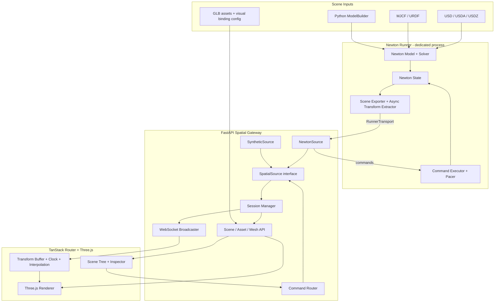

# Newton Spatial Sync Platform

> **Technical Specification v1.2**  
> 日期：2026-10-16  
> 状态：Ready for implementation（未决项集中在 §17，均已给出默认值；未另行决定前按默认值执行）  
> 取代：v1.1（2026-10-16）  
> 技术栈：TanStack Router · React · TypeScript · Three.js / React Three Fiber · FastAPI · Newton Physics · NVIDIA Warp

## 变更记录

### v1.2

| # | 变更 | 涉及章节 |
|---|---|---|
| 1 | 插值不跨越空白期：相邻帧间隔超过 3 个帧周期时直接跳到新帧；resume 后立即发帧；标签页回到前台时重置时钟偏移窗口 | §5.5、§8.4、§10.1 |
| 2 | 命令产生的帧（resume / step 帧、reset 快照）改走可靠通道，严格按 frame → ack → state 顺序投递 | §3.2、§5.2、§5.5、§7.3 |
| 3 | MVP 不使用共享内存：周期帧走独立的帧 Pipe，两端各用线程 + latest-only 槽；共享内存移至 P2-C，并附实现规则 | §7.3、§11、§12 |
| 4 | 关节约束误差定义修正：扣除沿关节自由度的正常运动；joints 新增 `parentLocalPose`、`axis` | §4.4、§5.1 |
| 5 | Newton mesh shape 导出格式改为 GLB | §1.2、§2、§4.5、§5.1、§6 |
| 6 | 每个 WebSocket 连接由唯一的 pump task 负责发送；可靠队列满或单次发送超时即断开 | §7.3、§10.1 |
| 7 | USD 实体在导入后立即用 `path_*_map` 把 label 改写为 Prim Path（D-09 定稿） | §4.2、§12、§15、§17 |
| 8 | playoutDelay 改为按帧周期计算，默认 2 × 帧周期（D-11） | §8.4、§17 |
| 9 | 补充 MuJoCo 相关依赖的锁定要求（D-01、D-03）；新增 D-15 约束误差显示范围 | §17 |

### v1.1

| # | 变更 | 涉及章节 |
|---|---|---|
| 1 | 稳定 ID 统一取自 Newton 实体 label；Python / USD / MJCF / URDF 共用一条 ID 路径 | §4.2 |
| 2 | 新增 MJCF / URDF 场景输入（机械臂的主要来源） | §1.2、§2、§4.2 |
| 3 | Marker 一律由 Newton Site 导出；关节锚点以子侧为权威值，父侧差值作为约束误差 | §4.4、§5.1 |
| 4 | Primitive 协议采用 Newton 几何语义（半边长、Z 轴）；新增 mesh 导出接口；区分 visual 与 collider | §4.3、§4.5、§5.1、§6 |
| 5 | 初始化与 reset 后显式执行正运动学（`eval_fk`）；静/动分类改用 `shape_body` 与 `is_kinematic` | §3.1、§7.4 |
| 6 | 新增时间节拍定义：`realtimeFactor`、`sampleTimeMs`；前端按采样时钟插值，simTime 只用于显示 | §3.2、§5.3、§8.4 |
| 7 | 新增 `epoch`；`seq` 在 Session 内全局单调 | §5.3、§5.5 |
| 8 | 暂停语义修正：`session.state` 全员广播、心跳、暂停中 `step` 必须出帧；frame 移除 `paused` 字段 | §5.4、§5.5、§8.4 |
| 9 | 明确多客户端控制权规则 | §5.5、§17 |
| 10 | Manifest 新增 group 节点、`joints`、`sites`、`warnings` | §5.1 |
| 11 | Manifest 与 WebSocket 的 revision 一致性规则 | §5.2 |
| 12 | 新增 `SpatialSource` 抽象与 `SyntheticSource`，从远景提前到 P0 | §0、§3、§7.1、§12 |
| 13 | GPU 异步读回、共享内存帧槽、单次编码广播等实现约束 | §7.2、§7.3、§9 |
| 14 | Pose API 改为查询参数 | §6 |
| 15 | 预留 `entity.state` 事件信封（服务 Lab World 的设备状态） | §5.6 |
| 16 | P0 引入 Newton ViewerViser 作为参考画面 | §1.5、§8.5、§12 |
| 17 | 测试分为 CI 门禁与非门禁两层，门禁只保留快速、无 GPU 的测试 | §13 |
| 18 | 新增待决策清单 | §17 |

## 0. 一句话定义

建设一个 **Newton → FastAPI → Three.js** 的实时空间同步平台：Newton 是运行中物理场景及运动状态的唯一事实源；FastAPI 提供场景查询、对象映射、Transform 流与受控操作；Three.js 加载对应可视化资产，并根据物理世界位姿实时更新画面。

网关不直接依赖 Newton，而是依赖 **SpatialSource** 抽象。Newton Runner 是主要实现；SyntheticSource（无物理、无 GPU 的确定性合成运动源）用于前端开发、E2E 与 CI；回放源和真实设备源是后续实现。Viewer 与协议对所有来源保持不变。

它是一个**轻量 Spatial Transform Bridge**，不是 Newton 全量 State 镜像、浏览器物理引擎，也不是通用数字孪生业务平台。架构应能作为 Lab World 的独立基础设施使用，而不依赖 Lab World 才能工作。

## 1. 背景、范围和术语

### 1.1 目标用户体验

开发者启动 Newton 场景后，在浏览器打开 Web Viewer：

1. 自动读取场景结构，显示工作台、机械臂、试管、设备等对象。
2. Newton 推进物理仿真；浏览器看到机械臂连杆、试管及其他运动刚体的实时运动。
3. 在对象树或三维画面选择任意 Body，可以看到该 Body 的世界位置、旋转、最近更新时间和 Newton 绑定信息。
4. 在机器人关节上选择锚点（Site），可以查看**关节锚点的世界坐标**。Body 原点与关节锚点不是同一概念。
5. 在浏览器中 Pause / Resume / Reset / Step；命令由 Newton Runner 接收并执行，浏览器不得私自更改权威物理状态。
6. 两个浏览器可以同时观察同一 Newton Session；不为每个浏览器重启仿真。
7. 暂停、重置、场景重载等状态变化，所有观察者同步可见。

### 1.2 MVP 包含

- 一个 Newton 仿真进程，一份权威物理状态，一个 FastAPI 网关；支持多个 Web 观察者。
- 场景来源：`ModelBuilder` Python 场景；`ModelBuilder.add_usd()` 导入的 USD；`add_mjcf()` / `add_urdf()` 导入的机器人。
- 所有实体以 Newton label 生成稳定 entityKey（§4.2）。
- 静态几何初始化，运动刚体位置 + 四元数实时同步。
- Three.js 资产：基本几何体必需；Newton mesh shape 导出为 GLB；GLB/GLTF 绑定；缺失时使用可辨认的占位几何体。
- Body / Site / Joint 选择与 Inspector，基本相机控制、场景树、实时数据监控。
- WebSocket 状态流与 `session.state` 广播，HTTP 场景/快照/查询 API，命令闭环与错误响应。
- 发布频率与实时率可配置，前端插值、断线重连、场景重载恢复。
- SyntheticSource：不依赖 Newton/GPU 即可运行前端与 E2E。
- `entity.state` 事件信封：只定义协议并透传，MVP 不要求有生产者。
- CPU 开发路径；有 NVIDIA GPU 时支持 CUDA，并量化 GPU→CPU 同步成本。

### 1.3 MVP 不包含

- 同步全部 Newton `State`（力、接触细节、粒子等）。
- 浏览器侧重新求解物理，或把拖拽 Three.js 对象当作权威物理修改。
- 支持所有 OpenUSD Physics、材质和复杂 USD Schema 的无损浏览器渲染。
- 复杂机器人控制器、真实设备接入、ROS 2、OPC UA、多人协作编辑。
- 动态修改 Newton 已 finalize 的模型拓扑；场景增删通过停止、重建和切换 `sceneRevision` 实现。
- 软体、流体、粒子顶点流；与刚体 Transform Stream 区分，未来以扩展通道实现。
- Redis/Kafka/持久数据库、云端多租户调度、跨服务器的 Session 编排。

### 1.4 术语与权威关系

- **Newton Model**：运行中的物理模型、Body/Shape/Joint 结构；物理结构事实源。
- **Newton State**：时间变化的完整物理状态；由引擎维护，不传给浏览器。
- **Transform**：从 State 按需抽取的 Body 世界坐标系位姿 `(position xyz + quaternion xyzw)`。
- **Label**：Newton 实体（body / shape / joint / site）上的字符串标签；entityKey 的来源。
- **Site**：Newton 中不参与碰撞、无质量、相对父 Body 有位姿的参考点（实现上是带 SITE 标志的 shape）。本平台的 Marker 全部来自 Site。
- **OpenUSD**：可选场景来源/资产描述；导入后不替代运行中 Newton 模型的事实源地位。
- **Scene Manifest**：基于 Newton Model 和可视化资产映射生成的浏览器最小场景结构。
- **Scene Revision**：场景结构版本；重载/重建时更新。
- **Epoch**：同一 Scene Revision 内的时间线编号；每次 reset +1。
- **Physics Body ID**：Newton 内部整数索引，仅在当前模型生命周期有效。
- **Entity Key**：外部稳定路径式 ID（如 `/World/Lab/RobotA/Link2`）。
- **Stream ID**：`uint32`，仅在当前 Scene Revision 中分配，用于紧凑的实时消息。
- **Realtime Factor (RTF)**：simTime 推进速度与墙钟之比。
- **sampleTimeMs**：Runner 抽取该帧时的系统单调时钟（毫秒），前端插值时间轴的依据。
- **SpatialSource**：网关侧的空间数据来源抽象（§7.1）。
- **Session**：一个权威空间数据来源的生命周期；对 Newton 而言即 Model + State + Runner。

### 1.5 为什么不直接使用 Newton 自带 Viewer / Viser

Newton 已提供统一的 viewer 接口（`set_model` → `begin_frame` → `log_state` → `end_frame`）和多个后端，包括基于浏览器的 ViewerViser、ViewerRerun 以及可录制的 ViewerFile。本项目仍然自建，原因如下：

1. 需要多客户端共享同一 Session 的网关，以及带确认的受控命令闭环；
2. 需要 TanStack 工作台（场景树、Inspector、诊断），并最终嵌入 Lab World；
3. 需要与来源无关的版本化协议，以便接入回放源和真实设备源。

同时充分利用 Newton 已有能力：P0 用 ViewerViser 跑同一场景作为参考画面，排查轴向、原点和尺寸错误；Shape → 可视几何的映射逻辑参考 `newton.viewer` 的实现。

## 2. 已确定的技术选择

| 模块 | 技术 | 决策原因 |
|---|---|---|
| 前端 | React + TypeScript + TanStack Router + Vite | 清晰的 SPA 路由与独立前后端开发 |
| 3D | Three.js + React Three Fiber | Three.js 渲染能力和 React 页面组合；每帧更新直接操作 Object3D，不触发 React 重渲染 |
| UI | shadcn/ui（可选）+ CSS/Tailwind | 轻量工程工作台风格；不引入重型编辑器 |
| API | FastAPI + Pydantic v2 + Uvicorn | HTTP、WebSocket、Schema 验证；独立控制面 |
| 来源抽象 | `SpatialSource` 接口 | 解耦网关与 Newton；支持合成、回放、真实设备源 |
| 仿真 | Newton Physics / NVIDIA Warp | 唯一权威物理引擎；可 CPU/GPU 运行 |
| Solver | 场景显式配置 | 简单刚体可用 XPBD；多关节机器人默认 SolverMuJoCo，Featherstone 作对照（D-03） |
| 场景输入 | Python ModelBuilder；USD；MJCF/URDF | 零资产场景可运行；机器人资产主要来自 MJCF/URDF；保留 USD 互操作 |
| 视觉资源 | primitive + GLB/glTF（Newton mesh shape 也导出为 GLB） | 浏览器性能可控；不要求浏览器运行完整 USD 解析器 |
| 网络 | HTTP + WebSocket | Scene/Assets 偶发传输、Transform 高频传输、Command 双向确认 |
| 数据持久化 | MVP 不使用数据库 | 场景配置、资产映射、示例文件在代码仓库；缓存状态在内存 |
| 进程隔离 | Newton Runner 独立进程 | 避免阻塞 FastAPI event loop，隔离 GPU 上下文、崩溃与资源回收 |

**部署约束**

- 第一阶段一个 API worker + 一个 Newton Runner。不要把 Uvicorn 调成多 worker 后各自启动一个重复仿真。
- Runner 通过 `spawn` 启动独立 Python 子进程（避免 CUDA fork 上下文问题）；进程间通信封装为 `RunnerTransport`（§7.3），未来才替换为远程传输。
- Newton / Warp 精确版本写入 `pyproject.toml`（D-01）。Newton API 迭代很快（例如实体名称字段近期由 `*_key` 更名为 `*_label`），任何 API 假设都以锁定版本的 smoke test 为准。

## 3. 总体架构与数据流



### 3.1 冷启动顺序

1. 启动 FastAPI Gateway，健康接口先可用。
2. 创建 Session 时选择来源：`newton`（启动 Runner 子进程）或 `synthetic`。
3. Runner 加载场景：Python Builder、`add_usd()`、`add_mjcf()` 或 `add_urdf()`；子资产通过 `add_builder(label_prefix=...)` 组合（§4.2）。
4. 构建期生成关节锚点 Site（§4.4），然后 `builder.finalize()`，构造 Solver、State、Control。
5. **执行 `newton.eval_fk`，使 `body_q` 与 `joint_q` 一致。** 广义坐标求解器（MuJoCo、Featherstone）必须执行；对其他求解器执行也无害。
6. 从 model 的 label 生成 entityKey 并校验唯一性；导出 Manifest（nodes / sites / joints / warnings），设置 `sceneRevision`、`epoch=0`。
7. 抽取初始**完整 Transform Snapshot**（不要求先运行一个物理步）。
8. 前端 GET Manifest → 加载视觉资产 → 打开 WS → 校验 `server.ready.sceneRevision` → 订阅 → 接收 `stream.snapshot`。
9. 后续接收 `transform.frame`；Three.js 渲染循环按采样时钟插值（§8.4）。

### 3.2 运行循环

- 物理求解频率和网络发布频率独立配置。默认 `physics_dt=1/240s`、`publish_hz=30`，不承诺固定实时吞吐。
- **节拍控制**：`realtimeFactor` 默认 1.0（D-04）。Runner 按墙钟限速，simTime 的推进不超过"墙钟流逝 × RTF"。落后时追赶上限为 `max_lag`（默认 250 ms），超出部分直接放弃，并通过 `session.state` 和诊断面板报告实际 RTF。`realtimeFactor=null` 表示不限速（训练或预演用）。
- `publish_hz` 按墙钟计时，与 RTF 无关。
- Runner 持有唯一可写 State，按物理子步执行；控制命令在安全的步间边界应用。GPU 下建议对 substep 循环做 CUDA graph capture，命令在两次 graph launch 之间生效。
- 若选 SolverMuJoCo，遵守该 Solver 的接触管线接口；**不可假定每种 Solver 都使用同一套 `collision_pipeline.collide()` 调用**。
- 发布周期批量抽取 State（§7.2），严禁逐 Body 触发 GPU→CPU 读取；读回不得阻塞 solver 主流。
- 周期发布的运动帧走 latest-only 帧通道（旧帧可覆盖）；场景变更、状态变化、命令结果以及命令产生的帧走可靠通道（不可丢、保序，§5.5）。
- FastAPI 不参与物理步进，不缓存可写 Physics State，只缓存最近已发布的只读空间快照。
- 无浏览器时是否继续仿真由 Session 配置决定，默认继续（D-10）；关闭 Session 时清理 GPU/CPU 资源。

## 4. 场景对象、变换与视觉绑定

### 4.1 对象模型

```text
Session
 └─ SceneRevision
     └─ Epoch（每次 reset +1）
         ├─ GroupNode（逻辑分组：设备、机器人；不是 Newton Body，没有 Transform）
         ├─ StaticVisualNode（shape_body = -1 的全局静态 Shape）
         ├─ BodyNode（运动或可能运动的刚体）
         │   ├─ Visual（一个 Body 可有多个；primitive / mesh / glb）
         │   ├─ Collider（调试层，来自参与碰撞的 shape）
         │   └─ Site（Marker：关节锚点、末端执行器点等）
         └─ JointInfo（关节元数据：类型、父/子 Body、锚点 Site）
```

Body Node **不是** Mesh：一个 Body 可能有多个碰撞 Shape 和多个视觉 Mesh。`model.shape_body` 给出 Shape 所属 Body，`model.shape_transform` 给出其 Body 局部变换。Mesh 几何体不逐帧同步；前端计算 `worldBodyPose × localVisualPose`。

`shape_body=-1` 的全局静态 Shape 作为 StaticVisualNode 出现在 Manifest 中，不能从 `State.body_q` 按 Body 索引读取。

设备是逻辑分组（GroupNode），例如离心机由固定外壳和旋转转子组成，机械臂由多个 Link Body 组成。设备本身不必是一个 Newton Body。

### 4.2 稳定 ID：entityKey = 规范化后的 Newton label

所有来源共用同一条 ID 路径：构建或导入时为实体设置 label，finalize 后从 model 读取 label 生成 entityKey。

- **Python 场景**：为每个 body / shape / joint / site 传入 `label`。推荐用子 builder 构建设备，再以 `add_builder(sub, label_prefix="World/Lab/RobotA")` 组合层级（Newton 用 `/` 拼接前缀与标签）。
- **MJCF / URDF**：导入到子 builder，再用 `add_builder(..., label_prefix=...)` 挂到场景路径下；link / joint / site 名作为末段。
- **USD**（D-09）：USD 场景直接导入主 builder（Prim Path 本身就是全局路径，不再加 label_prefix）。`add_usd()` 返回后，立即用 `path_body_map` / `path_shape_map` / `path_joint_map` 把 builder 上对应实体的 label 改写为 Prim Path。下游仍然只认 label，不依赖 Newton 内部的 label 生成细节。builder 上 label 列表的字段名以锁定版本为准，可行性在 P0-A 验证。
- **规范化**：确保以 `/` 开头；禁止空段、`?`、`#`；大小写敏感。
- **唯一性**：finalize 后校验。重复 label 导致加载失败，并报告冲突实体。
- **缺失 label**（D-08）：默认生成 `/__unlabeled/{kind}_{index}`，在 Manifest 中标记 `stableKey: false` 并写入 `warnings`；strict 模式下直接加载失败。
- **字段名**：model 上 label 数组的属性名以锁定版本为准（近期版本由 `*_key` 更名为 `*_label`）。
- Newton 原生 index 仅在当前模型生命周期有效，可放在 Manifest 的 `debug` 字段用于排障，不得用作持久主键或用户书签。
- `streamId` 每个 Scene Revision 重新分配。外部 API 一律使用 entityKey，实时传输使用 streamId。

示例：

```text
/World/Lab/RobotA/Link2
/World/Lab/RobotA/Joint2/anchor
/World/Lab/CentrifugeA/Rotor
/World/Lab/Tube001
```

### 4.3 坐标、单位与几何约定

- **线性单位**：米（m）。
- **坐标参考**：右手世界坐标系，规范化为 Z-up。导入 Y-up USD 时只做一次转换，不得重复转换。
- **位姿**：Body 在世界系中的 Transform，不是父节点局部 Transform。
- **四元数**：`[qx,qy,qz,qw]`（与 Newton/Warp 一致），单位化；插值时保证相邻四元数同半球。
- **Three.js**：建立 `physicsRoot`，统一完成 Z-up→Y-up 映射（绕 X 轴 -π/2）；其下运动 Body 容器保持与 Newton 相同的世界位姿语义。
- **渲染层级**：运动 Body 在 `physicsRoot` 下平铺，每个 Body 的 Mesh 子节点应用自身 `localPose`；场景树上的逻辑父子关系不等于 Three.js Transform 继承关系。
- **GLB**：绑定配置必须声明 `assetUpAxis`、比例和 `localPose`（§4.5）；不能假定 Body 原点就是 Mesh 原点。

**Primitive 约定**：协议中的 primitive 参数一律采用 Newton 语义，前端由单一工厂函数转换为 Three.js 几何体。轴向旋转在几何体本地空间烘焙一次（`geometry.rotateX(Math.PI/2)`），再应用 `localPose`。

| Newton 形状 | 协议字段（Newton 语义） | Three.js 构造 | 转换 |
|---|---|---|---|
| Box | `halfExtents: [hx,hy,hz]`，原点在几何中心 | `BoxGeometry(2hx, 2hy, 2hz)` | 尺寸 ×2 |
| Sphere | `radius` | `SphereGeometry(r)` | 无 |
| Capsule | `radius`、`halfHeight`（不含半球帽），沿 +Z | `CapsuleGeometry(r, 2·halfHeight)` | 绕 X 轴 +π/2（Y→Z） |
| Cylinder | `radius`、`halfHeight`，沿 +Z | `CylinderGeometry(r, r, 2·halfHeight)` | 绕 X 轴 +π/2 |
| Cone | `radius`（底面）、`halfHeight`，底面在 -halfHeight，锥顶在 +halfHeight | `ConeGeometry(r, 2·halfHeight)` | 绕 X 轴 +π/2（Three.js 锥顶 +Y → +Z） |
| Plane | `width`、`length`（0 表示无限），法线 +Z | `PlaneGeometry`（无限平面用大尺寸网格） | 无（法线同为 +Z） |
| Mesh | `meshId`、`scale` | `BufferGeometry` | 见 §4.5 |

Newton 中不被浏览器直接支持的形状（SDF、heightfield、带 `barrel_radius` 的圆柱等）降级为包围盒占位，并写入 `warnings`。

### 4.4 关节锚点与 Site

用户点选机器人 `Joint_3` 时关心的是**关节锚点的世界位置**，不是 Link Body 原点。

- Marker 一律来自 Newton Site。MJCF / USD 资产中的 site 会被导入器自动带入。
- **关节锚点生成**（D-14）：构建期（finalize 前），对所有非 free 关节，在子 Body 上以该关节的子侧变换调用 `add_site` 生成 Site，label 为 `{jointLabel}/anchor`，`role="joint-anchor"`。若资产中已存在同名 Site，直接复用。`add_body()` 隐式创建的 free joint 不生成锚点。
- **权威计算**：锚点世界位姿 = 子 Body 世界位姿 × Site 局部位姿（子侧）。
- 前端可以自行派生 Site 世界位姿，但基础必须是 Newton 提供的 Body 世界位姿和 Manifest 中的局部位姿。
- 至少一个关节样例需用 Newton 侧独立计算与浏览器显示做交叉验证。

**约束误差**（P1，可选；D-15）

- 父侧锚点 = 父 Body 世界位姿 × `parentLocalPose`；父 Body 为世界（`parentBodyKey=null`）时，`parentLocalPose` 即世界系位姿。
- 子侧锚点 = 子 Body 世界位姿 × 锚点 Site 局部位姿（即权威锚点）。
- 关节轴 `axis` 定义在父侧锚点坐标系中（与 Newton 约定一致）。
- 父子两侧沿关节自由度的相对运动是正常运动，不是误差，计算时必须扣除：

| 关节类型 | 位置误差 | 角度误差 |
|---|---|---|
| fixed | ‖p_parent − p_child‖ | 相对旋转的完整角度 |
| revolute | ‖p_parent − p_child‖ | 对相对旋转做 swing-twist 分解（twist 轴 = axis），只取 swing 角 |
| prismatic | 位置差在父侧锚点坐标系中扣除沿 axis 的分量后取模 | 相对旋转的完整角度 |
| ball | ‖p_parent − p_child‖ | 不计 |
| free | 不计 | 不计 |
| 其他（D6 等多自由度） | MVP 不计，Inspector 标注"未支持" | 不计 |

MVP 只显示位置误差，角度误差放到 P1 后段。广义坐标求解器下误差应接近 0；XPBD 等最大坐标求解器下可能非零。

### 4.5 视觉资产与形状导出

- **visual 与 collider**：带 VISIBLE 标志的 shape 进入 `visuals`；参与碰撞的 shape 进入 `colliders`（调试层）；同时具备两者的 shape 两边都出现。导入时可通过 `load_visual_shapes`（USD）/ `parse_visuals`（MJCF）控制视觉 shape 的加载。
- **Mesh shape**：Runner 用 trimesh 把 Newton mesh shape 的顶点和三角形导出为 GLB，通过 `GET /api/v1/sessions/{id}/meshes/{meshId}` 提供（`model/gltf-binary`），前端复用 GLTFLoader，不需要自定义解析器。`meshId` 为内容哈希，可长期缓存。GLB 内数据保持 Newton 的 Z-up Body 局部坐标，Manifest 中对应 visual 标注 `assetUpAxis: "Z"`，前端不做轴向转换。shape 的 `scale` 由 Manifest 给出，不烘焙进 GLB，同一 mesh 可按不同 scale 复用。加载后若没有法线，由前端调用 `computeVertexNormals()` 生成。
- **GLB 绑定**：`assets/bindings/*.yaml` 按 entityKey 配置 `{url, localPose, scale, assetUpAxis}`。前端统一应用 `assetUpAxis` 转换，不要求逐资产手调 `localPose`。
- **回退链**：GLB 绑定 > Newton visual shape（primitive / mesh）> collision shape > 占位几何。每次回退写入 `warnings`，不阻断其他对象。

### 4.6 OpenUSD 策略

- Newton runtime 为事实源：USD 用于初始化、资产组织及身份绑定，不是每帧更新的中间格式。
- 第一版至少演示一个 `add_usd()` 场景、一个 MJCF/URDF 机器人和一个 Python Builder 场景。
- 优先以离线资产转换或已配对 GLB 供 Three.js 使用；USD→GLB 自动转换不是 MVP 硬依赖。
- 对不支持的 USD Schema 或渲染材质必须给出明确的兼容报告（Manifest `warnings`），不能静默忽略重要物理 Body。

## 5. 数据契约（协议版本 1）

以下消息属于应用**自定义传输协议**，不是 Newton 原生格式，也不是 OpenUSD 实时协议。v1.0 草案未实现，因此协议版本号保持 1，本节字段为协议 1 的正式定义。

Schema 的唯一事实源是 `packages/protocol` 中的 Pydantic 模型；由其生成 JSON Schema 和 TypeScript 类型。前端只对 Manifest 等低频消息做运行时校验，高频帧不做逐帧校验。

### 5.1 Scene Manifest

`GET /api/v1/sessions/{session_id}/scene`（响应 `ETag` = sceneRevision）

```json
{
  "protocolVersion": 1,
  "sessionId": "session-001",
  "sceneRevision": "rev-0001",
  "revisionNumericId": 1,
  "epoch": 0,
  "sceneName": "lab-demo",
  "source": {
    "kind": "newton",
    "newtonVersion": "<locked>",
    "solver": "SolverMuJoCo",
    "physicsDt": 0.0041666667,
    "basePublishHz": 30,
    "realtimeFactor": 1.0
  },
  "coordinates": {
    "handedness": "right",
    "upAxis": "Z",
    "units": "m",
    "quaternionOrder": "xyzw",
    "poseSpace": "world",
    "primitiveConvention": "newton"
  },
  "nodes": [
    {
      "entityKey": "/World/Lab",
      "kind": "group",
      "name": "Lab",
      "parentEntityKey": null
    },
    {
      "entityKey": "/World/Lab/RobotA",
      "kind": "group",
      "name": "RobotA",
      "parentEntityKey": "/World/Lab"
    },
    {
      "entityKey": "/World/Lab/RobotA/Link2",
      "kind": "body",
      "streamId": 17,
      "name": "Link2",
      "parentEntityKey": "/World/Lab/RobotA",
      "transformMode": "stream",
      "stableKey": true,
      "visuals": [
        {
          "kind": "glb",
          "url": "/api/v1/assets/robot-link2.glb",
          "assetUpAxis": "Y",
          "localPose": {"p": [0, 0, 0], "q": [0, 0, 0, 1]},
          "scale": [1, 1, 1]
        }
      ],
      "colliders": [
        {
          "kind": "primitive",
          "geometry": {"type": "capsule", "radius": 0.04, "halfHeight": 0.12},
          "localPose": {"p": [0, 0, 0.12], "q": [0, 0, 0, 1]}
        }
      ],
      "debug": {"newtonBodyIndex": 5}
    },
    {
      "entityKey": "/World/Lab/TableA",
      "kind": "static",
      "name": "TableA",
      "parentEntityKey": "/World/Lab",
      "transformMode": "static",
      "initialPose": {"p": [1.2, 0.0, 0.4], "q": [0, 0, 0, 1]},
      "visuals": [
        {
          "kind": "primitive",
          "geometry": {"type": "box", "halfExtents": [0.6, 0.35, 0.4]},
          "localPose": {"p": [0, 0, 0], "q": [0, 0, 0, 1]}
        }
      ]
    }
  ],
  "sites": [
    {
      "entityKey": "/World/Lab/RobotA/Joint2/anchor",
      "role": "joint-anchor",
      "parentBodyKey": "/World/Lab/RobotA/Link2",
      "jointKey": "/World/Lab/RobotA/Joint2",
      "localPose": {"p": [0, 0, 0], "q": [0, 0, 0, 1]}
    },
    {
      "entityKey": "/World/Lab/RobotA/Gripper/tcp",
      "role": "generic",
      "parentBodyKey": "/World/Lab/RobotA/Gripper",
      "localPose": {"p": [0, 0, 0.105], "q": [0, 0, 0, 1]}
    }
  ],
  "joints": [
    {
      "entityKey": "/World/Lab/RobotA/Joint2",
      "type": "revolute",
      "parentBodyKey": "/World/Lab/RobotA/Link1",
      "childBodyKey": "/World/Lab/RobotA/Link2",
      "parentLocalPose": {"p": [0, 0, 0.3], "q": [0, 0, 0, 1]},
      "axis": [0, 0, 1],
      "anchorSiteKey": "/World/Lab/RobotA/Joint2/anchor",
      "dofCount": 1
    }
  ],
  "warnings": [
    {
      "code": "unsupported_shape",
      "entityKey": "/World/Lab/Floor/Heightfield",
      "message": "heightfield rendered as bounding-box placeholder"
    }
  ]
}
```

规则：

- 样例仅演示协议结构，不代表真实 Newton 模型尺寸或关节锚点。
- `kind ∈ {group, body, static}`。`streamId` 只出现在 `kind=body` 节点，`uint32`，在 revision 内唯一。
- `parentEntityKey` 必须指向 Manifest 中存在的节点，或为 `null`（根）。它只表达逻辑层级，不表达 Transform 继承。
- `visuals[].kind ∈ {primitive, mesh, glb}`。mesh 指由 Newton mesh shape 导出的 GLB（§4.5），形如 `{"kind":"mesh","meshId":"sha256-…","url":"/api/v1/sessions/session-001/meshes/sha256-…","assetUpAxis":"Z","scale":[1,1,1],"localPose":{…}}`；glb 指外部绑定的资产。
- Body / Static 节点可带可选 `fallbackVisuals`，保留被外部 GLB 绑定替换的整组 Newton visual shapes。`visuals`、`fallbackVisuals`、`colliders` 各自都是同时显示的几何组；按该顺序选择首个可完整加载的非空组，全部不可用时显示占位几何，不得把绑定与所有回退组叠加显示。未使用绑定的旧 Manifest 可省略 `fallbackVisuals`。
- primitive 的 `geometry` 字段严格遵守 §4.3 的 Newton 语义。
- `sites[].parentBodyKey` 为 `null` 表示固定在世界系的 Site。
- `joints[].parentLocalPose` 为关节在父 Body 坐标系中的锚点位姿；`parentBodyKey` 为 `null` 时即世界系位姿。`axis` 只对单自由度关节（revolute、prismatic）给出，定义在父侧锚点坐标系中；free 关节两者都省略。
- `warnings[].code` 至少包括：`unsupported_shape`、`unlabeled_entity`、`asset_missing`、`asset_fallback`、`unsupported_usd_schema`。

### 5.2 WebSocket 接入与一致性

`WS /api/v1/sessions/{session_id}/ws`

客户端订阅：

```json
{
  "type": "client.subscribe",
  "protocolVersion": 1,
  "sceneRevision": "rev-0001",
  "scope": "all",
  "rateHz": 30
}
```

`scope` 支持 `all` 与 `entities`（`entityKeys: string[]`），初始化只需 `all`；Phase 2 支持 `device` / `viewport` 范围订阅。服务端将 `rateHz` 限制在 `[1, basePublishHz]`（D-12）。

服务端顺序：

1. `server.ready`：`{protocolVersion, sessionId, sceneRevision, revisionNumericId, epoch, sessionState, simTime, basePublishHz, realtimeFactor, heartbeatIntervalMs}`。
2. 客户端比较 `sceneRevision` 与本地已加载的 Manifest；不一致则重新 GET Manifest 后再订阅（WS 可保持连接）。
3. 收到订阅后发送 `subscription.ack`：`{scope, grantedRateHz}`。
4. 发送 `stream.snapshot`（当前订阅范围的完整位姿），随后发送所有缓存的最新 `entity.state`（§5.6）。
5. 持续发送 `transform.frame`，并按需发送事件。

**客户端一致性规则**

- 只应用 `sceneRevision` 等于当前已加载 Manifest 的快照和帧，其余丢弃。
- 收到 `scene.replaced`：释放旧 Object3D 与 streamId 映射，重新 GET Manifest，重新订阅。
- `epoch` 变化：清空插值缓冲，等待并应用新 epoch 的 `stream.snapshot`，丢弃旧 epoch 的帧。
- `seq` 小于或等于已应用 `seq` 的帧丢弃。

**消息一览**

| 方向 | type | 可靠性 | 说明 |
|---|---|---|---|
| S→C | `server.ready` | 可靠 | 连接建立后的第一条消息 |
| S→C | `subscription.ack` | 可靠 | 实际 scope 与 grantedRateHz |
| S→C | `stream.snapshot` | 可靠 | 订阅后、reset 后、重连后的完整位姿 |
| S→C | `transform.frame` | 周期帧可覆盖（latest-only）；命令产生的帧可靠 | 订阅范围的完整运动 Body 位姿 |
| S→C | `session.state` | 可靠，全员广播 | 生命周期、暂停、RTF、reset 等状态变化 |
| S→C | `scene.replaced` | 可靠，全员广播 | 新 sceneRevision |
| S→C | `command.ack` | 可靠，仅发给请求者 | `applied` / `rejected` |
| S→C | `entity.state` | 可靠 | 预留，§5.6 |
| S→C | `server.heartbeat` | 可靠 | 默认 1 Hz，所有状态下都发送 |
| S→C | `server.error` | 可靠 | 带错误码 |
| C→S | `client.subscribe` | — | 订阅 / 修改订阅 |
| C→S | `command.request` | — | 控制命令 |

"可靠"指不受 latest-only 覆盖。若某客户端的可靠消息队列溢出，服务端断开该客户端（客户端重连后重新获得完整 Snapshot），不得因此阻塞其他客户端或 Runner。

**帧完整性**：MVP 每个 `transform.frame` 是订阅范围内的完整运动 Body 位姿集合，跳过过期帧不会破坏一致性。Phase 2 的稀疏增量必须配完整关键帧和丢帧恢复机制，不能简单丢弃增量帧。

### 5.3 Transform Frame

```json
{
  "type": "transform.frame",
  "protocolVersion": 1,
  "sessionId": "session-001",
  "sceneRevision": "rev-0001",
  "epoch": 0,
  "seq": 1250,
  "simTime": 5.208333,
  "sampleTimeMs": 183402551.25,
  "poses": [
    [17, 0.2, 0.1, 0.8, 0, 0, 0, 1],
    [18, 0.3, 0.1, 0.9, 0, 0, 0, 1]
  ]
}
```

- `poses[i] = [streamId: uint32, x, y, z, qx, qy, qz, qw]`。
- `seq`：Session 内全局单调递增，不因 reset 或场景重载归零（D-05）。
- `epoch`：当前 revision 内的时间线编号。
- `simTime`：物理时间，仅用于显示与诊断，不作插值时间轴。
- `sampleTimeMs`：Runner 抽取该帧时的系统单调时钟。同机部署时 Runner 与 Gateway 共享系统单调时钟；未来远程 Runner 时由 Gateway 以接收时刻替代，并在 `server.ready` 中标注时钟来源。
- v1.0 的 `paused` 字段已移除；会话状态只由 `server.ready`、`session.state` 和 `server.heartbeat` 表达。
- `stream.snapshot` 使用相同载荷，`type="stream.snapshot"`。
- JSON 精度：位置保留 6 位小数（µm 级），四元数保留 7 位。发送前检查非有限值（§10.1）。
- 只需要 XYZ 的点查询通过 HTTP Pose API 或 Site 计算提供，不为每个物理属性开实时通道。

### 5.4 Session State 与心跳

```json
{
  "type": "session.state",
  "sessionId": "session-001",
  "state": "PAUSED",
  "sceneRevision": "rev-0001",
  "epoch": 0,
  "seq": 1250,
  "simTime": 5.208333,
  "realtimeFactor": 1.0,
  "actualRtf": 0.0,
  "cause": {"kind": "command", "requestId": "cmd-123", "command": "pause"}
}
```

- 任何状态变化（生命周期迁移、暂停/恢复、reset、RTF 变更、FAILED）都向所有客户端广播。`cause.kind ∈ {command, lifecycle, error}`。
- `server.heartbeat`：`{type, state, simTime, lastSeq, actualRtf, serverTimeMs}`，默认 1 Hz，所有状态下都发送。
- 连接存活以任意消息（含心跳）到达为准；超过 3 × `heartbeatIntervalMs` 无消息，判定为 DISCONNECTED。
- 帧龄告警只在 `state=RUNNING` 时计算。PAUSED 时不发 `transform.frame` 属于正常行为。

### 5.5 命令语义

客户端发送：

```json
{
  "type": "command.request",
  "requestId": "cmd-123",
  "command": "pause",
  "args": {}
}
```

Runner 应用后返回（仅发给请求者）：

```json
{
  "type": "command.ack",
  "requestId": "cmd-123",
  "status": "applied",
  "simTime": 5.208333,
  "epoch": 0
}
```

支持的命令：

| 命令 | 参数 | 语义 |
|---|---|---|
| `pause` | — | 在停止周期发布前可靠送出最终完整位姿帧，再按 frame → ack → state 顺序进入 PAUSED，使观察者停在同一权威采样 |
| `resume` | — | PAUSED → RUNNING；立即发出一帧当前状态，不等下个发布周期 |
| `reset` | — | 恢复初始状态并执行 `eval_fk`；epoch +1；保持当前 RUNNING / PAUSED 状态 |
| `step` | `count`（默认 1，整数范围 1–1000，D-16） | 仅在 PAUSED 下接受，推进 `count` 个 physics step；执行后**必须**发出一帧 `transform.frame`（多步只发最终状态）；超限返回 `invalid_args`，不得静默截断 |
| `set_realtime_factor` | `value`（正数或 null） | P1；修改节拍并广播 `session.state` |

规则：

- `command.ack` 只关闭请求者的 pending 状态；所有客户端的状态显示以 `session.state` 为准。UI 必须等 `applied` 后才显示执行成功。
- **命令产生的帧与保序**：`pause` 的最终位姿帧、`resume`、`step` 产生的帧和 `reset` 产生的快照，由 Runner 经可靠通道发出（§7.3）。Gateway 按以下顺序投递：先向所有订阅者发 `transform.frame` / `stream.snapshot`，再向请求者发 `command.ack`，最后向所有客户端广播 `session.state`。之后到达的旧周期帧由客户端按 seq 规则丢弃。
- `reset` 后向所有订阅者发送新 epoch 的 `stream.snapshot`；场景结构不变时 `sceneRevision` 不变。
- `status ∈ {applied, rejected}`；`rejected` 时带 `reason ∈ {invalid_state, unknown_command, invalid_args, unauthorized, source_unavailable}`。例如 RUNNING 下发送 `step` 返回 `invalid_state`。
- **幂等**：`requestId` 在 Session 内去重（保留最近 256 个），重复请求返回原 ack。
- **顺序**：同一 Session 的命令按 Runner 接收顺序串行执行。
- **控制权**（D-06）：localhost 部署下所有连接的客户端都可以发命令，结果全员广播；开启远程访问后只有 operator 角色可以发命令。
- 关节控制未来设计独立的 `set_joint_target`，需经能力与范围校验；禁止实现无校验的任意 Python 表达式或原始 State 写入 API。

### 5.6 `entity.state`（预留）

用于 Lab World 设备层的粗粒度状态（离心机运行/停止、盖子开合、转速等），与 Transform 流分离。

```json
{
  "type": "entity.state",
  "sessionId": "session-001",
  "sceneRevision": "rev-0001",
  "entityKey": "/World/Lab/CentrifugeA",
  "schema": "device.centrifuge/0",
  "stateSeq": 12,
  "simTime": 5.208333,
  "payload": {"running": true, "lidOpen": false, "rpm": 3000}
}
```

- 可靠、低频。`stateSeq` 按 entityKey 单调递增。
- Gateway 按 entityKey 缓存最新值；新订阅者在 `stream.snapshot` 之后收到所有缓存值。
- 本平台只规定信封，`payload` 的 schema 由上层（如 Lab World）定义。
- MVP 不要求生产者。Gateway 必须透传；前端遇到未知 schema 时在 Inspector 中显示原始 JSON，不得报错。
- P1-C 用 SyntheticSource 产生一条示例状态，验证端到端通路。

### 5.7 Phase 2 二进制帧

MVP 用 JSON 保证正确性。经 Profiling 确认 CPU/网络瓶颈后，实现等价的二进制消息：

- 固定帧头：magic、protocolVersion、messageKind、revisionNumericId（uint32）、epoch（uint32）、seq（uint64）、simTime（float64）、sampleTimeMs（float64）、bodyCount（uint32）。
- 小端序。每个 Pose：`uint32 streamId + 7 × float32`，**32 bytes/Body**。
- `revisionNumericId` 与 sceneRevision 的映射在 `server.ready` 中给出；收到未知 revision 或格式错误的帧时丢弃并计数。
- 控制与场景事件仍使用 JSON 文本帧；接收端按 WebSocket 帧类型区分。
- 前端用 `DataView` / `Float32Array` 解析，避免每个 Body 分配临时对象。

## 6. FastAPI API 契约

| 方法 | Endpoint | 功能 | 阶段 |
|---|---|---|---|
| GET | `/api/v1/health` | API、Source/Runner 健康状态 | P0 |
| GET | `/api/v1/scenes` | 已注册场景列表（含可用来源类型） | P0 |
| POST | `/api/v1/sessions` | 启动场景：`{sceneId, source: "newton" \| "synthetic", realtimeFactor?}`；单 Session MVP 可复用已运行实例 | P0 |
| GET | `/api/v1/sessions/{id}` | 状态、solver、simTime、revision、epoch、RTF、counts | P0 |
| GET | `/api/v1/sessions/{id}/scene` | Scene Manifest（ETag = sceneRevision） | P0 |
| GET | `/api/v1/sessions/{id}/snapshot` | 最新完整 Transform Snapshot | P0 |
| WS | `/api/v1/sessions/{id}/ws` | 订阅、状态与命令 | P0 |
| GET | `/api/v1/sessions/{id}/pose?key={entityKey}` | Body / Site 世界位姿、simTime、epoch、staleMs | P1 |
| GET | `/api/v1/sessions/{id}/joints/state?key={jointKey}` | 关节坐标 `joint_q`（按需，非实时流，D-13） | P1 |
| GET | `/api/v1/sessions/{id}/meshes/{meshId}` | Newton mesh shape 导出的 GLB（`model/gltf-binary`，内容哈希，长缓存） | P1 |
| GET | `/api/v1/sessions/{id}/stats` | solve / readback / publish 等服务指标 | P1 |
| POST | `/api/v1/sessions/{id}/restart` | FAILED 后按最后有效配置重启 | P1 |
| GET | `/api/v1/assets/{assetId}` | 白名单资产读取、缓存头 | P1 |
| DELETE | `/api/v1/sessions/{id}` | 关闭 Source / Runner，释放资源 | P1 |

- entityKey 含 `/`，因此 Pose 查询使用查询参数（需 URL encode），避免 `%2F` 被反向代理提前解码导致路由错误。
- Pose 来自最近已发布的只读快照，HTTP 请求不触发 GPU 同步。返回 `staleMs`；无快照时返回 `503 session_not_ready`；未知实体返回 `404 unknown_entity`。
- `joints/state` 由 Runner 在下一个步间边界读取并返回，超时默认 200 ms。

### 6.1 生命周期状态机

```text
CREATED -> LOADING -> READY -> RUNNING <-> PAUSED
                       |                     |
                       +-> FAILED <----------+
RUNNING/PAUSED -> STOPPING -> STOPPED
```

- `RUNNING` / `PAUSED` 可往返；`reset` 不改变生命周期状态，只让 epoch +1。
- `FAILED` 提供错误码、错误消息、最后有效 Scene Revision 和重启入口；状态变化通过 `session.state` 广播。
- **场景重载**：Session ID 不变。先停止旧 Runner（STOPPING），再以新 sceneRevision 启动（LOADING → READY → RUNNING），并广播 `scene.replaced`。任何时刻都不存在两个 Runner 写同一 Session。

## 7. Source 与 Newton Runner

### 7.1 SpatialSource（Gateway 侧抽象）

```python
class SpatialSource(Protocol):
    async def start(self, scene_id: str, options: SessionOptions) -> SceneManifest: ...
    def latest_frame(self) -> TransformFrame | None: ...                   # latest-only，非阻塞
    def events(self) -> AsyncIterator[SourceEvent]: ...                     # 可靠：session.state / scene.replaced / entity.state / error
    async def execute(self, command: Command) -> CommandResult: ...
    async def query_joint_state(self, joint_key: str) -> JointState: ...    # P1
    async def read_mesh(self, mesh_id: str) -> bytes: ...                   # P1
    async def close(self) -> None: ...
```

| 实现 | 说明 | 阶段 |
|---|---|---|
| `NewtonSource` | 管理 Runner 子进程，经 RunnerTransport 通信 | P0 |
| `SyntheticSource` | 进程内 asyncio 任务；固定小场景（地面、若干做正弦/圆周运动的盒子、一个 2 连杆"机械臂"、一个 Site）；完整支持 pause / resume / reset / step / epoch 语义；可产生示例 `entity.state` | P0 |
| `ReplaySource` | 读取录制的 Manifest + 帧序列（可参考 Newton ViewerFile 的录制思路） | P3 |
| `DeviceSource` | 真实设备 / IoT 的位姿与状态 | P3 |

SyntheticSource 必须是确定性的（同样的命令序列产生同样的帧），不依赖 Newton、Warp 或 GPU，用于前端开发、E2E 与 CI。

### 7.2 Newton Runner

`NewtonRunner` 负责：

1. 装载场景（Builder / USD / MJCF / URDF），处理 label 规范化与锚点 Site 生成（§4.2、§4.4）。
2. 初始化 `Model` / `State` / `Control` / `Solver`；初始化与 reset 后执行 `eval_fk`。
3. 节拍控制（RTF）与 step 推进；在步间边界处理命令。
4. 导出 Manifest、mesh 资产、初始 Snapshot 和后续 Transform Frame。
5. 管理 `simTime`、`seq`、`epoch`、`sceneRevision`、错误与生命周期。
6. 退出时正确清理 Warp 资源。

推荐接口（**设计约定，非 Newton 原生 API**）：

```python
class NewtonRunner:
    def load_scene(self, scene_id: str) -> SceneManifest: ...
    def start(self) -> None: ...
    def pause(self) -> None: ...
    def resume(self) -> None: ...
    def reset(self) -> None: ...                      # 含 eval_fk、epoch += 1
    def step_once(self, count: int = 1) -> None: ...
    def set_realtime_factor(self, value: float | None) -> None: ...
    def latest_snapshot(self) -> TransformSnapshot: ...
    def joint_state(self, joint_key: str) -> JointState: ...
    def execute(self, command: Command) -> CommandResult: ...
    def close(self) -> None: ...
```

**Transform 抽取**

- `state.body_q` 存放各 Body 的世界变换。整体抽取，禁止逐 Body 调用 `.numpy()`。
- **CUDA 设备**：在 sim stream 上先把 `body_q` 做一次设备内复制到专用 staging 数组（与步序天然一致，不会读到半步数据）；再在独立的 copy stream 上把 staging 异步复制到预分配的 pinned host 双缓冲，并记录 event。发布线程等待 event 后编码，solver 主流不因读回而同步。
- **CPU 设备**：在步边界直接复制。
- 抽取时检测非有限值（§10.1）。
- 订阅过滤（P2）：先在 GPU 上按目标 body indices gather，再整体读回。
- 记录 `solver_ms`、`readback_ms`、`publish_ms`。

### 7.3 进程与 IPC

- `api`：FastAPI、WebSocket，唯一对外入口。
- `sim-runner`：独立 Python 进程，唯一持有 Newton 和 GPU 上下文。
- `RunnerTransport`：只在 `packages/transport` 定义一次，两端共用，由两条 `multiprocessing` Pipe 组成：
  - **帧 Pipe**：只承载周期发布的 TransformFrame，编码为紧凑 bytes（帧头 + N × 32 bytes，pose 布局与 §5.7 一致）。Runner 侧由独立发送线程从进程内 latest-only 槽取帧发送；solver 线程只写槽，永远不因发送而阻塞。Gateway 侧读线程持续读空 Pipe，只保留最新帧。
  - **控制 Pipe**：可靠、保序，承载 Manifest、事件、命令、命令结果，以及命令产生的帧和快照（§5.5）。
- 容量估算：500 个 Body 约 16 KB/帧，30 Hz 下不到 0.5 MB/s；10,000 个 Body 约 10 MB/s。本机 Pipe 足以承载。
- **MVP 不使用 `multiprocessing.shared_memory`**。只有当 P2-C 的 profiling 证明帧 Pipe 是瓶颈时才引入共享内存，并遵守：
  1. 读方先把槽位整体拷贝到私有内存，再校验序号（为偶数且前后一致），失败则重试；不得直接在共享缓冲上构造对象或编码。
  2. 共享内存由 Gateway 父进程创建和 `unlink()`；Runner 子进程以 `track=False`（Python 3.13+）连接，避免 resource_tracker 提前回收或残留；Runner 崩溃重启时由父进程复用或清理。
  3. 纯 Python 无法插入内存屏障，seqlock 的正确性依赖 CPU 的写入顺序；ARM 平台（如 Grace、Jetson）需单独验证，或改用带锁方案。
- Gateway 侧帧 Pipe 与控制 Pipe 各有一个读线程，通过 `loop.call_soon_threadsafe` 投递给 asyncio。
- **广播**：每帧只编码一次（建议 orjson），同一份 bytes 供相同 scope 与速率的客户端共享。Broadcaster 只做非阻塞操作：更新各客户端的 latest-only 帧槽，或把可靠消息放入其有界队列，然后唤醒该客户端。
- **每连接唯一 pump task**：每个 WebSocket 连接由且仅由一个后台 task 调用 `send`（Starlette 不允许多个协程并发写同一连接）。pump 先发可靠队列中的消息，再发 latest-only 帧；`rateHz < basePublishHz` 的客户端在 pump 内抽帧。可靠队列满或单次 `send` 超过 2 s，立即断开该连接，客户端重连后重新获得完整 Snapshot。慢客户端不得拖慢 Runner 或其他客户端。
- 第一阶段不引入 Redis / Kafka / ZeroMQ；远程 Runner 是替换 RunnerTransport 的后续版本（P2-D）。

### 7.4 静态 / 动态分类

- `shape_body = -1` 的 shape → StaticVisualNode（`initialPose` 取自其变换），不进入实时流。
- 其他 Body 默认进入实时流，包括 `is_kinematic` Body（由控制驱动）和关节连接的 Body。
- **不得**以"质量 = 0"判断是否需要同步。
- 场景配置可显式声明"已验证静止"的 Body（例如用固定关节焊在世界上的机柜外壳），将其降级为 static。
- `add_body()` 会隐式创建 free joint 和单 Body articulation；这类 free joint 列入 `joints`（`type="free"`），但不生成锚点 Site。

### 7.5 Solver 策略

Newton 有多类求解器，它们对 joints、contacts、controllers 的支持并不完全相同。以 `SceneConfig.solver` 显式选择，并记录支持矩阵：

- 最小刚体盒/球场景：`SolverXPBD` 作为 smoke test。
- 刚性多关节机械臂：默认 `SolverMuJoCo`，`SolverFeatherstone` 作对照，P1-A 结束时以实测结论定稿（D-03）。
- 使用 SolverMuJoCo 时，需验证对应可选依赖以及接触管线选择。
- 第一版不使用实验性软体 Solver 作为默认场景。

## 8. 前端功能与开发约束

### 8.1 路由

- `/`：场景/Session 首页。选择 Demo Scene 与来源（newton / synthetic），启动或连接现有 Session。
- `/sessions/$sessionId`：主工作台，包含 Three.js Viewer、场景对象树、Inspector、仿真控制栏。
- `/sessions/$sessionId/diagnostics`：性能/网络诊断（可与主工作台 Tab 合并）。

采用 TanStack Router 文件路由与 Vite 插件 `@tanstack/router-plugin`；不使用 TanStack Start SSR。

### 8.2 页面组成

```text
+---------------------------------------------------------------------+
| Session / Scene / Source / Connection / State / SimTime / Controls  |
+----------------+--------------------------------------+-------------+
| Object Tree    |                                      | Inspector   |
| - Lab          |          Three.js Viewer             | Name/Key    |
|   - RobotA     |                                      | Body Pose   |
|     - Link2    |  Orbit / Select / Highlight          | Site XYZ    |
|     - Joint2   |                                      | Joint Info  |
|   - Centrifuge |                                      | Entity State|
+----------------+--------------------------------------+-------------+
| Publish Hz | Target/Actual RTF | Recv Rate | Drops | Frame Age | Epoch |
+---------------------------------------------------------------------+
```

优先做工程工作台，而不是复杂的数字孪生编辑器。用户可以快速验证任意 Body / Site 的坐标，不要求外观高度拟真。

### 8.3 高性能渲染规则

1. 由 Manifest 构建 Object3D 与 `streamId` 的映射；每个 Stream ID 复用 Object3D/Matrix，不能每帧创建 Mesh。
2. WebSocket 新帧只写入非 React 的 TypedArray/Buffer；在 R3F `useFrame` 中统一插值并更新 Object3D。
3. **不要在 30/60 Hz 数据流中逐帧 `setState` 大量对象。**
4. 物理 Body 是世界位姿；渲染 Transform 容器不能叠加逻辑层级的父变换。
5. 同一几何/材质的重复对象评估 `THREE.InstancedMesh`；需维护 `(mesh, instanceId) ↔ streamId` 映射以支持选择。
6. 支持 Frustum Culling、Pixel Ratio 上限、阴影降级、卸载资产时释放 GPU 资源。
7. Primitive 统一经由 `createPrimitiveGeometry(geometry)` 工厂按 §4.3 转换，每种形状有单测。
8. 场景树显示 group / body / static / site / joint；group 节点没有 Object3D Transform。
9. Site 渲染为小型坐标轴 gizmo，可开关；选中关节锚点时（P1）显示父/子侧约束误差。

### 8.4 插值、时钟与状态

- 保留最近至少 3 帧的 `(sampleTimeMs, poses)`。
- **时钟映射**：`offset = min(localRecvTime − sampleTimeMs)`，在最近约 2 s 内取滑动最小值以抵消网络抖动；渲染时刻 `t_render = now − offset − playoutDelay`。`playoutDelay = 2 × (1000 / grantedRateHz)` ms（30 Hz 下约 66 ms），随订阅速率自动变化（D-11）。
- 在 `sampleTimeMs` 包围 `t_render` 的两帧之间：position 线性插值，quaternion 同半球 SLERP。
- 超出最新帧时持有最后一帧，不外推。**MVP 不预测物理、不依赖客户端动力学。**
- **不跨越空白期**：相邻两帧的 `sampleTimeMs` 间隔超过 `3 × (1000 / grantedRateHz)` ms 时（例如暂停后恢复、暂停中 step、网络中断后恢复），视为不连续：丢弃更早的帧，直接显示新帧，之后恢复正常插值。
- 标签页从后台回到前台（`visibilitychange`）时，重置时钟偏移的滑动窗口并清空缓冲，以下一帧为新起点。
- 不论 RTF 为何值，插值都基于 `sampleTimeMs`；`simTime` 只用于显示。
- `epoch` 或 revision 变化时清空缓冲，直接应用新 Snapshot，防止画面回绕。`seq` 回退或重复的帧丢弃。
- 会话状态显示以 `session.state` 为准；帧龄告警只在 RUNNING 下生效；连接存活以心跳判定（§5.4）。
- 应用变换时跳过非有限值并计数，在诊断面板显示。

### 8.5 开发工具

- **参考画面**：`tools/viser_reference.py <scene>` 使用 Newton ViewerViser 在本地打开同一场景，与 Web Viewer 并排对照轴向、原点和尺寸。
- **调试图层**：碰撞形状、Site gizmo、世界坐标轴与网格、Body 原点标记。

## 9. 性能与容量策略

### 9.1 基础带宽模型

Binary Pose = `4 bytes id + 7 × 4 bytes floats = 32 bytes`。

| 运动 Body 数 | 30 Hz 原始数据率（单客户端，不含协议开销） |
|---:|---:|
| 100 | 0.096 MB/s |
| 500 | 0.48 MB/s |
| 2,000 | 1.92 MB/s |
| 10,000 | 9.60 MB/s |

以上是**二进制理论有效载荷**，不是 JSON 的实际网络吞吐；客户端数会线性放大分发流量；未计入头部、重传和流控。

### 9.2 优化次序

1. **先减少错误同步**：静态物体不持续发送；Shape/Mesh 不逐帧发送；发布频率与物理频率解耦。
2. **再减少无谓读回**：GPU 上打包/gather，一次异步读回（§7.2），不逐 Body `.numpy()`。
3. **再减少编码与分发开销**：每帧单次编码、多客户端共享字节（§7.3）。
4. **再优化传输编码**：JSON 验证正确性；压力场景切 Binary WebSocket。
5. **最后做订阅过滤与稀疏更新**：实体/设备/视锥订阅、姿态阈值变化检测，并保证关键帧和订阅一致性。
6. 前端重点测量 draw calls、实例数、动态 Transform 应用时间、页面 FPS；不要把渲染瓶颈误判为网络问题。

### 9.3 验收指标（测试目标，不是已实现性能）

两套可复现的样例，记录完整硬件（CPU/GPU）、浏览器、分辨率、Newton/Warp/Python/Three.js 版本和场景文件 hash。

- **功能场景**：1 个有运动关节的机器人 + 20 个可移动试管 + 工作台/离心机/静态设施；30 Hz 发布目标，UI 连续播放。
- **压力场景**：至少 2,000 个静态或实例化可视对象、500 个运动 Body；30 Hz 发布目标。另做 2,000 和 10,000 运动 Body 的分级基准，只记录实测结果，不作为普遍性能承诺。
- 功能场景中，浏览器端 Body 世界位姿与 Newton 同一 `seq` 抽取值的误差满足 Float32 正确性阈值，位置误差目标 `≤ 1e-4 m`（不计插值造成的刻意时间差）。
- 同一 Session 可有 2 个浏览器实时观察，Newton 模型不会因此被重复创建。
- 断线重连 / 晚加入必须得到完整 Snapshot；Scene Revision 变化后不得继续使用旧 Stream ID。
- 记录 `fps p50/p95`、`transform_apply_ms p95`、`readback_ms p95`、消息吞吐、帧龄、实际 RTF。建议目标：显示帧率 ≥ 45 FPS、端到端新鲜度 p95 < 150 ms（不含 playoutDelay），但必须在指定开发机上测量，**不得据此声称跨硬件性能保证**。
- FastAPI 的 HTTP/WebSocket 处理不被 Newton step 阻塞；Runner 崩溃时 Session 呈现 FAILED，API 保持可用。

## 10. 鲁棒性、远程安全和可观测性

### 10.1 异常情况

| 场景 | 预期行为 |
|---|---|
| 连接中途断开 | UI 显示 disconnected；重连后 `server.ready` → 校验 revision → 完整 Snapshot |
| 仿真暂停 | `session.state` 全员广播；不发帧；心跳继续；UI 显示 Paused，不报帧龄告警 |
| Reset | epoch +1；全员收到新 epoch Snapshot；清空插值缓冲 |
| 暂停后恢复 / 长时间无帧后来帧 | 视为不连续，直接显示新帧，不跨空白期插值（§8.4） |
| 模型重载 | `scene.replaced`；清理旧 Mesh/ID 映射，重新获取 Manifest 和 Snapshot |
| Manifest 与 WS revision 不一致 | 前端重新拉取 Manifest 后再订阅；丢弃其他 revision 的帧 |
| 多客户端并发命令 | Runner 串行执行；结果经 `session.state` 全员可见；非法状态下的命令返回 `invalid_state` |
| Newton Runner 崩溃 | FastAPI 继续可用，Session 转 FAILED 并广播；提供错误码和重启入口 |
| 资产缺失 | 按 §4.5 回退链降级，写入 `warnings`，不阻断其余物体 |
| 慢客户端 | 帧 latest-only 覆盖；可靠队列满或单次发送超过 2 s 即断开该客户端，不影响 Solver 与其他客户端 |
| 非法四元数 / NaN | Runner 抽取时检测：该 Body 本帧沿用上一有效值并计数；连续 30 帧异常发送 `server.error` 警告 |
| 实时率跟不上 | 放弃超出 `max_lag` 的追赶；报告实际 RTF |
| 订阅速率超限 | Clamp，并在 `subscription.ack` 中告知实际速率 |
| 缺失 label | `stableKey=false` + `warnings`；strict 模式下加载失败 |

### 10.2 安全边界

- 开发默认只监听 `127.0.0.1`，不默认公开 GPU 仿真和可执行的控制 API。
- 开启远程访问时：WebSocket 鉴权、命令角色区分（viewer / operator）、Origin/CORS 白名单、TLS 反向代理、请求限流和命令参数校验。
- 场景文件与资产访问使用登记清单/白名单路径，拒绝任意服务器文件路径读取和任意 URL 抓取。
- 控制命令必须有 `requestId`、权限/范围检查和顺序约束；拒绝未经授权的物理 State 直接写入和任意代码执行。

### 10.3 诊断面板

- **Newton / Source**：来源类型、`physics_dt`、`simTime`、目标/实际 RTF、step FPS、`solver_ms`、`readback_ms`（并注明同步或异步读回）、Body / Shape / Site 数量、warnings 数、未标注实体数。
- **FastAPI**：每秒发布帧数、fanout、每客户端订阅与授予速率、payload bytes、dropped frames、可靠队列深度、Runner 心跳。
- **浏览器**：Render FPS、Draw Calls、对象数、每帧变换应用耗时、帧龄、`sceneRevision`、`epoch`、连接与会话状态、跳过的非有限值计数。
- 结构化 JSON 日志，`sessionId` / `sceneRevision` / `epoch` / `seq` 贯穿全链路。可预留 OpenTelemetry 接口，初期不要求外部 Collector。

## 11. 目录结构

```text
newton-spatial-sync/
├── README.md
├── pyproject.toml                 # Python workspace / uv；锁定 Newton/Warp 版本
├── package.json                   # pnpm workspace
├── specs/
│   ├── spatial-sync-v1.1.md
│   └── protocol-v1.md
├── apps/
│   ├── web/
│   │   ├── src/routes/
│   │   │   ├── __root.tsx
│   │   │   ├── index.tsx
│   │   │   └── sessions.$sessionId.tsx
│   │   ├── src/components/
│   │   │   ├── viewer/
│   │   │   ├── scene-tree/
│   │   │   ├── inspector/
│   │   │   └── controls/
│   │   ├── src/lib/
│   │   │   ├── api/
│   │   │   ├── protocol/          # 生成的类型 + Manifest 运行时校验
│   │   │   ├── stream/            # WS、帧缓冲、一致性规则
│   │   │   ├── clock/             # 采样时钟映射与插值
│   │   │   ├── geometry/          # primitive 工厂（§4.3）
│   │   │   ├── scene/
│   │   │   └── performance/
│   │   └── vite.config.ts
│   └── api/
│       ├── app/main.py
│       ├── app/routes/
│       ├── app/session_manager.py
│       ├── app/stream_broadcaster.py
│       └── app/sources/
│           ├── base.py            # SpatialSource
│           ├── newton_source.py   # Runner 子进程 + RunnerTransport 客户端
│           └── synthetic_source.py
├── packages/
│   ├── protocol/
│   │   ├── schema/                # Pydantic 模型：协议唯一事实源
│   │   └── types/                 # 由 JSON Schema 生成的 TS 类型
│   ├── transport/                 # RunnerTransport：帧 Pipe + 控制 Pipe（两端共用）
│   └── sim_runtime/
│       ├── runner.py
│       ├── scenes.py
│       ├── loaders.py             # builder / usd / mjcf / urdf
│       ├── labels.py              # label 规范化、唯一性校验、entityKey 生成
│       ├── sites.py               # 关节锚点 Site 生成
│       ├── manifest_export.py     # shape → visual / collider、mesh 导出为 GLB
│       ├── transform_extractor.py # 同步 / 异步读回
│       ├── pacer.py               # RTF 节拍
│       └── commands.py
├── assets/
│   ├── visuals/
│   └── bindings/
├── tools/
│   └── viser_reference.py
├── examples/
│   ├── falling-boxes/
│   ├── robot-and-tubes/
│   └── usd-lab/
└── tests/
    ├── contract/                  # CI 门禁
    ├── unit/                      # CI 门禁
    ├── gateway/                   # CI 门禁（SyntheticSource）
    ├── e2e/                       # CI 门禁（SyntheticSource + 无头浏览器）
    ├── sim_runtime/               # 非门禁（需要 Newton）
    └── perf/                      # 非门禁（手动 / 夜间）
```

目录只规定模块边界；实现者可以合并过度碎片化的文件，但 FastAPI route、Newton solver loop 和 Three.js 渲染逻辑不得互相调用内部实现。

## 12. 实施阶段与 Issue 拆分

**P0 依赖关系**

```text
P0-A Newton Baseline ───────────────────────────────────────┐
P0-B Protocol Schema ──┬──► P0-C Gateway + SyntheticSource ──┼──► P0-E Newton 接入
                       └──► P0-D Web Viewer MVP ─────────────┘
```

P0-A 与 P0-B 可并行；P0-C 与 P0-D 在 P0-B 之后并行（P0-D 先用 fixture，P0-C 就绪后对接 SyntheticSource）；P0-E 汇合。

### Phase 0 — 基础与协议（必须）

**Issue P0-A — Newton Baseline**（无依赖）

- 锁定 Newton / Warp 版本（D-01）。
- Python 场景：地面、下落 Box、一个转动关节；Solver、运行循环、单步、暂停、重置。
- Smoke test：MJCF 导入后的 label 格式；`add_builder(label_prefix=...)` 的拼接结果；builder / model 上 label 字段名；用 `path_*_map` 改写 USD label 的可行性（字段可写、索引对应）（D-09）。
- 验证初始化与 reset 后 `eval_fk` 的效果。
- `tools/viser_reference.py` 跑通同一场景。
- CPU 与 GPU（如有）各跑一次。
- 验收：命令行按固定步推进，打印某 Body 的 entityKey、世界位姿与 simTime；label 实测结论回填 §17。

**Issue P0-B — Protocol Schema**（无依赖）

- Pydantic 模型：SceneManifest（nodes / sites / joints / warnings）、TransformFrame、Snapshot、SessionState、Heartbeat、Command / Ack、EntityState、错误码。
- 生成 TS 类型；契约测试（Python 生成样例，TS 侧校验通过）。
- §4.3 转换表的前后端共用测试 fixture。
- 验收：Schema 版本化；CI 契约测试通过。

**Issue P0-C — Gateway + SyntheticSource**（依赖 P0-B）

- `SpatialSource` 接口与确定性 `SyntheticSource`。
- Session API；WS 全部消息类型；命令语义（ack + `session.state` 广播、`resume` / `step` 出帧、`reset` epoch +1、frame → ack → state 保序、幂等与串行）；心跳；revision 一致性；每连接唯一 pump task 与慢客户端策略。
- 验收：无 Newton 环境下，测试客户端能完成订阅；暂停后 simTime 停止且心跳继续；`step` 产出一帧；`reset` 使 epoch +1；重连收到完整 Snapshot；两个客户端看到同一状态变化。

**Issue P0-D — Web Viewer MVP**（依赖 P0-B；联调依赖 P0-C）

- TanStack Router + Vite + R3F；场景树（group / body / static / site）、Inspector、OrbitControls。
- Primitive 工厂、Body Object3D 映射、采样时钟插值（§8.4）、大间隔跳帧与 `visibilitychange` 处理、epoch / revision 处理、状态栏以 `session.state` 为准。
- 验收：对接 SyntheticSource，浏览器运动正确；暂停时不报连接异常；reset 无画面回绕；暂停后恢复和暂停中 step 都即时显示、无慢动作；两个浏览器状态一致。

**Issue P0-E — Newton 接入**（依赖 P0-A、P0-C、P0-D）

- Runner 子进程、RunnerTransport（帧 Pipe + 控制 Pipe；命令产生的帧走控制 Pipe）、pacer（RTF）、读回（CPU 同步；GPU 异步双缓冲）。
- label → entityKey、静/动分类、Manifest 导出（primitive）。
- 验收：浏览器完整复现下落 Box 的位置与旋转，与 ViewerViser 参考画面一致；两个浏览器只对应一个 Runner；强制结束 Runner 后 Session 进入 FAILED 且 API 仍可用。

### Phase 1 — 实验室与机器人 Demo（首个展示里程碑）

**Issue P1-A — Articulated Robot**

- 通过 MJCF/URDF 导入 7-DOF 机械臂（D-02），按 §4.2 设定 label_prefix；SolverMuJoCo 与 SolverFeatherstone 对比（D-03）。
- 关节锚点 Site 生成；约束误差显示（先做位置误差，按 §4.4 定义）；`joints/state` 按需查询。
- 验收：任选 Link / Site 可查看世界位置与姿态；夹爪在 Three.js 中的姿态与 Newton 一致；关节锚点与 Body 原点明确区分并有测试。

**Issue P1-B — USD Scene + Visual Binding**

- `add_usd()` 导入至少包含机械设备与动态刚体的场景；按 D-09 用 `path_*_map` 把 label 改写为 Prim Path 后生成 entityKey。
- visual / collider 区分；mesh shape 导出为 GLB；GLB 绑定（`assetUpAxis`）与回退链；`warnings` 兼容报告。
- 验收：USD 初始结构、Newton Transform 与 Three.js 显示一致；无需逐帧传 USD。

**Issue P1-C — Workbench and Reliability**

- 可见性、选中高亮、诊断面板（含实际 RTF）、调试图层；`set_realtime_factor` 命令。
- Runner 崩溃、场景重载（`scene.replaced`）、reset、断线重连、多客户端并发命令测试。
- `entity.state` 通路：SyntheticSource 发出示例设备状态，Inspector 正确显示。
- 验收：开发者仅通过浏览器即可定位任一设备 / 关节当前的世界 XYZ；设备状态事件端到端可见。

### Phase 2 — 大场景和性能（MVP 正确性证明之后）

- **P2-A — Binary Transform Stream**：§5.7 帧格式、前端 TypedArray 解码、吞吐/CPU 对比。
- **P2-B — Subscriptions & Keyframes**：设备/实体/视锥过滤、增量发送、完整关键帧与断线恢复。
- **P2-C — GPU Extraction & Render Scaling**：Warp gather + 异步读回基准、InstancedMesh、LOD/Culling、10k 对象压力场景；仅当 profiling 证明帧 Pipe 是瓶颈时，按 §7.3 规则引入共享内存帧通道。
- **P2-D — Remote Runner Transport**：把本机 RunnerTransport 替换为远程传输，API 和 WS 协议保持不变；时钟改用 Gateway 接收时刻。

### Phase 3 — 非 MVP 远景（只需预留接口）

- ReplaySource：Manifest + 位姿时间序列的录制与回放，播放器无需安装 Newton。
- DeviceSource：真实设备 / IoT 接入（Real2Sim2Real），协议与 Viewer 不变。
- 传感器、接触事件等独立通道；软体 / 粒子专门数据通道。
- 与 Lab World 深度集成（`entity.state` 的 payload schema 由 Lab World 定义）。

## 13. 测试策略与验收条件

### 13.1 CI 门禁（每个 PR 必跑；快速，不需要 GPU 或 Newton）

| 类型 | 内容 |
|---|---|
| Contract | Pydantic ↔ TS Schema 同构；样例 Manifest / 帧 / 事件往返 |
| Unit | 四元数顺序、归一化、同半球；Z-up→Y-up；§4.3 primitive 转换；Body × VisualLocal；Site 世界位姿；label 规范化与唯一性；时钟映射、插值与大间隔跳帧；各关节类型的约束误差 |
| Gateway | 基于 SyntheticSource：订阅、Snapshot、pause / step / reset / epoch、`session.state` 广播、resume / step 的 frame → ack → state 顺序、revision 不一致、慢客户端与发送超时断开、重复 requestId、越权命令 |
| E2E（无头浏览器） | 基于 SyntheticSource：场景显示、选中 Body / Site、暂停 UI、暂停后恢复无顿挫、reset 无回绕、资产缺失回退 |

目标：全部门禁在 5 分钟内完成。

### 13.2 非门禁（手动或夜间，产出报告，不阻塞合并）

| 类型 | 内容 |
|---|---|
| Newton Integration（CPU） | 初始 Snapshot、step 后位姿、`eval_fk`、pause / step / reset 的 simTime 与 epoch；位姿断言必须带容差（GPU 仿真不保证逐位确定） |
| Import | USD / MJCF / URDF 的 label、shape-body 映射、视觉偏移、Y/Z-up 兼容 |
| Load / Profiling | 100 / 500 / 2,000 运动 Body；同步与异步读回；JSON 与 binary；FPS；丢帧数 |
| Failure | Runner 异常退出、资产 404、页面刷新 |
| Visual | 与 ViewerViser 参考画面对照截图（人工确认） |

**必须提供的证据**：自动化测试结果、GIF / 短视频或可复现 Demo、性能报告（注明硬件、版本、场景、测量方法）。

### MVP Definition of Done

- [x] `uv` + `pnpm` 的 README 一键启动说明可复现，包括无需 GPU 的 SyntheticSource 模式。
- [x] Newton Python 场景可运行；USD 与 MJCF 示例可导入，或给出具体兼容性问题和测试结论。
- [x] Web Viewer 能显示至少一台有动态关节的机器人和可移动对象。
- [x] 浏览器选中 Body，获得同一 `simTime` 下准确的世界 XYZ + 四元数。
- [x] 关节锚点来自 Site，与 Body 原点明确区分并经过测试。
- [x] Pause / Resume / Reset / Step 经过 Runner ack；状态变化全员可见；暂停不误报断线；reset 无画面回绕。
- [x] 不逐帧同步 USD、完整 Newton State 或静态 Mesh。
- [x] 两个客户端可以观看同一 Session；断线重连后正常恢复。
- [x] 渲染 FPS、物理步频、实际 RTF、readback / publish 指标可见。
- [x] 协议与 Newton 实现隔离：同一前端在 SyntheticSource 与 NewtonSource 下无需改动。
- [ ] CI 门禁全部通过，且不依赖 GPU。

Local delivery receipt: [FINAL-VALIDATION.md](../development/v1.2/FINAL-VALIDATION.md). All equivalent local gates passed at3896875; the external CI checkbox remains open because this repository has no remote or external CI run. Optional Newton/CUDA evidence and performance limits are recorded separately.

## 14. 交付给开发者的执行要求

1. 按 **Phase 0 → Phase 1 → Phase 2** 合并验收，不要为赶进度把 Binary、Redis、远程控制全部塞进首个 PR。
2. 以 Issue 为最小交付单元；前后端、Runner、资产与测试可通过 git worktree 并行，但必须共享 `packages/protocol` 的版本化 Schema。
3. 遇到 Newton API / Solver 版本差异，以锁定版本的官方文档和实际 smoke test 为依据并记录偏差；不要静默切换到其他物理引擎。
4. 每个阶段都必须能从零启动并做可视化展示；不能只交付文档或接口而没有端到端场景。
5. 允许按 profiling 结果调整缓冲、采样策略与目录组织，但必须遵守：**Newton 事实源、Scene / Transform 分离、Body / Site 明确区分、Web 只渲染并发送受控命令**。
6. §17 的默认值在未另行决定前生效；任何变更须同步更新 §17 和相关章节。
7. CI 门禁之外的测试不得阻塞合并。

## 15. 主要风险与待实测结论

- 不同 Solver 对 MJCF / USD / 关节驱动 / 接触的支持不一致；在 P0/P1 以真实机器人文件实测后确定默认 Solver（D-03）。
- Newton API 迭代快（如 `*_key` → `*_label`）；所有 API 假设以锁定版本的 smoke test 为准。
- USD label 改写依赖 builder 上的 label 字段可写，且与 `path_*_map` 的索引一致；需在 P0-A 验证（D-09）。
- Newton 的 MJCF 导入器会把 cylinder 映射为 capsule；碰撞形状与视觉预期可能不一致，应优先使用 visual mesh 或 GLB，并在 `warnings` 中体现。
- USD 的物理结构与高质量显示资产的对应关系未必能从导入结果无损导出；需要 GLB 绑定和回退链。
- GPU → CPU 读回可能成为大场景瓶颈；不能只凭 32 bytes/Body 估算端到端性能。异步读回的缓冲生命周期（staging / pinned / event）若实现错误会读到不完整数据，需要专项测试。
- 重场景下实际 RTF < 1 是常态；UI 必须显示实际值，避免误判为网络卡顿。
- 物理 Body 与渲染 Mesh 原点不一致、USD/GLB 轴向不同，是错误渲染的高频原因；依靠 §4.3 的约定、ViewerViser 参考画面和调试图层排查。
- "一个 Newton 大场景"与 Newton 多 world 并行不是同一需求；MVP 只支持一个可视世界，未来若支持多世界，需要为每个 world 提供独立的 Scene / State 地址空间。
- 过期帧丢弃 + 稀疏增量容易产生不可恢复的缺口；增量发布必须有完整的基线管理（P2-B）。

## 16. 官方资料（实现前以锁定版本再次核对）

- Newton Physics Overview: https://newton-physics.github.io/newton/latest/guide/overview.html
- Newton Viewers and Debugging: https://newton-physics.github.io/newton/latest/guide/visualization.html
- Newton State API: https://newton-physics.github.io/newton/latest/api/_generated/newton.State.html
- Newton ModelBuilder（label、add_builder、add_usd、add_site）: https://newton-physics.github.io/newton/latest/api/_generated/newton.ModelBuilder.html
- Newton Sites: https://newton-physics.github.io/newton/latest/concepts/sites.html
- Newton Conventions（四元数、坐标轴、primitive 约定）: https://newton-physics.github.io/newton/latest/concepts/conventions.html
- Newton USD Parsing: https://newton-physics.github.io/newton/latest/concepts/usd_parsing.html
- Newton Articulations: https://newton-physics.github.io/newton/latest/concepts/articulations.html
- Newton Solvers: https://newton-physics.github.io/newton/latest/solvers/index.html
- Newton Collisions and Contacts: https://newton-physics.github.io/newton/latest/concepts/collisions.html
- TanStack Router + Vite: https://tanstack.com/router/latest/docs/installation/with-vite
- Three.js Object3D: https://threejs.org/docs/pages/Object3D.html
- Three.js InstancedMesh: https://threejs.org/docs/pages/InstancedMesh.html
- FastAPI Lifespan: https://fastapi.tiangolo.com/advanced/events/

## 17. 待决策清单

默认值在未另行决定前生效。状态：**已定** = 本版确定；**默认生效** = 按默认值执行，可调整；**待实测** = 需实测后回填。

| ID | 决策项 | 默认值 | 状态 | 确定时点 |
|---|---|---|---|---|
| D-01 | Newton / Warp 及相关依赖的锁定版本 | Newton **1.7.0**、Warp **1.18.0**、Python **3.13.14**；精确版本见 `pyproject.toml` / `.python-version`。Newton 的 `sim` extra 安装 SolverMuJoCo 依赖；`uv.lock` 锁定 `mujoco` / `mujoco-warp` **3.15.0**。默认环境不安装 Newton / Warp，CPU/CUDA smoke 与版本证据见 `docs/development/v1.2/P0-A.md` | 已定 | P0-A 已实测 |
| D-02 | 机械臂资产 | Newton 1.7.0 官方示例资产的 Franka Research 3 URDF（7 个机械臂转动自由度及双指夹爪），固定资产 revision `f8fb7abcbeba2318814a74f3eeb02780ad7925d6`；原文件、许可证及 SHA-256 随仓库提供。保留 MJCF smoke 示例；实际版本的官方机器人示例采用 URDF，沿用 §1.2 / §12 允许的导入路径 | 已定 | P1-A 已实测 |
| D-03 | 机械臂默认 Solver | SolverMuJoCo，CPU 使用 native MuJoCo，CUDA 使用 mujoco-warp，两者完整 0.5 s 接触场景均通过。Featherstone 相同完整配置接触不稳定，记录为不支持该配置；只将正确的接触前对照计入测量。小场景 GPU 未捕获 graph 时较 CPU 慢，不宣称 GPU 加速；依赖见 D-01，实测见 `docs/development/v1.2/P1-A.md` | 已定 | P1-A 已实测 |
| D-04 | 实时率策略 | `realtimeFactor=1.0`，`max_lag=250 ms`，允许 null（不限速） | 默认生效 | — |
| D-05 | seq / epoch 语义 | seq 在 Session 内全局单调；epoch 每次 reset +1 | 已定 | — |
| D-06 | 多客户端控制权 | localhost：所有客户端可控制，结果全员广播；远程：仅 operator | 默认生效 | 开启远程访问前复核 |
| D-07 | Primitive 参数语义 | Newton 语义（半边长、halfHeight、轴为 Z） | 已定 | — |
| D-08 | 缺失 label 的处理 | 自动生成 `/__unlabeled/...`，`stableKey=false` + warning；strict 模式加载失败 | 默认生效 | — |
| D-09 | USD 实体的 entityKey 来源 | `add_usd()` 后用 `path_*_map` 把 label 改写为 Prim Path，下游只认 label；Newton 1.7.0 的 `body_label` / `shape_label` / `joint_label` 可写，三个 path map 的索引及 finalize 后结果已实测通过 | 已定 | P0-A 已验证可行性 |
| D-10 | 无观察者时是否继续仿真 | 默认继续；可设 `continueWithoutObservers=false`，无订阅者时自动暂停，首位订阅者返回时仅恢复由该策略暂停的会话，不覆盖用户显式暂停 | 默认生效 | P1-C 已验证 |
| D-11 | 插值 playoutDelay | `2 × 帧周期`（30 Hz 下约 66 ms），随 grantedRateHz 变化 | 默认生效 | P0-D 后按体验调整系数 |
| D-12 | 发布频率与订阅上限 | `basePublishHz=30`；客户端 `rateHz ∈ [1, basePublishHz]` | 默认生效 | — |
| D-13 | `joint_q` 是否进入实时流 | 否；P1 通过 HTTP 按需查询；P2 可考虑为选中的少量关节提供轻量订阅 | 默认生效 | — |
| D-14 | 关节锚点 Site 生成范围 | 所有非 free 关节 | 默认生效 | — |
| D-15 | 约束误差显示范围 | MVP 只显示位置误差；角度误差放到 P1 后段 | 默认生效 | — |
| D-16 | 单次手动步进范围 | `step.count` 为 1–1000 的整数；超限返回 `invalid_args`，不静默截断。默认 `physics_dt` 下单次最多推进约 4.167 s 仿真；实际执行仍受命令超时和资源清理约束 | 默认生效 | P0-C / P0-E 参数校验 |

P0-A 身份实测补充：MJCF 导入后的 label 保留完整模型 / `worldbody` 层级，不能假定只有 link 名。Newton 1.7.0 会在 finalize 前自动填充未命名实体；支持的构建 / 导入适配器应保留缺失 label 的来源记录，以执行 D-08，不能凭 `body_0` 等拼写把用户显式标签误判为缺失。未知第三方 builder 未提供此记录时，非空 Newton label 仍按权威值保留，此来源辨识限制须在兼容报告中明确说明。

P0-C 浏览器实测补充：仅广播 PAUSED 状态而未可靠送出最终位姿时，观察者可能停在不同的最后周期帧。因此 `pause` 在状态变更之前可靠送出最终采样；PAUSED 状态下仍不发送周期帧，心跳及显式 `step` 保持原语义。

---

**最终产品边界**：一个 Session 发布一份带版本的 Scene Manifest 和一个小型 Transform Stream；FastAPI 通过 SpatialSource 抽象提供可订阅的 Web Spatial Gateway；Three.js 独立管理渲染资源与插值，按稳定映射更新对象。这套契约既能接实时 Newton，也能接回放源和真实设备源，Viewer 无需重写。
