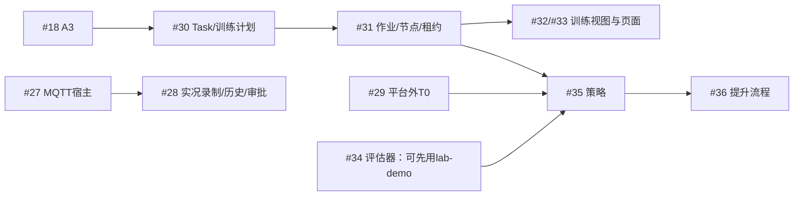

# Lab RSI Platform：后续计划与交接

本文件是 2026-10-21 的统一交接入口。用户已确认 #86；本轮要求重新整理计划并交接，没有恢复功能实现、测试、基准或 GPU 运行。恢复工作时先核对 GitHub 与本地实际状态，较新的事实优先于本快照。

已发布并读回：[父议题#2计划与交接摘要](https://github.com/CaiZongyuan/spatial-sync/issues/2#issuecomment-6306003018)、[#83维护状态更正](https://github.com/CaiZongyuan/spatial-sync/issues/83#issuecomment-6306003974)。新会话开场文本见同目录 `NEXT_SESSION.md`。

## 1. 已交付基线

- 主 checkout：`D:/Projects/Robots/spatial-sync`，本地及审计时远端 main 为 `500d9ed8ff9bf37df385e7bde83c679dd1270baa`；tree `dde110417b9464287104de49837189e4b5a75a31`。
- 最近合并：#89（#86 UI）和 #90（浏览器用例启动同步、共享控制用例使用原生 WebSocket）。#86 已关闭，九项验收已勾选。
- 最新 main push [39524938791](https://github.com/CaiZongyuan/spatial-sync/actions/runs/39524938791) 十项成功、最长287s；最终候选 d593 的 CI 十项成功、最长284s。此前 main 红灯已修复，旧回退倒计时已解除。不要把287s称为 #85 的200s余量验收通过。
- 原始 PRD #2 的44个子议题：22关闭、22未关闭。#86及维护票不计入这44张票。
- UI 八张1440×900浅/暗原图在 [PR89](https://github.com/CaiZongyuan/spatial-sync/pull/89) 描述；[123秒完整中文视频](https://github.com/CaiZongyuan/spatial-sync/pull/89#issuecomment-6304684885)含同步字幕、A/B/C重点框与箭头，已验证远端哈希、Range及播放/跳转。
- 交付事实与资源释放入口：`../issue-86/DELIVERY-FINAL.json`、`../issue-86/workbench-B-d59303b9/completion.json`。后者17个记录身份全部释放；这些是当次完成证据，不代表未来整个 OS 没有进程。
- GitHub 原生依赖快照：本目录 `open-dependencies.json`；44票原文 `prd-subissues.json`；工作树快照 `worktrees.json`。

## 2. 下一批顺序与容量

优先顺序是交付策略；硬前置以原生依赖为准，不把“暂不安排”伪称“技术阻塞”。

| 阶段 | 工作 | 启动/完成边界 |
|---|---|---|
| 恢复本地E2E前 | #91 用户库隔离 | 新发现的开放维护票：默认用户库会被测试导入污染。先确认API的LW_LIBRARY、state、recordings均为自有目录；安排隔离修复，不能仅改卡片预期数掩盖污染 |
| 下一批，交付线 | #26 计划页与会话面板 | 恢复冻结候选，语义整合 #86/#90，完成新头验证、独立审查和完整演示；最接近交付，先收尾 |
| 同批，关键风险线 | #18 A3 fr3-lab | 先补已授权 grasp-height 的兼容/teaching 证据，形成有几何依据的可行布局候选；物理可行性和素材发布权分别处理 |
| 限额维护 | #85 CI余量，#83剩余事项 | 与功能开发解耦；先更新陈旧候选、分析一个慢 lane，再做有界探针。200s×5是 #85 自身验收，不是其它PR的新门禁 |
| 第二批 | #27 → #28 MQTT实况 | 原冻结mailbox WIP不能视作生产MQTT；完成真实adapter/宿主/共享审批与录制历史后再交付 |
| 关键路径继续 | #18 → #30 → #31 → #32/#33 | T1不等T0。#18完成后立即从Task/训练计划开始，避免再次被接触抓取试验卡住 |
| 空闲容量可推进 | #34 评估基础、I5真实MCP旅程 | #34硬前置已关闭，可先评估lab-demo virtual程序；I5使用现有robot-and-tubes，不被 #70 阻挡 |
| 独立实验线 | #29 T0第二轮 | 仅按冻结假设和预算安排明确GPU窗口；不直接开始训练，也不合并整套实验代码到main |
| 后续阶段 | #35–#46 | 按下方原生依赖推进；#42保持R2前的冻结状态，不因它“已解锁”就抢先扩大WIP |

4个agent槽位建议：PM/集成1个、功能owner最多2个、审查或媒体1个。最终双轴审查时让冻结作者让出槽位，保留两个独立审查角色；CI等待、长GPU任务不必永久占住实现者。代码准备可并行，单活跃会话、重型浏览器/物理运行和基准窗口须明确预约；性能基准独占，GPU只有一个明确owner。不要同时恢复所有冻结分支或排队多个大型PR。

### 正确的关键依赖

父议题 #2 的旧图曾误写 `A3 + T0 → T1`，本轮已按已批准规格修正为 `A3 → T1`、`T0 → #35`，原生依赖未改。

## 3. 冻结候选与接手动作

所有下列工作树在审计时干净；干净不等于已验证，也不能单凭标签认定旧owner停止写入。恢复写操作前先确认owner/进程租约，无需重复请求用户已经给过的功能授权。

### #26：先交付L2

- 分支 `feat/issue-26-plan-ui`，工作树 `.worktrees/issue-26`，HEAD `26c6e8f998d4c0d316ce73b4fc4992709c303fd9`；相对main落后2、独有5提交，25文件，无PR。
- 已有计划列表/详情、会话面板、真实HTTP路径与幽灵臂、录制回放。最终旧头 Standards/Spec PASS。
- **接手顺序：**先确认冻结点 → 对齐当前main → 语义整合 `PlatformShell`、`Workbench`、`SceneViewport`/共享渲染及相关E2E → 刷新真实live/recording旅程与强制检查 → 新头双轴审查、CI和完整中文演示 → 合并/集成树/main CI。
- 保留 #86 的纸面、透明阴影舞台、物理坐标轴、图标、三栏、控件语义；保留计划几何/幽灵材质所有权。不能只解决文本冲突。
- 旧业务证据producer为 `614de3c`，只能作回归基线。旧live原始result记录了清理失败，补充cleanup-readback证明随后释放，不能把原结果改标全绿。policy仅证明披露的DTO渲染，不是生产policy runtime。
- `issue-26/CHECKPOINT.md` 的614旧head已过时。优先读 `../issue-26/review-spec-final.md`、`../issue-26/review-standards-final.md`、`../issue-26/REVIEW-REPAIRS.md`，再读旧CHECKPOINT中的旅程证据。
- 共享渲染改动须核对严格预览输入；如输入变化，实际重采受影响预览，并完成由重采触发的Newton CPU门禁。不能仅以“UI-only”自动豁免。

### #18：A3真正阻挡T1

- 原素材导入分支 `.worktrees/issue-18` / `feat/issue-18-fr3-lab-import` / `f7a480f6a588de2a3186fe166214954112083194`。
- 已批准的前置 `.worktrees/issue-18-grasp-height` / `feat/issue-18-grasp-height` / `f6b2e765ac8734d8464a66f8e6f00a8e524e4f92`；无需再次问是否允许实现graspHeightM。
- 实际Newton校准没有移动物理TCP/Tube bottom。旧向量+h80约80mm误差，超过原10mm门限，**是失败对照**。Synthetic toy h20成功不证明真实FR3布局可行。
- **接手顺序：**先读前置进展并对齐main，补公开新旧录制兼容与actual teaching/model比较；同时提出有几何依据的可行候选；再安排有界CPU窗口验证原尺寸六管、四个承诺槽位/远槽P6、支撑及舱体路径，最后完整I3演示。
- 资产发布权仍有缺口，不能编造来源或license；用户延期的仓库LICENSE与第三方/程序化环境资产发布权是两件事。许可不明不阻止已批准代码/兼容工作，但阻止无依据发布素材。
- 不直接重启全工厂导出、盲目SDK/IK搜索，不改原10mm门限或用toy几何冒充真实结果。
- 入口：`../issue-18-grasp-height/progress-source-20261020.md`、`../issue-18/GRASP_FRAME_PROPOSAL.md`、`../issue-18/MECHANICAL_PROPOSAL.md`、`../issue-18/GEOMETRY_DECISION.md`。`../issue-18/NEXT_PROBES.md`存在早期未执行计划，先与新进展对照，不机械执行。
- 仍欠当前main的四项Linux Newton检查、严格预览重采、独立审查和完整可演示fr3-lab包；完成才关闭#18/启动#30。

### #27：真实MQTT尚未交付

- `.worktrees/issue-27`，`feat/issue-27-device-host`，HEAD `266d7b337bcccf333603636158521611d53350b3`；落后main3、独有1提交，10文件，无PR。
- 已有Catalog第二消费者、driver mailbox、availability admission和三个MQTT Program的无socket边界；旧focused21测试通过。
- **接手顺序：**确认旧owner已停止写入并对齐main → 完成绑定loader、常驻DeviceHost生命周期及生产MQTT adapter的队列/线程所有权 → 接共享动作/审批管线和CLI/MCP → 假broker网关与自有真实broker验证。
- 第一次公开实况高风险入口就必须走既有`require`审批；MQTT callback不得越过owner线程修改HostCore/StateStore。覆盖旧/重复/迟到ACK、dispatch前ACK、断连/重连generation、retained遥测、取消后排队命令、时钟与队列压力。
- 入口：`../issue-27/CHECKPOINT.md`、`../issue-27/IMPACT.md`。21 tests不证明真实broker、API或完整MQTT；`packages/programs/**`变更需要四项Newton CPU检查。#28仍被#27阻塞。

### #85：先缩小问题，后做五次验收

- `.worktrees/issue-85`，`fix/issue-85-ci-margin`，Draft PR88，HEAD `9b41f23989d5689e8abd6e03e066f682739a37b8`。审计时GitHub `CONFLICTING/DIRTY`；分叉main214，main新增2提交，PR侧7提交。
- 0/5是门槛未满足，不只是少跑几次：三次诊断最长280/211/238s；第二次还有业务失败，最后两条45s用例27.853/28.391s超过60%=27s。
- PR88旧69case/5shard/9job不等于当前main68case/4shard/10job。workflow、多个E2E和37个preview文件重叠，不能直接合入旧分支；保护#90新文档同步、B native、C fault/epoch、清理与轴oracle。
- **接手顺序：**语义整合并更新实际覆盖映射 → 用已有JUnit/step/phase选一个慢lane → 一个有预算/退出条件的probe → 证明足够余量后冻结最终head → 才执行同head连续五次全成功、max job≤200s、每个浏览器case≤原时限60%。head变化重新计数。
- 保留10,001次HTTP、35/7图片和三帧settling等真实工作；不删工作量、降阈值、加重试或赌runner。
- 入口：`../issue-85/CURRENT_CHECKPOINT.md`、`../issue-85/ci-diagnostic-3/diagnosis.md`、`../issue-85/ci-diagnostic-3/summary.json`。旧HANDOFF/ADVISOR中的旧main、计数和“等第三次数据”已过时。

### #29：预算内的独立T0第二轮

- 旧 `.worktrees/issue-29` / `spike/issue-29-fr3-contact` / `1abcd49084a2491d7654a2a699fc98926e9467dc` / Draft PR49保留；不合并整套实验进main。
- 第二轮 `.worktrees/issue-29-round2` / `spike/issue-29-round2` / `29938219e7554419c73f905493dcde8d6cf76f4a`。保护旧实验、模型、数据及用户外部Isaac/Tutorial修改；不sync既有专用环境。
- 最新仅D1旧模型630的机制诊断：128 home×8=1024首次终止，成功/抓/抬/插/放均0，RANGE400、timeout624；400次首越界均为被动finger2上界。是分布证据，不是控制因果或solver bug证明。
- 已结算诊断92/7200预算秒，余7108，其中最终审计预留1200；新训练0次/0秒，第二轮新候选最终审计尚未运行。92为含启动/清理的保守预算墙钟，不是纯GPU核执行时间。
- **接手顺序：**核live ledger与现有资源 → 冻结一个区分H1/H2的最小可测比较，写明固定动作、原限制/reset/oracle、预测/停止条件 → PM排具体GPU窗口。余额不等于可以随意扩试验；预算内已授权步骤不应反复向用户索要常规许可。
- 当前ledger的GO仅覆盖已结束的D1。后续诊断或训练须由PM发出具体GO并更新ledger，不能沿用旧D1 GO；这是执行窗口协调，无需重新向用户申请已有范围授权。
- 保留固定home、1024回合至少922成功、原物理限制及完整顺序；最多一次新完整训练≤14400s。D1旧策略0/1024不是第二轮训练后的最终失败。第二轮新候选最终仍失败才停止并提交`ready-for-human`的T2规格选项。
- 入口：`../issue-29-round2/budget-ledger.live.json`、`../issue-29-round2/frozen-home-all-first-20261020-164027701/RESULT.md`、`../issue-29-round2/frozen-home-all-first-20261020-164027701/budget-settlement.json`、`../issue-29-round2/FIRST_PREP.md`。不要重复已有失败的substeps/限位/旧策略分支，也不重新跑教程benchmark。

### I5、网站及后置项

- #91为新开的本地E2E隔离问题：API未设置`LW_LIBRARY`时，asset-library测试导入写进用户`~/.spatial-sync/library`，后续固定7卡片断言可能遇到9卡片。恢复本地全量E2E前先隔离真实API的库、state与recordings，再修fixture/指南；只给Vite进程设置变量不等于已隔离API。原issue中3分片/55pass是其当时观察，不回退当前main的4分片/68case配置。本次只纳入交接，没有运行复现或清理用户库。
- I5仍未完成，未找到独立ticket：按信息规格§15，让Claude Code通过MCP在Newton `robot-and-tubes` 完成I3全流程；Linux真实录制作为release附件，一次`bench_info.py`结果写PR。现有UI视频不能替代它，#70 Windows问题不阻挡它。
- #87 / [PR92](https://github.com/CaiZongyuan/spatial-sync/pull/92) 是另一个owner的网站通道；审计head `304712d679d53949dc5dbb279275876230ec0fec`，base3d、相对main500落后1，检查成功。原owner继续负责对齐、精确头检查和发布；本轮没有接管、合并或清理其进程。
- #42 / Draft PR53 / `feat/issue-42-model-vault` / `013c665529bc5138894f4437dc378a1762b3fab2` 继续阶段性后置，临近R2真实消费者时才恢复。
- #70 Windows tick差异低优先级/on-hold，Linux/WSL是性能门禁基线。
- #83仍开放：CI余量、I5、A3后启动T1及T0条件动作未全结束。旧“GPU尚未启动”不再适用；D1已执行，新训练仍0。
- #86曾记录的长时取景缩小、早期概览空白仍未确认。另开有界复现窗口再定修复，不把它们写成#89/#90已修复，也不启动旧的整套渲染性能探针。

## 4. 剩余票的原生未关闭前置

以下表由本轮GitHub依赖快照生成；“—”表示技术上已解锁，不代表立即开工或已有可合并候选。

| 工单 | 标题 | 未关闭前置 |
|---|---|---|
| [#18](https://github.com/CaiZongyuan/spatial-sync/issues/18) | [A3] fr3-lab 导入与演示 | — |
| [#26](https://github.com/CaiZongyuan/spatial-sync/issues/26) | [L2] 计划页与会话页计划面板 | — |
| [#27](https://github.com/CaiZongyuan/spatial-sync/issues/27) | [L3] Device Host 与 MQTT 实况宿主 | — |
| [#28](https://github.com/CaiZongyuan/spatial-sync/issues/28) | [L3] 实况录制、实况历史与真机审批 | #27 |
| [#29](https://github.com/CaiZongyuan/spatial-sync/issues/29) | [T0] FR3 接触抓取技术验证（平台外） | — |
| [#30](https://github.com/CaiZongyuan/spatial-sync/issues/30) | [T1] Task 版本与训练计划 | #18 |
| [#31](https://github.com/CaiZongyuan/spatial-sync/issues/31) | [T1] 作业编排、GPU 租约与本机节点 | #30 |
| [#32](https://github.com/CaiZongyuan/spatial-sync/issues/32) | [T1] 训练视图与作业详情 | #31 |
| [#33](https://github.com/CaiZongyuan/spatial-sync/issues/33) | [T1] 训练页（具身层）与资源 · 算力 | #31 |
| [#34](https://github.com/CaiZongyuan/spatial-sync/issues/34) | [T2] 具身评估集与评估器 | — |
| [#35](https://github.com/CaiZongyuan/spatial-sync/issues/35) | [T2] 策略版本与 robot_arm.policy | #29, #31, #34 |
| [#36](https://github.com/CaiZongyuan/spatial-sync/issues/36) | [T2] 提升流程与 Controller 版本 | #35 |
| [#37](https://github.com/CaiZongyuan/spatial-sync/issues/37) | [T2] 实验记录、RSI 看板与闭环预算（具身层） | #30, #33, #34 |
| [#38](https://github.com/CaiZongyuan/spatial-sync/issues/38) | [T3] agent 编写的脚本程序 | #36 |
| [#39](https://github.com/CaiZongyuan/spatial-sync/issues/39) | [T3] 示范 | #31, #34 |
| [#40](https://github.com/CaiZongyuan/spatial-sync/issues/40) | [R1] 评估中心页 | #34 |
| [#41](https://github.com/CaiZongyuan/spatial-sync/issues/41) | [R1] 成本账本与成本中心（GPU 先行） | #31 |
| [#42](https://github.com/CaiZongyuan/spatial-sync/issues/42) | [R2] Vault、模型表与资源 · 模型 | — |
| [#43](https://github.com/CaiZongyuan/spatial-sync/issues/43) | [R2] Agent 与 Harness 版本、Agent 评估集 | #34 |
| [#44](https://github.com/CaiZongyuan/spatial-sync/issues/44) | [R2] Agent 运行器（Claude Agent SDK）与 LLM 成本 | #31, #41, #42, #43 |
| [#45](https://github.com/CaiZongyuan/spatial-sync/issues/45) | [R3] Agent 层一圈 RSI | #37, #44 |
| [#46](https://github.com/CaiZongyuan/spatial-sync/issues/46) | [R4] Embodiment、Controller 与 Robot Model 资源 | #36, #42 |

## 5. 恢复、验证与交付约定

1. 先读根 `AGENTS.md`、对应规格、`docs/VERIFICATION.md`、GitHub最新评论及本交接。`docs/spec/LAB_WEB_UI_SPEC_V1.md`是生产页面契约，原型只作视觉参照。
2. 核实际main、最新push CI、工单阻塞、worktree状态、owner与资源。先确认再恢复旧分支；不从旧checkout/旧日志推断当前进程，原作者不可用时明确交接责任。
3. 一个issue一个owner和工作树；工作树放主checkout的`.worktrees/`。提交前做有界简化，冻结后跑完整强制检查/独立Standards与Spec审查。对齐当前main，精确最终head CI成功后才合并，核集成tree，再观察main push到成功。
4. main红时只修复该红灯，暂停其它合并；一小时无就绪修复则回退引入提交。不要重跑旧失败取绿。当前500基线已绿，没有遗留回退倒计时。
5. `packages/sim_runtime/**`、`packages/programs/**`、`library/scenes/**`或真实Newton预览重采触发四项Newton CPU检查；以Linux/WSL预算为门禁，PR给命令/结果/tick P95。严格预览输入变化必须实际重采；已发布包保持不可变，不手改capture指纹凑兼容。
6. 默认Playwright expect10s、工作台45s、live90s、retry0、video、worker1及真实断言保留。#90新增启动同步不是总导航10s SLA；B共享控制走nativeWS，C独立故障用例保留relay4001和非零epoch。观察器退出0只证明观察完成，不等于CI成功，要核实际十项结论。
7. 协议/录制保持版本兼容，entityKey保持唯一身份，Z-up转换只在primitives边界，Web/CLI/MCP沿单一动作管线。新契约或设备模型决定按AGENTS处理；常规实现和已有授权不再问用户。
8. 交付重大UI功能时发布一条完整中文MP4到对应PR评论，含同步字幕、字母重点标记/箭头；下一条新片音色在Sambert01–15随机选择，冻结后复用音轨，避免重复TTS。当前PR89片为02，不重生成。密钥仅在`C:/Users/zongy/.env`读取`BAILIAN-TOKEN`，不打印/提交。使用所需视频技能；未知POST结果先查重，不能重复评论。
9. 每批合并和每12活跃小时向#2更新五项：已合并、活跃/下一步、暂停/恢复条件、main CI、用户动作。规划不算开工，旧标签不代表执行租约。本轮不生成timeline。

### 必须保护的本地状态

- 用户暂存 `docs/ui/Lab Platform Redesign.html`：SHA256 `d5a4a5ac23350c84238d8871b62a5253b5adda294ebaff9a9a4fb1a037fcbbee`，暂存blob `64a4b8604246f27dbf4e571f30383f57d3c1129a`。
- 用户修改 `apps/web/src/routeTree.gen.ts`：SHA256 `d645af7cb26be6a892ed7a0e6c6ce442374b3c09930ffcec3390fbf61590c81e`。这两项是有意保留，不得stash/reset/清理或顺带提交。
- 用户服务端口8011/5191/8014；网站owner及其它issue的环境/进程不是本任务资源。清理只用当前创建句柄，或核PID、命令、创建时间三项；旧PID文字不是授权依据。
- 已有Linux环境可以在核对锁、输入、路径、无活跃消费者后复用。`../issue-86/workbench-B-d59303b9/run_original_B_linux.py`是成熟监督方法参考，但head/hash/选择已冻结，**不能直接拿它为新任务启动旧用例**。

## 6. 历史入口处理

根 `checkpoint.md`、`continuation.md`、`_checkpoint_next.md` 的旧内容已归档到本目录`legacy/`，原路径改为本文件入口。旧文档中的main214、未完成86、Sambert15/16、旧活跃owner、旧GPU未启动和旧回退倒计时均不是当前指令。保留所有原始失败、预算和验证收据；本次没有删除工作树、环境、原始产物或远端分支。
